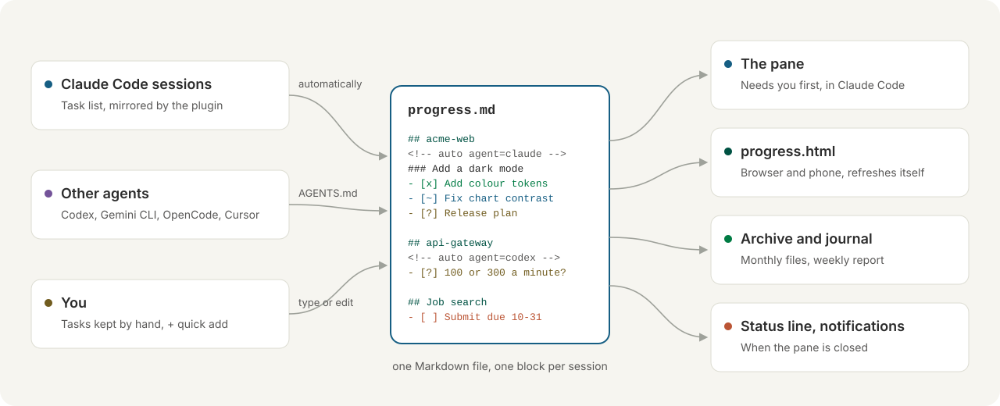

<h1 align="center">
<picture>
  <source media="(prefers-color-scheme: dark)" srcset="docs/images/tour-en-dark.svg">
  
</picture>
</h1>

English · [繁體中文](README.zh-TW.md) · [简体中文](README.zh-CN.md)

For anyone running more than one AI coding agent. It tells you which one is waiting on you, so none of them sits there doing nothing.

## Why you'd want it

You've got Claude Code on one project, Codex on another, maybe Gemini on a third. Twenty minutes in, one of them stops to ask you something, and you only find out when you happen to switch back. This pane puts that question in front of you as soon as it's asked.

- **You won't miss a question again.** Anything waiting on you sits at the top, with a button for each answer. Click one and the agent carries on.
- **It works with the agents you already use.** Claude Code, Codex, Gemini CLI, Cursor, OpenCode, Grok Build and Muse Code. Connect them with one command and they report on their own. You don't have to tell them anything.
- **You can always pick up where you left off.** Compact the chat, close the terminal, come back tomorrow: you'll see what got done, what's stuck and what's next. If a session stopped halfway, you can take it over.

## Install

```
claude plugin marketplace add WenyuChiou/claude-progress-pane
claude plugin install project-progress@claude-progress-pane
claude -p "/progress connect"
```

The last line connects the other agents on your machine. Restart them afterwards (the first time, Codex asks you to approve the hook in its `/hooks`). Then open Claude Code and the pane shows up on the right.

**Or let your agent do it.** Paste this into Codex, Gemini CLI, Cursor, Grok, Muse, or any agent that can run commands:

```text
Install the claude-progress-pane plugin for Claude Code and connect this machine's coding agents to it.
Run these three commands in order, and stop and tell me if one fails:
claude plugin marketplace add WenyuChiou/claude-progress-pane
claude plugin install project-progress@claude-progress-pane
claude -p "/progress connect"
Then show me what the last command printed and tell me which agents to restart.
```

Using Aider, Copilot or Windsurf? Paste the section "Report your progress to the progress pane" from [AGENTS.md](AGENTS.md) into its instructions, and it will report too.

## Use

| | |
|---|---|
| Just work | Every session shows up by itself: how far it got, why it exists, what it's waiting on |
| `+ Job search: Fabrikam fellowship due 11-20` | In the pane's box: a task of your own |
| `/progress open` | The same view in your browser |
| `/progress connect` | Hook your other agents into the pane |
| `/progress report` | Copy the last seven days as text |
| `/progress lang en` | `en`, `zh-TW`, `zh-CN` or `auto` |

## How it works

<picture>
  <source media="(prefers-color-scheme: dark)" srcset="docs/images/flow-en-dark.svg">
  
</picture>

Everything lives in one plain Markdown file, `~/.claude/progress.md`, so you can open it and edit it yourself. The format is written up in [docs/FORMAT.md](docs/FORMAT.md).

## More

[Guide](docs/GUIDE.md) (setup script, reading the pane, every command, tidying, troubleshooting) · [Contributing](CONTRIBUTING.md) · [Changelog](CHANGELOG.md) · [MIT](LICENSE)
