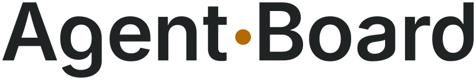
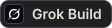
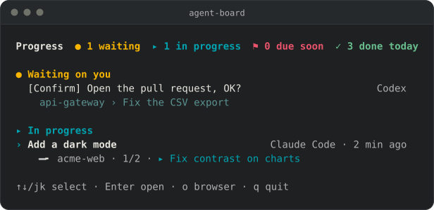
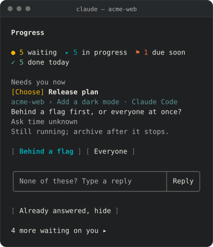
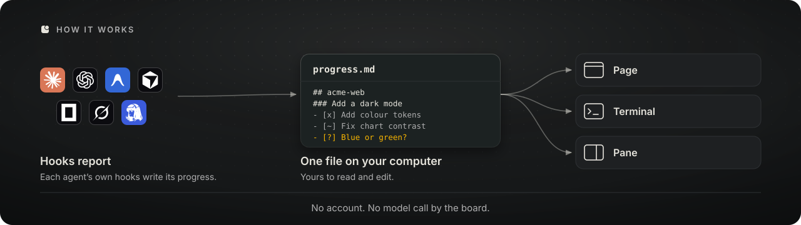

<h1 align="center"></h1>

<p align="center"><b>See what every AI coding agent is doing, and answer the one that needs you, from one board.</b></p>

<p align="center"><a href="LICENSE"></a> <a href="https://github.com/WenyuChiou/agent-board/actions/workflows/test.yml"></a> <a href="https://www.npmjs.com/package/@wenyuchiou/agent-board"></a></p>

<p align="center">English · <a href="README.zh-TW.md">繁體中文</a> · <a href="README.zh-CN.md">简体中文</a></p>

<p align="center">

</p>

<p align="center"><b>Integrations</b><br>
<a href="#supported-agents"></a>
<a href="#supported-agents"></a>
<a href="#supported-agents"></a>
<a href="#supported-agents"></a>
<a href="#supported-agents"></a>
<a href="#supported-agents"></a>
<a href="#supported-agents"></a>
<a href="#supported-agents"></a>
<a href="#supported-agents"></a>
<a href="#supported-agents"></a>
</p>

<p align="center"><sub>dot and other web chats report by hand: you merge their block into the progress file (<a href="docs/REMOTE_REPORTERS.md#chat-relay-a-prompt-to-paste">how</a>).</sub></p>

You have Claude Code on one project, Codex on another and Antigravity on a third, and when one of them stops to ask you something, you only find out when you happen to switch back. **Agent Board** puts that question in front of you the moment it's asked, with a button for each answer. It runs on your computer and keeps everything in one Markdown file.

## Quick start

With Node.js 22+, in any terminal:

```sh
npx @wenyuchiou/agent-board setup
npx @wenyuchiou/agent-board
```

The first command finds the agents on this computer, shows what setup would change, and asks once: `Set these up? [Y/n]`. A yes writes the files, approves the board's hooks in Codex and Hermes Agent, and installs the Claude Code plugin when Claude Code is on this computer; a no writes nothing. Without a terminal to answer in, such as in an agent's chat, setup only previews: `setup --apply` then writes the files and lists the approval and plugin commands to run yourself. The second command opens the live terminal board over SSH or in an interactive terminal without a display, and the page otherwise. In an agent's chat, `/agent-board` opens the same page. If nothing is set up yet, the second command alone asks the same question first. To stop the board's page, run `npx @wenyuchiou/agent-board stop`. For the shorter `agent-board` command, install it once with `npm install -g @wenyuchiou/agent-board`. To set up one agent only, add `--agent` and its name, such as `--agent codex`. To remove it, see [Update and uninstall](docs/GUIDE.md#update-and-uninstall). More in the [setup guide](docs/SETUP.md#install-with-npm). An agent that needs the board's status reads `agent-board --json`; the [Board JSON reference](docs/BOARD-JSON.md) describes its versioned, redacted fields.

The board follows your system language when it is Traditional or Simplified Chinese, and English otherwise. To choose one, add `--lang en`, `--lang zh-TW` or `--lang zh-CN` to the setup command; the board, its page and `stop` then use it. An account connected through the Claude Code plugin uses `/progress lang` instead.

Scan the QR code from `npx @wenyuchiou/agent-board --lan` with a phone on the same Wi-Fi. Use it only on a network you trust: the link is not encrypted and anyone who has it can open the page. Details: [the board's page](#the-boards-page).

Then:

- Start a new session of each agent: a session that was already open is not connected.
- **Claude Code** connects through its plugin instead, which a yes to setup installs. If setup only previewed: `claude plugin marketplace add WenyuChiou/agent-board`, then `claude plugin install agent-board@agent-board`.
- **Codex:** a yes to setup trusts its hooks. If setup only previewed, trust them in `/hooks` ([how](docs/CODEX.md)).
- **OpenCode, OpenClaw:** reload their plugins.
- **dot and other web chats:** paste [the last section of AGENTS.md](AGENTS.md#report-your-progress-to-the-progress-pane) into the agent's instructions, then save each block it writes and merge it into the progress file as [Remote reporters](docs/REMOTE_REPORTERS.md#chat-relay-a-prompt-to-paste) shows.

In the new session, open the board with its entry:

- **I use Claude Code:** `/agent-board`
- **I use Codex:** `$agent-board`
- **I use Antigravity:** `/agent-board` (checked in a synthetic home, not run live yet)
- **I use OpenCode:** `/agent-board`

To add a task of your own, write a `### title` with `- [ ] step` lines in `progress.md` (a fresh install uses `~/.agent-board/progress.md`; [the format](docs/FORMAT.md)). With the Claude Code plugin, you can instead type `+ project: title; step; step` in the pane's box, or `/progress add …` in Claude Code's chat.

<details>
<summary><b>Without npm: install from a checkout</b></summary>

To install from a clone of this repository instead, with Node.js 18+:

```sh
git clone https://github.com/WenyuChiou/agent-board.git
cd agent-board
node scripts/setup-agent.mjs
node scripts/setup-agent.mjs --apply
```

`setup-agent.mjs` takes the same options as `npx @wenyuchiou/agent-board setup`, such as `--agent codex`. On Windows, use the exact paths it prints. What each one writes: [setup guide](docs/SETUP.md).

</details>

<details>
<summary><b>Let an agent install it</b></summary>

Paste this into the agent you already use:

```text
Install Agent Board from https://github.com/WenyuChiou/agent-board on this computer.
Read its AGENTS.md, README and setup guide. Identify my current host and the other installed coding agents, then preview the common installer: node scripts/setup-agent.mjs.
Preserve existing settings and the shared progress path. Follow my approval requirements for persistent changes, then apply the applicable hooks, plugins and board command. Do not require or call another AI product to bootstrap this one.
Complete any required scoped host trust, read the settings back, and have this session report its own real task progress. Open the interactive board.
Verify actual hook events separately for CLI, desktop App and IDE. Installed files, transport acceptance and an ACK are different from a working progress connection.
Tell me which existing sessions need reload and which adapters remain unsupported or unverified. Never scan private conversations or silently skip a blocker.
```

</details>

## Key commands

### Open the board in your agent

| | Agent | Board command |
|:-:|---|---|
|  | Claude Code | `/progress` |
|  | Codex CLI and App | `$agent-board` |
|  | Antigravity | `/agent-board` (checked in a synthetic home, not run live yet) |
|  | OpenCode | `/agent-board` |
|  | Cursor | `/agent-board` (checked in a synthetic home, not run live yet) |
|  | Grok Build | `/agent-board` (checked in a synthetic home, not run live yet) |
|  | Muse Code | `/agent-board` (checked in a synthetic home, not run live yet) |
|  | Hermes Agent | `/agent-board` |
|  | OpenClaw | `/agent-board` |
|  | DeepSeek Harness | `/agent-board` (checked in a synthetic home, not run live yet) |

**In the Claude desktop app,** when its Code tab shows no pane, the footer shows the waiting count and `/agent-board opens the board`. `/agent-board` starts the live [board page](#the-boards-page) and replies with its link, where you can answer questions and archive work; it works in every Claude Code session and leaves the pane as it is. When the pane cannot be placed, `/progress` does the same. If the live page cannot start, both explain why and show the command that starts it. The board page needs the board script that `/progress connect` installs, or the next session start updates.

In the Claude desktop app the agent can open the board too: ask it to open the board and it starts the same page and gives you the same link.

### Open the board anywhere

| Where | Command |
|---|---|
| A terminal or desktop | `node "$HOME/.agent-board/agent-board.mjs"` (terminal board over SSH or without a display, page otherwise) |
| A phone on the same Wi-Fi | `node "$HOME/.agent-board/agent-board.mjs" --lan` (scan the QR code it prints) |
| An agent reading the board | `node "$HOME/.agent-board/agent-board.mjs" --json` ([field reference](docs/BOARD-JSON.md)) |
| Check one agent's setup | `node "$HOME/.agent-board/agent-board.mjs" --codex-doctor --agent codex` |

<details>
<summary><b>Keys on the terminal board</b></summary>

**In a terminal,** `--watch` works like the pane:

| Key | Does |
|---|---|
| ↑ ↓, Enter | Pick a line, open it |
| `x` | Tick the next step of your own task; it goes into the work log |
| `d` | Confirm one of your own tasks, or a stopped session's work, done |
| `a` | Archive one of your own tasks, or a stopped session's block |
| `1`–`9`, `y` / `n` | Copy the answer to another agent's question, to paste in that agent |
| `c` | Copy a command, or the command that reopens the session that asked |
| `h`, `u` | Mark another agent's question already answered: hidden on this computer, nothing sent; show the hidden ones again |
| `i` | Show or fold the tasks idle more than 7 days |
| `o`, `q` | Open the browser view; quit |

Finished work leaves the board by itself. The board writes `progress.md` as carefully as the pane does, and leaves other sessions' blocks alone unless you archive one that has stopped or confirm it done.

</details>

## Supported agents

| | Agent | Runs in | On the board | Reply from the board |
|:-:|---|---|---|---|
|  | Claude Code | CLI | Its own pane: every task and turn | In the pane |
|  | Codex | CLI, App | Seven hooks, closing questions and reported steps | Copy; send to a [connected session](docs/MESSAGING.md#codex-exclusive-owner-adapter) |
|  | Antigravity | CLI, App, IDE | Four hooks, CLI closing questions and reported steps | Copy; send to a [connected CLI](docs/MESSAGING.md#antigravity-exclusive-owner-cli-stream) |
|  | OpenCode | CLI | Session events, closing questions and steps from its progress tool | Copy |
|  | Cursor | IDE, CLI | Hooks and CLI closing questions | Copy |
|  | Grok Build | CLI | Four hooks and closing questions | Copy; `--allow-resume` once a session ended |
|  | Muse Code | CLI | Two hooks (stop, end) | Copy |
|  | Hermes Agent | Chat | Four shell hooks, closing questions and reported steps | Copy |
|  | OpenClaw | Chat | Its plugin's session events | Copy |
|  | DeepSeek Harness | CLI | Its plugin's session events | Copy |
| | dot, other web chats | Web | A block you merge | Answer in its chat |

Hooks say whether a session is working or waiting; task steps and when it is done come from the agent's own reports. The closing questions above reach Needs you as hook-owned steps. Antigravity CLI's hooks carry no reply text, so the board reads the last reply from its own transcript file; that format is undocumented and was checked on agy 1.5.2. Only the closing question is kept. Gemini CLI is still a target (`--agent gemini`) for paid and enterprise use: see [setup](docs/SETUP.md#legacy-gemini-cli-compatibility).

### Connected-session messaging

<!-- messaging-matrix:start -->

Generated from receiver records by `node scripts/messaging-matrix.mjs --write`. Progress reporting is separate. Verified requires a `<date>-<host>-live.md` file for that surface; synthetic tests only establish Implemented. Unconnected targets use Tier 4 / [P5] Copy fallback, not a native receiver. Unknown means the roadmap names no primitive for this surface.

| Host | Surface | Tier | Primitive | Status | Live run | Receiver |
| --- | --- | --- | --- | --- | --- | --- |
| Antigravity | 2.0 Desktop App | 3 | Unknown | Implemented | Not tested | [hooks/receivers/hook-mailbox-antigravity.ts](hooks/receivers/hook-mailbox-antigravity.ts) |
| Antigravity | agy TUI | 3 | Unknown | Implemented | Not tested | [hooks/receivers/hook-mailbox-antigravity.ts](hooks/receivers/hook-mailbox-antigravity.ts) |
| Antigravity | Exclusive-owner Stream CLI (stdin) | 1 | Unknown | Implemented | Earlier run, not counted: [docs/validation/2026-10-19-native-hooks.md](docs/validation/2026-10-19-native-hooks.md) | [scripts/antigravity-session-connector.mjs](scripts/antigravity-session-connector.mjs) |
| Antigravity | IDE | 3 | Unknown | Implemented | Not tested | [hooks/receivers/hook-mailbox-antigravity.ts](hooks/receivers/hook-mailbox-antigravity.ts) |
| Claude Code | CLI | 1 | &#91;P1&#93; | Implemented | Not tested | [hooks/receiver-record.ts](hooks/receiver-record.ts) |
| Claude Code | Desktop Code | 4 | &#91;P5&#93; | Proposed | Not tested | None |
| Claude Desktop | Chat | 4 | &#91;P5&#93; | Proposed | Not tested | None |
| Codex | CLI | 3 | Unknown | Implemented | Not tested | [hooks/receivers/hook-mailbox-codex.ts](hooks/receivers/hook-mailbox-codex.ts) |
| Codex | Daemon | 4 | &#91;P5&#93; | Proposed | Not tested | None |
| Codex | Desktop App | 4 | &#91;P5&#93; | Proposed | Not tested | None |
| Codex | Exclusive-owner app-server | 1 | &#91;P1&#93; | Implemented | Earlier run, not counted: [docs/validation/2026-10-19-native-hooks.md](docs/validation/2026-10-19-native-hooks.md) | [scripts/codex-session-connector.mjs](scripts/codex-session-connector.mjs) |
| Codex | Existing-owner proxy (active turn only) | 2 | Unknown | Verified | [docs/validation/2026-11-04-codex-cli-proxy-live.md](docs/validation/2026-11-04-codex-cli-proxy-live.md) | [scripts/codex-message-connector.mjs](scripts/codex-message-connector.mjs) |
| Cursor | cursor-agent CLI | 3 | Unknown | Implemented | Not tested | [hooks/receivers/hook-mailbox-cursor.ts](hooks/receivers/hook-mailbox-cursor.ts) |
| Cursor | IDE (Composer) | 3 | Unknown | Implemented | Not tested | [hooks/receivers/hook-mailbox-cursor.ts](hooks/receivers/hook-mailbox-cursor.ts) |
| DeepSeek Harness | Cordis CLI | 4 | &#91;P5&#93; | Proposed | Not tested | None |
| DeepSeek Harness | Desktop | 4 | &#91;P5&#93; | Proposed | Not tested | None |
| DeepSeek Harness | TUI | 1 | &#91;P1&#93; | Implemented | Not tested | [hooks/receivers/deepseek.ts](hooks/receivers/deepseek.ts) |
| DeepSeek Harness | Web | 1 | &#91;P1&#93; | Verified | [docs/validation/2026-11-08-deepseek-harness-live.md](docs/validation/2026-11-08-deepseek-harness-live.md) | [hooks/receivers/deepseek.ts](hooks/receivers/deepseek.ts) |
| dot / Web Chats | ChatGPT | 4 | &#91;P5&#93; | Proposed | Not tested | None |
| dot / Web Chats | Claude.ai | 4 | &#91;P5&#93; | Proposed | Not tested | None |
| dot / Web Chats | DeepSeek Web | 4 | &#91;P5&#93; | Proposed | Not tested | None |
| dot / Web Chats | dot | 4 | &#91;P5&#93; | Proposed | Not tested | None |
| dot / Web Chats | Grok Web | 4 | &#91;P5&#93; | Proposed | Not tested | None |
| Gemini | Web | 4 | &#91;P5&#93; | Proposed | Not tested | None |
| Gemini CLI | CLI | 3 | Unknown | Implemented | Not tested | [hooks/receivers/hook-mailbox-gemini.ts](hooks/receivers/hook-mailbox-gemini.ts) |
| Grok Build | CLI | 4 | &#91;P5&#93; | Proposed | Not tested | None |
| Hermes Agent | Chat Gateway | 4 | &#91;P5&#93; | Proposed | Not tested | None |
| Hermes Agent | CLI | 4 | &#91;P5&#93; | Proposed | Not tested | None |
| Muse Code | CLI | 3 | Unknown | Implemented | Not tested | [hooks/receivers/hook-mailbox-muse.ts](hooks/receivers/hook-mailbox-muse.ts) |
| OpenClaw | Desktop Control UI | 4 | &#91;P5&#93; | Proposed | Not tested | None |
| OpenClaw | Gateway | 4 | &#91;P5&#93; | Proposed | Not tested | None |
| OpenClaw | WebChat | 4 | &#91;P5&#93; | Proposed | Not tested | None |
| OpenCode | CLI TUI | 4 | &#91;P5&#93; | Proposed | Not tested | None |
| OpenCode | Desktop App | 4 | &#91;P5&#93; | Proposed | Not tested | None |
| OpenCode | Web UI | 4 | &#91;P5&#93; | Proposed | Not tested | None |

<!-- messaging-matrix:end -->

<details>
<summary><b>How each agent was checked</b></summary>

| Agent | Checked |
|---|---|
| Claude Code | Claude Code 2.1.301 in CI |
| Codex | 0.163.0-alpha.10.2 app-server ([record](docs/validation/2026-10-19-native-hooks.md)); CLI in the 0.23.5 live run; App untested |
| Antigravity | CLI on Windows ([record](docs/validation/2026-10-19-native-hooks.md)); the App opens the board but does not report a question yet (#285); IDE untested |
| OpenCode | Plugin SDK 1.19.3 ([record](docs/validation/2026-10-19-portable-hosts.md)) |
| Cursor | checked in a synthetic home, not run live yet |
| Grok Build | 1.0.62 with a mock model |
| Muse Code | checked in a synthetic home, not run live yet |
| Hermes Agent | 0.19.0 with a mock model |
| OpenClaw | Source contract and synthetic callbacks ([record](docs/validation/2026-10-19-portable-hosts.md)); app untested |
| DeepSeek Harness | Plugin loader ([record](docs/validation/2026-10-19-portable-hosts.md)); app untested |
| dot, other web chats | Untested |

"With a mock model" means the real agent ran against a stand-in model. A live run of 0.23.5 in each app is in the [parity record](docs/validation/2026-10-20-parity-0.23.5.md): there a question from Codex CLI or OpenCode did not reach the board (fixed after 0.23.5, #213), and neither did one from the Antigravity app (#285).

</details>

## What you see

- **Answer the one that is waiting.** A question from any agent sits at the top, with a button for each answer. With messaging on ([`--messages-dir`](docs/MESSAGING.md#enable-locally)) and that session connected, **Send** queues your answer, and a confirmation from that session means it was received; otherwise press **Copy** and paste it into that chat.
- **Check the others are still moving.** Each agent's task shows its current step and when it last reported. Work nobody has touched for a week folds into one **N idle 7+ days** line.
- **Clear what is finished or dead.** Finished work moves to a monthly archive by itself. A session that stopped halfway can be archived, confirmed done or taken over.
- **Tell an agent something without going there.** With messaging on and the session connected, type in the reply box and send it; otherwise press **Copy** and paste it there.

**The terminal board** (`--watch`), with Codex's question open: `y` or `n` copies the answer.



**Claude Code's pane**, beside the chat: the same board, with the question's answers as buttons.



Both pictures are drawn by the board's own code from synthetic data. Native hook evidence is [recorded separately](docs/validation/2026-10-19-native-hooks.md).

### The board's page

The board commands above open the board as a page in your browser (in a chat app they print plain text instead, with no link). From any terminal, `node "$HOME/.agent-board/agent-board.mjs"` does the same; run it again to reopen the page. (`--serve` is the old spelling, still accepted.) On the page you can:

- **Answer** a question: **Send** it when messaging is on and the session is connected, or **Copy** the reply. The LAN page has no messaging.
- **Tick** your next step, **archive** a task, or **Archive now** to clear everything finished.
- **Already answered, hide** a question you answered in its own chat: hidden on this computer until that session asks something new; nothing is sent. This button is also visible directly on the card after Send. The Hidden notice offers **Show again** to restore that question.

The page listens on 127.0.0.1 only, and its address carries a random key: anything on this computer that has the link can use it. It keeps running after you close the tab; **Close the board** stops it. Add `--lan` to the same command to open it on a phone on the same Wi-Fi: that link is plain HTTP and anyone who has it can use the page, so use it only on a network you trust. Details and limits are in [the guide](docs/GUIDE.md#the-boards-page).

## How it works



Each agent's hooks write what its session is doing into its own block of one local `progress.md` (a fresh install uses `~/.agent-board/progress.md`). Task steps come from the agent's own reports; supported hooks also read the last reply and keep only its closing question. The board reads the file without calling a model; the optional Claude plugin can sum up turns with Claude's model, as [the guide says](docs/GUIDE.md#does-anything-leave-my-machine-what-does-it-cost). You can read and edit the file too: [the file format](docs/FORMAT.md). In English, 繁體中文 and 简体中文.

### Three Core Pillars

- **One Markdown file**: every agent's progress goes into one plain progress.md that you can read and edit; no database.
- **Every agent on one board**: Claude Code, Codex, Antigravity, Cursor, OpenCode and the other connected agents, side by side.
- **Questions first**: the questions your agents are waiting on come first, and you answer them from the board; a connected session receives the answer.

For architectural positioning and coexistence with memory tools, see the [Architecture Positioning Guide](docs/dev/architecture-positioning.md).

## Troubleshooting

Start with the doctor. It checks what the installer wrote for one agent and changes nothing:

```sh
node "$HOME/.agent-board/agent-board.mjs" --codex-doctor --agent codex
```

Use the agent's own name after `--agent` (the doctor keeps its old name for every agent). It prints whether the files are in place, what is wrong and one next step. Only a new session that shows up on the board proves the connection. With `--json`, `installed` says the files are in place and `ready` that the agent has a status adapter; `connected` stays `unverified`.

| You see | Try |
|---|---|
| An agent is not on the board | Start a new session of it; one that was already open is not connected. For Codex, preview `npx @wenyuchiou/agent-board --codex-trust --codex-bin "<path-to-codex>" --json` with Codex's full path; the plain doctor prints the command when it can reach Codex. Review the preview, then add `--apply` only if you approve. Codex CLI also offers `/hooks`. |
| Nothing changed after installing | Run `npx @wenyuchiou/agent-board setup` again without `--apply` (from a checkout: `node scripts/setup-agent.mjs`). Read the conflicts and Next steps; edited files are left alone and listed there. |
| An old version is still running | A running session keeps the version it loaded: start a new one. To update, see [the guide](docs/GUIDE.md#update-and-uninstall). |
| An agent shows up twice | It may be connected both ways: by the Claude plugin's `/progress connect` and by setup. `/progress connect status` lists what the plugin connected; remove one with `/progress connect remove` or `--codex-remove --agent <name>`. |
| A question will not go away | Answer it in its own chat, then press **Already answered, hide** (`h`). After 3 days it moves into **Earlier unanswered questions**, and after 7 days into **Older unanswered questions**. |

More answers are in the guide's [FAQ](docs/GUIDE.md#faq) and [Troubleshooting](docs/GUIDE.md#troubleshooting). Found a bug? Open an issue with the [bug form](https://github.com/WenyuChiou/agent-board/issues/new?template=bug_report.yml), paste the doctor's output, and follow the guide's [safe-report steps](docs/GUIDE.md#reporting-a-problem-safely): no session ids, home-folder paths or tokens.

<details>
<summary><b>Colours and marks</b></summary>

The pane follows Claude Code's theme (`/config`, then **Theme**); the page follows your computer's light or dark mode until you pick Light or Dark. On the board's page, the look button is next to **Close the board**: it opens a menu of Light, Dark and System, then the progress bar's three styles, Ink (the default), Blue and Green. The progress bar shows one cell per step beside the count, such as `━━━━╸── 5/7`; the style you pick shows on the page, the pane and the terminal board alike (`/progress style blue` in the pane, `s` on the terminal board). The button sits at the bottom of the expanded sidebar, or below the tasks on a narrow screen or when the sidebar is collapsed. Every mark has its own shape, so it reads without colour; the page draws a step still to do as a small dot rather than a ring, so it does not look like a button:

| Mark | Means | | Mark | Means |
|:-:|---|---|:-:|---|
| ● | Waiting on you | | ◐ | Running, or waiting on someone else |
| ▸ | Doing now | | ! | Stuck |
| ○ • | To do (a ring in the pane, a small dot on the pages) | | ⚑ | Due within two weeks |
| ✓ | Done | | – | Cancelled |

</details>

## Documentation

| Read | For |
|---|---|
| This README | The first five minutes |
| [Guide](docs/GUIDE.md) | Daily use, keys, the page, update and uninstall, FAQ, troubleshooting |
| [Setup](docs/SETUP.md) | What the installer writes for each agent |
| [Codex](docs/CODEX.md) · [Messaging](docs/MESSAGING.md) · [File format](docs/FORMAT.md) · [Local exchange](docs/LOCAL-EXCHANGE.md) · [Remote reporters](docs/REMOTE_REPORTERS.md) | Reference |
| [AGENTS.md](AGENTS.md) · [Contributing](CONTRIBUTING.md) · [Security](SECURITY.md) | Working on the code; how a non-Claude agent reports by hand |

## License

[MIT](LICENSE). Agent logos are from [Simple Icons](https://simpleicons.org) (CC0) and [Lobe Icons](https://github.com/lobehub/lobe-icons) (MIT) and belong to their owners; an agent without a logo is shown by its initial.

<p align="center"><sub>Latest stable version: 0.24.2 · <a href="CHANGELOG.md">Changelog</a></sub></p>
