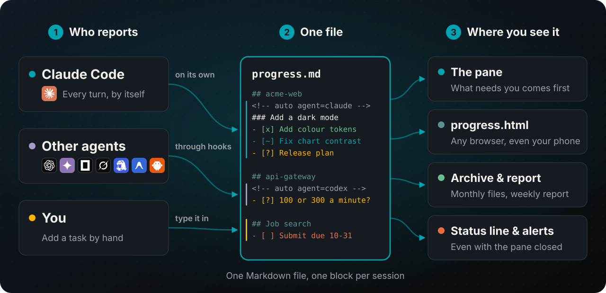
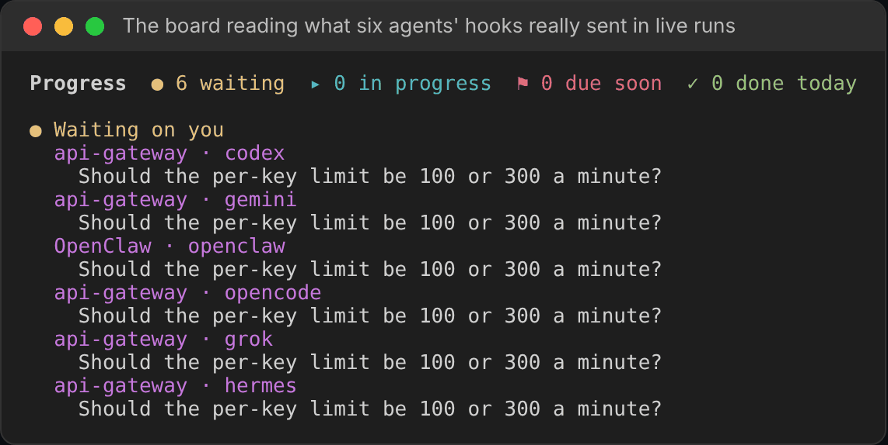
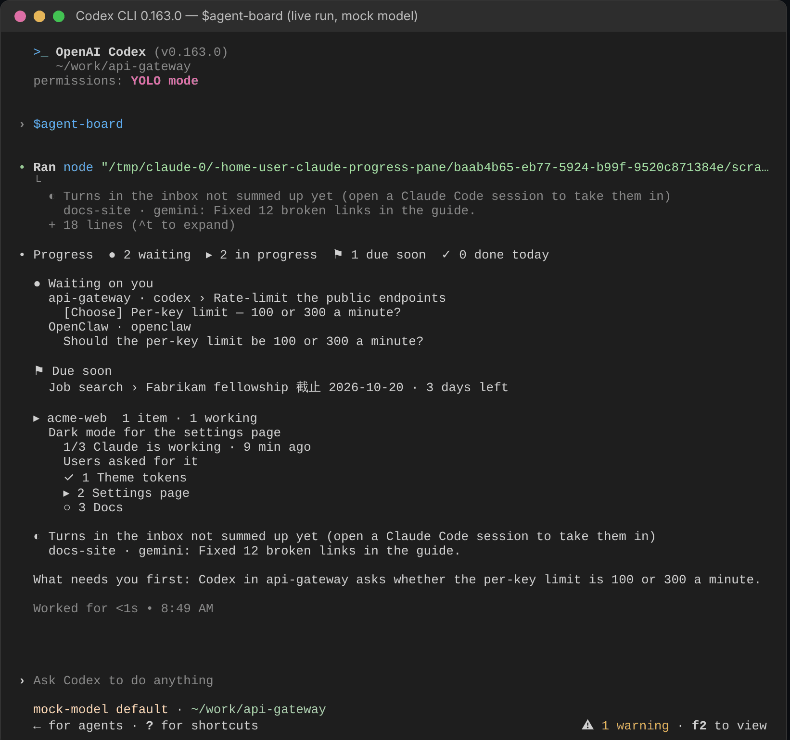
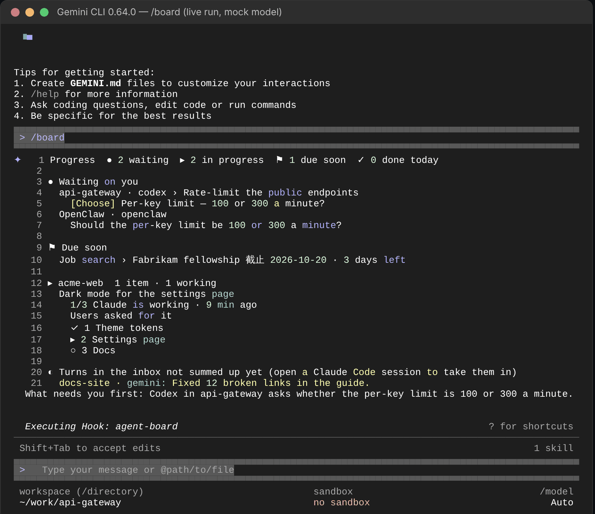

<h1 align="center">

</h1>

<p align="center">
<b>See what every AI coding agent is doing, with whatever is waiting on you at the top.</b><br>
A Claude Code plugin that also follows Codex, Gemini CLI, OpenCode, Grok Build, Hermes Agent and OpenClaw, with more <a href="#supported-agents">below</a>.
</p>

<p align="center">
<a href="CHANGELOG.md"></a>
<a href="#quick-start"></a>
<a href="LICENSE"></a>

</p>
<p align="center">
<a href="#supported-agents"></a>
<a href="#supported-agents"></a>
<a href="#supported-agents"></a>
<a href="#supported-agents"></a>
<a href="#supported-agents"></a>
<a href="#supported-agents"></a>
</p>

<p align="center">English · <a href="README.zh-TW.md">繁體中文</a> · <a href="README.zh-CN.md">简体中文</a></p>

You have Claude Code on one project, Codex on another, Gemini on a third. Twenty minutes in, one of them stops to ask you something, and you only find out when you happen to switch back. **Agent Board** puts that question in front of you the moment it's asked, with a button for each answer.

## What you get

- **Whatever needs you comes first.** A question from any agent sits at the top with a button for each answer. In Claude Code, one click answers it; for other agents you get the exact words or command to paste. Already answered it in the chat? **Already answered, hide** puts it away on this computer and sends nothing; it comes back if that session asks something new.
- **Every agent in one place.** Grouped by project, with a title, a line of background and numbered steps for each session, summed up for you after every turn.
- **Pick up where you left off.** Compaction, a closed terminal, the next morning: you see what's done, what's stuck and what's next. A session that stopped halfway can be taken over in one click.
- **Your own to-dos too.** Type `+ Job search: Fabrikam fellowship due 11-20` in the pane's box. Due dates turn the row amber, then red.
- **Outside the terminal.** `/progress open` shows the same view in your browser (it works on a phone too), and other agents open [a page you can click](#the-boards-page) to tick, archive and answer. The status line and desktop notifications tell you when something needs you while the pane is closed.
- **Reports.** `/progress report` and `/progress today` copy what got done, as text.
- **Tidies itself.** Finished work moves to a monthly archive; a journal keeps every finished step.
- **One plain Markdown file.** Everything is in `~/.claude/progress.md`, which you can read and edit. English, 繁體中文 and 简体中文; light and dark.

## How it works



Each connected agent's hook saves its last reply into `~/.claude/progress-inbox/`. An open Claude Code session picks it up within five seconds, sums the turn up, writes it into that agent's own block in `progress.md`, and deletes the file. The format is in [docs/FORMAT.md](docs/FORMAT.md).

## Quick start

**1. Install** (needs Claude Code 2.1.287 or newer):

```
claude plugin marketplace add WenyuChiou/agent-board
claude plugin install agent-board@agent-board
```

**2. Open Claude Code.** The pane sits on the right (type `/progress` if you don't see it). On its first start it connects every coding agent installed on this machine and tells you which; an agent you install later is connected the same way, the next time Claude Code starts.

**3. Restart your other agents** once, so they load the new hook. The first time, Codex asks you to approve it in `/hooks`, and Hermes Agent asks you to answer `y`. From then on every agent's turn appears within a few seconds.

<details>
<summary><b>Or let an agent install it for you</b></summary>

Paste this into Codex, Gemini CLI, Cursor, Grok, Hermes, Muse, or any agent that can run commands:

```text
Install the Agent Board plugin for Claude Code and connect this machine's coding agents to it.
Run these three commands in order, and stop and tell me if one fails:
claude plugin marketplace add WenyuChiou/agent-board
claude plugin install agent-board@agent-board
claude -p "/progress connect"
Then show me what the last command printed and tell me which agents to restart.
```

</details>

## Supported agents

Install it in Claude Code, and every time Claude Code starts it connects the agents installed on the machine. The badges at the top follow the same grouping: green works fully, yellow-green works in part.

**Works fully**: its turns reach the board by themselves, and the board opens inside it.
- **Claude Code** 2.1.302, in the pane; answer a question with one click
- **Codex** 0.163.0, with `$agent-board`; approve the hook once in Codex's `/hooks`
- **Gemini CLI** 0.64.0, with `/board`; Gemini asks once before it runs the command
- **OpenCode** 1.19.3, with `/board`

**Works in part**
- **Grok Build** 1.0.62: its turns reach the board; `/agent-board` inside it is not verified yet
- **Hermes Agent** 0.19.0: both work; answer `y` once; a one-off `hermes -q` question shows as stopped, not waiting
- **OpenClaw** 2026.10.4: both work; needs 2026.4.24 or newer, and warns that it can't verify where the plugin came from, then loads it
- **dot** and **Muse** on the web: no hook, so paste [one prompt](docs/REMOTE_REPORTERS.md#chat-relay-a-prompt-to-paste) into the chat and paste each block it writes into [the board's page](#the-boards-page); no board inside them
- **Any other agent** (Aider, Copilot, Windsurf…): paste one section of [AGENTS.md](AGENTS.md) into its instructions and it writes its own block; no board inside it

**Not supported yet**
- **Cursor**: on Windows it runs every hook through bash, and another tool's PowerShell hook blocked its turns; macOS and Linux not verified yet
- **Muse Code**: the hook follows its documentation, and its `/agent-board` skill goes into `~/.agents/skills`, which Muse Code reads; neither is verified yet
- **Antigravity**: it has no turn-end hook, so its turns can't reach the board

### By capability

✅ works · ⚠️ works, with a limit above · ❔ not verified yet · ❌ not supported yet

| | Agent | Its turns on the board | The board inside it | Verified on |
|:-:|---|:-:|:-:|---|
|  | **Claude Code** | ✅ | ✅ the pane | 2.1.302 |
|  | **Codex** | ✅ | ✅ `$agent-board` | 0.163.0 |
|  | **Gemini CLI** | ✅ | ✅ `/board` | 0.64.0 |
|  | **OpenCode** | ✅ | ✅ `/board` | 1.19.3 |
|  | **Grok Build** | ✅ | ❔ `/agent-board` | 1.0.62 |
|  | **Hermes Agent** | ⚠️ | ✅ `/agent-board` | 0.19.0, 0.16.0 (Windows) |
|  | **OpenClaw** | ⚠️ | ✅ `/agent-board` | 2026.10.4 |
|  | **Cursor** | ❌ | ❔ `/agent-board` | 2026.10.16 (Windows) |
|  | **Muse Code** | ❔ | ❔ `/agent-board` | |
| | **Antigravity** | ❌ | ❔ `/agent-board` | |
| | **dot**, **Muse** (web) | ⚠️ | ❌ | |
| | **Any other agent** | ⚠️ | ❌ | |

Inside an agent, the board is printed text: it shows everything, but nothing in it can be clicked. So the board command also opens [the board's page](#the-boards-page) in your browser, where you tick a step, archive a task, copy an answer, or answer a Grok Build or Codex session that has ended. A session that is still open is answered in that agent.



## The board in every agent

Connecting also gives each agent a way to show the board, so whichever one you are in, you see what all of them are doing:

| In | Type |
|---|---|
| Gemini CLI, OpenCode | `/board` |
| Codex | `$agent-board` |
| OpenClaw, Hermes Agent | `/agent-board` |
| Grok Build, Cursor, Antigravity (not verified yet) | `/agent-board` |
| Any terminal, next to any agent | `node ~/.claude/agent-board.mjs --watch` (`--html` opens it in the browser) |
| A browser, from any agent | `node ~/.claude/agent-board.mjs --serve` |
| A chat app, through an agent (Hermes Agent, OpenClaw) | `node ~/.claude/agent-board.mjs --chat` (plain text, no page or address; the agent runs it) |

**In a chat app.** `--chat` prints the board as plain text, with no page, no address and no browser, cut to fit one message (it ends with "+N more" when there is more). Questions waiting on you come first, then each task with its next step, then what finished today. It shows your home folder as `~` and hides the credential forms it knows (such as `token=...`, `Bearer ...` and common key prefixes); a secret in another shape is not recognised, so keep secrets out of the board. The Hermes Agent skill runs it for you and sends what it prints as it is.

**Work in it, as in the pane.** Run `node ~/.claude/agent-board.mjs --watch` in a terminal beside the agent (a split pane):

| Key | Does |
|---|---|
| ↑ ↓, Enter | Pick a line, open it |
| `x` | Tick the next step of your own task; it goes into the work log |
| `a` | Archive one of your own tasks, or a stopped session's block |
| `1`–`9`, `y` / `n` | Copy the answer to another agent's question, to paste in that agent |
| `c` | Copy a command, or the command that reopens the session that asked (its ID where there is none) |
| `h`, `u` | Mark another agent's question already answered: hidden on this computer, nothing sent; show the hidden ones again |
| `o`, `q` | Open the browser view; quit |

Finished work leaves the board by itself. The board writes `progress.md` as carefully as the pane does, and leaves other sessions' blocks alone unless you archive one that has stopped.


<table><tr>
<td></td>
<td></td>
</tr></table>

Above, Codex 0.163.0 and Gemini CLI 0.64.0; OpenCode and the terminal are in the [guide](docs/GUIDE.md#the-board-in-every-agent).

The board reads `progress.md` directly, so it needs no Claude Code session, only Node.js 18 or newer. Codex and Gemini CLI installed with npm bring it, a native Codex install does not; if `node --version` finds none, install Node. When it is missing, a session start says so once, and `/progress connect status` shows it. Other agents' turns are summed up into steps while a Claude Code session is open; until then the board lists them as they came in.

### The board's page

The board commands above print the board, then open its page in the browser and give its address on the last line; `node ~/.claude/agent-board.mjs --serve` does the same from any terminal (`--no-open` only prints the address). A second `--serve` brings back the page that is already open. On the page you can:

- **Tick** the next step of your own task, **archive** a task, or press **Archive now** to put away everything finished.
- **Copy** the answer to another agent's question, the ID of the session that asked it, a session's resume command, or a command in a step.
- **Already answered, hide** a question you answered in its own session. It is hidden on this computer, on the page, the pane and the terminal board alike, and nothing is sent. It comes back when that session asks something new; **Show again** brings it back sooner.
- **Answer** a Grok Build or Codex session that has ended. The reply runs `grok -r <id>` or `codex exec resume <id>` in that session's own folder, and the page shows what the agent says back once it answers, which can take a few minutes. One reply at a time per session. A session that is still open is answered in its own window, because two writers would mix one session up.
- **Paste a block** from a web chat such as Muse or dot. Copy the chat prompt from the page into the chat once, then paste each block the chat prints. A block that is not in the format, or that would replace Claude's or another agent's block, is refused.

The page listens on 127.0.0.1 only (unless you add `--lan`, below), and its address carries a random key, so neither other computers nor other web pages you have open can use it. It closes after 30 minutes without anyone looking at it, or with its **Close the board** button, but not while a reply is still on its way to an agent.

**On a phone.** The page fits a phone's screen. To open it from a phone on the same Wi-Fi as the computer, run `node ~/.claude/agent-board.mjs --serve --lan`. Besides the computer's address, it prints the page's address on your network and a QR code of it: point the phone's camera at the code. When the computer has more than one network address, `--lan 192.168.1.23` picks one. Windows may ask whether Node.js may use the network: allow it on private networks, and check that Windows counts your Wi-Fi as a private one (it calls a network it has just joined public), or the phone can't reach the page. Away from that network, open a Claude Code session through Remote Control and ask it where things stand: it reads the same `progress.md`.

The page on your network comes with these limits:

- It opens only when you add `--lan`, only at a private address of the computer (one starting with 192.168, 10, or 172.16 to 172.31, never a public one), and it answers only requests sent to that address.
- Its address carries a key of its own, not the key of the computer's page. Anyone who has that address, or photographs the QR code, can use the page until it closes, so use it on a network you trust, such as your home Wi-Fi, not a café's.
- On the network the page uses plain HTTP, which is not encrypted, so another device on the same Wi-Fi could read what passes, agents' answers included. That is why a phone can tick, archive, mark a question answered (and show it again), copy, paste a block and close the board, but not answer an agent: a reply runs a program on the computer, so the phone shows the answer for you to copy, and you send it from the computer's page.
- It closes after 10 minutes in which no phone looks at it, and whenever the computer's page closes. A second `--serve --lan` while it is open gives the same address.

## Commands

| Type | To |
|---|---|
| `/progress` | Open the pane |
| `/progress connect` | Connect your other agents now and see what changed; each session also does this on its own (`/progress connect remove` takes the hooks out and stops it) |
| `+ project: title due 11-20; step; step` | Add a task of your own, in the pane's box (or `/progress add …`) |
| `/progress open` | See it in the browser |
| `/progress report` / `/progress today` | Copy the last 7 days / today as text |
| `/progress notify on` / `off` | Desktop notifications |
| `/progress lang en` | `en`, `zh-TW`, `zh-CN` or `auto` |
| `/progress tidy` | Archive finished work now, and stopped work past its [age](docs/GUIDE.md#how-it-keeps-itself-tidy) |

## Colours and marks

The pane follows Claude Code's theme. Run `/config`, choose **Theme**: a light theme gives the pane its light colours, any other the dark ones. `progress.html` follows your computer's light or dark mode. Both sets are traditional Japanese colours, picked so every word stays readable.

| Mark | Means | | Mark | Means |
|:-:|---|---|:-:|---|
| ● | Waiting on you | | ◐ | Running, or waiting on someone else |
| ▸ | Doing now | | ! | Stuck |
| ○ | To do | | ⚑ | Due within two weeks |
| ✓ | Done | | – | Cancelled |

Press **Legend** at the bottom of the pane to see this list there.

## FAQ

<details>
<summary><b>Do I need other agents, or does it work with Claude Code alone?</b></summary>

It works with Claude Code alone. Every Claude Code session shows up by itself; connecting other agents is optional.
</details>

<details>
<summary><b>I installed it from Codex (or another agent). Can that agent see Claude Code's work?</b></summary>

Yes. The plugin lives in Claude Code, but connecting gives every agent its board command (see [The board in every agent](#the-board-in-every-agent)), and the board reads the one file every agent writes to. Keep a Claude Code session open somewhere if you want other agents' turns summed up into steps.
</details>

<details>
<summary><b>I switched to a new computer. Do I lose everything?</b></summary>

Nothing is lost, but nothing moves by itself either: `progress.md`, the inbox and the hooks live on each computer. On the new one, run the three install commands and restart your agents. To bring your history along, copy `~/.claude/progress.md` and the `progress-archive-*.md` and `progress-journal-*.md` files beside it.

To share one board between two computers, set `CLAUDE_PROGRESS_FILE` on both to the same file in a synced folder (OneDrive, Dropbox, iCloud). This works best when you use one computer at a time: two computers writing at once can leave your sync app with a conflicted copy.
</details>

<details>
<summary><b>An agent doesn't show up.</b></summary>

1. Run `/progress connect` again and read what it prints: it names every agent it connected and any config file it could not edit.
2. Restart that agent; hooks load when it starts. Codex needs the hook approved in `/hooks`, and Hermes Agent asks once.
3. Keep a Claude Code session open: the pane reads the inbox only while one is running. Turns that arrive meanwhile wait there for up to two days.
4. Close every Claude Code session (an open one reads each file and deletes it within seconds), then check `~/.claude/progress-inbox/`. If no file appears after a turn, the hook didn't run; if one does, open an issue with it. A turn the board could not take (`progress.md` could not be written, or the model gave no summary of a reply that asks nothing) stays there as a `.taking` file and is tried again every 15 minutes; after 8 tries it is kept as a `.failed` file, not deleted. A report that is not valid JSON, or names no session, is kept as a `.failed` file at once, and the pane says where; `.failed` files are not cleaned up, so remove them once you have looked.
</details>

<details>
<summary><b>Does anything leave my machine? What does it cost?</b></summary>

`progress.md`, the inbox and `progress.html` stay on your computer. Turns are summed up by Claude Haiku through your own Claude Code login: one short call per turn of another agent, or of a Claude Code session that keeps no Task list. If GitHub's `gh` is installed, the pane asks it for the state of your pull request. Nothing else is sent anywhere. See [SECURITY.md](SECURITY.md).
</details>

<details>
<summary><b>Does it work on Windows?</b></summary>

Yes: macOS, Linux and Windows, in the terminal, the desktop app and VS Code. On Windows the hooks run a PowerShell script, so they need no `sh`.
</details>

<details>
<summary><b>I used it as <code>claude-progress-pane</code> before.</b></summary>

The plugin was renamed in 0.10.0 and doesn't move over by itself. Run the steps in [Coming from the old name](docs/GUIDE.md#coming-from-the-old-name). Your `progress.md` stays as it is.
</details>

<details>
<summary><b>How do I uninstall it?</b></summary>

```
claude -p "/progress connect remove"
claude plugin uninstall agent-board@agent-board
claude plugin marketplace remove agent-board
```

The first line takes the hooks out of your other agents. `progress.md` stays.
</details>

More answers are in the guide's [Troubleshooting](docs/GUIDE.md#troubleshooting).

## Documentation

- [Guide](docs/GUIDE.md): setup script, reading the pane, every command, other agents, tidying, troubleshooting
- [File format](docs/FORMAT.md): how `progress.md` is written, for anything that wants to write to it
- [AGENTS.md](AGENTS.md): the code's layout, and the section any agent can follow to report by hand
- [Changelog](CHANGELOG.md) · [Contributing](CONTRIBUTING.md) · [Security](SECURITY.md)

## License

[MIT](LICENSE). Agent logos are from [Simple Icons](https://simpleicons.org) (CC0) and [Lobe Icons](https://github.com/lobehub/lobe-icons) (MIT) and belong to their owners; an agent without a logo is shown by its initial.
