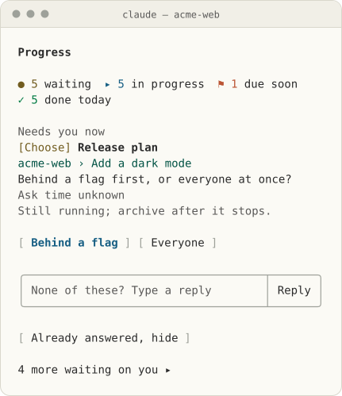
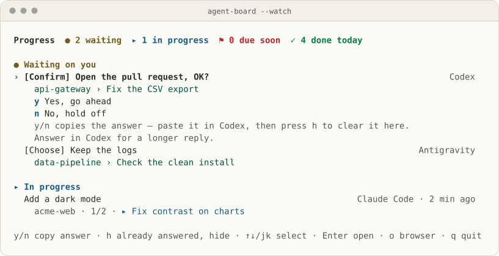
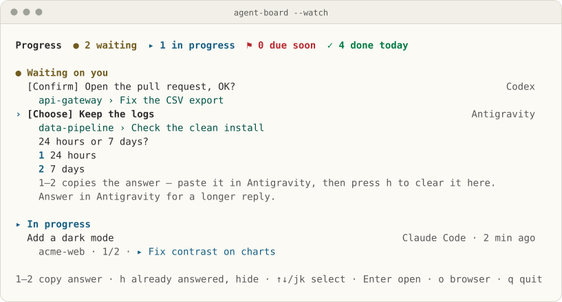

<h1 align="center">Agent Board</h1>

<p align="center"><b>See what every AI coding agent is doing, and answer the one that needs you, from one board.</b></p>

<p align="center">
<picture><source media="(prefers-color-scheme: dark)" srcset="docs/images/pane-en-dark.svg"></picture>
</p>

<p align="center">
<a href="#quick-start"></a>
<a href="LICENSE"></a>
</p>

<p align="center">English · <a href="README.zh-TW.md">繁體中文</a> · <a href="README.zh-CN.md">简体中文</a></p>

You have Claude Code on one project, Codex on another, Antigravity on a third. One of them stops to ask you something, and you only find out when you happen to switch back. **Agent Board** puts that question in front of you the moment it's asked, with a button for each answer. It runs on your computer and keeps everything in one Markdown file.

## Quick start

1. Find the agent you use in [Pick your agent](#pick-your-agent).
2. Run its command, or paste the install prompt below the table into that agent.
3. Open the board: `/progress` in Claude Code, `$agent-board` in Codex, `/board` in OpenCode, or `node ~/.agent-board/agent-board.mjs --serve` in any terminal.

Every agent except Claude Code connects through this repository, with Node.js 18+:

```sh
git clone https://github.com/WenyuChiou/agent-board.git
cd agent-board
```

### Install with npm

From its first npm release (planned for 0.24.0), the installer and the board are also on npm, so no checkout is needed. This needs Node.js 22+:

```sh
npx @wenyuchiou/agent-board setup
npx @wenyuchiou/agent-board setup --apply
npx @wenyuchiou/agent-board --serve
```

The first command shows what setup would change and writes nothing. The second makes the change, and the third opens the board's page. `npx @wenyuchiou/agent-board setup` takes the same options as the `setup-agent.mjs` lines below, such as `--agent codex`. `--watch`, `--chat` and `--html` open the other views. More in the [setup guide](docs/SETUP.md#install-with-npm).

## Pick your agent

| | Agent | Connect it | Open the board |
|:-:|---|---|---|
|  | Claude Code | `claude plugin marketplace add WenyuChiou/agent-board`<br>`claude plugin install agent-board@agent-board` | `/progress` |
|  | Codex CLI and App | `node scripts/setup-agent.mjs --agent codex`, then trust its hooks in `/hooks` ([how](docs/CODEX.md)) | `$agent-board` |
|  | OpenCode | `node scripts/setup-agent.mjs --agent opencode`, then reload its plugins | `/board` |
|   | Hermes Agent, OpenClaw | `node scripts/setup-agent.mjs --agent <name>`, with `hermes` or `openclaw`; then reload OpenClaw's plugins | `/agent-board` |
|      | Antigravity, Cursor, Grok Build, Muse Code, DeepSeek Harness | `node scripts/setup-agent.mjs --agent <name>`, with `antigravity`, `cursor`, `grok`, `muse` or `deepseek` | `/agent-board` (not verified yet) |
| | dot and other web chats | Paste [the last section of AGENTS.md](AGENTS.md#report-your-progress-to-the-progress-pane) into the agent's instructions | Paste its block into [the board's page](#the-boards-page) |

A `setup-agent.mjs` line only shows what it would change; run it again with `--apply` to make the change. Then start a new session of that agent: a session that was already open is not connected. Without `--agent`, it looks for every agent installed on this computer. On Windows, use the exact paths it prints. What each one writes: [setup guide](docs/SETUP.md).

<details>
<summary><b>Let an agent install it</b></summary>

Paste this into the agent you already use:

```text
Install Agent Board from https://github.com/WenyuChiou/agent-board on this computer.
Read its AGENTS.md, README and setup guide. Identify my current host and the other installed coding agents, then preview the common installer: node scripts/setup-agent.mjs.
Preserve existing settings and the shared progress path. Follow my approval requirements for persistent changes, then apply the applicable hooks, plugins and board command. Do not require or call another AI product to bootstrap this one.
Complete any required scoped host trust, read the settings back, and have this session report its own real task progress. Open the interactive board.
Verify actual hook events separately for CLI, desktop App and IDE. Installed files, transport acceptance and an ACK are different from a working progress connection.
Tell me which existing sessions need reload and which adapters remain unsupported or unverified. Never scan private conversations or silently skip a blocker.
```

</details>

## What you see

- **Answer the one that is waiting.** A question from any agent sits at the top, with a button for each answer. **Send** reaches a session that has a live connection; otherwise **Copy** gives you the reply to paste into its chat.
- **Check the others are still moving.** Each agent's task shows its current step and when it last reported. Work nobody has touched for a week folds into one **N idle 7+ days** line.
- **Clear what is finished or dead.** Finished work moves to a monthly archive by itself. A session that stopped halfway can be archived, confirmed done or taken over.
- **Tell an agent something without going there.** Type a reply on the board: it goes straight to that session if it is connected, and otherwise the board copies it for you to paste.


## How it works


Each agent's hooks write what its session is doing into its own block of one local `progress.md` (a fresh install uses `~/.agent-board/progress.md`). Task steps come only from the agent's own reports, and no private conversation is read. The board reads the file without calling a model; the optional Claude plugin can sum up turns with Claude's model, as [the guide says](docs/GUIDE.md#does-anything-leave-my-machine-what-does-it-cost). You can read and edit the file too: [the file format](docs/FORMAT.md). In English, 繁體中文 and 简体中文.

## Supported agents

| | Agent | Runs in | On the board | Reply from the board | Checked |
|:-:|---|---|---|---|---|
|  | Claude Code | CLI | Its own pane: every task and turn | In the pane | Claude Code 2.1.301 in CI |
|  | Codex | CLI, App | Six hooks, plus the steps it reports | Copy; send to a [connected session](docs/MESSAGING.md#codex-exclusive-owner-adapter) | 0.163.0-alpha.10.2 app-server ([record](docs/validation/2026-10-19-native-hooks.md)); CLI in the 0.23.5 live run; App untested |
|  | Antigravity | CLI, App, IDE | Four hooks, plus the steps it reports | Copy; send to a [connected CLI](docs/MESSAGING.md#antigravity-exclusive-owner-cli-stream) | CLI on Windows ([record](docs/validation/2026-10-19-native-hooks.md)); the App opens the board but does not report a question yet (#285); IDE untested |
|  | OpenCode | CLI | Session events, plus steps from its progress tool | Copy | Plugin SDK 1.19.3 ([record](docs/validation/2026-10-19-portable-hosts.md)) |
|  | Cursor | IDE, CLI | Hooks | Copy | Untested |
|  | Grok Build | CLI | Four hooks | Copy; `--allow-resume` once a session ended | 1.0.62 with a mock model |
|  | Muse Code | CLI | Two hooks (stop, end) | Copy | Untested |
|  | Hermes Agent | Chat | The board and its skill; its own hooks are still to come | Copy | 0.19.0 with a mock model |
|  | OpenClaw | Chat | Its plugin's session events | Copy | Source contract and synthetic callbacks ([record](docs/validation/2026-10-19-portable-hosts.md)); app untested |
|  | DeepSeek Harness | CLI | Its plugin's session events | Copy | Plugin loader ([record](docs/validation/2026-10-19-portable-hosts.md)); app untested |
| | dot, other web chats | Web | A block you paste | Answer in its chat | Untested |

Hooks say whether a session is working or waiting; its steps and when it is done come from the agent's own reports. "With a mock model" means the real agent ran against a stand-in model. A live run of 0.23.5 in each app is in the [parity record](docs/validation/2026-10-20-parity-0.23.5.md): there a question from Codex CLI or OpenCode did not reach the board (fixed after 0.23.5, #213), and neither did one from the Antigravity app (#285). Gemini CLI is still a target (`--agent gemini`) for paid and enterprise use: see [setup](docs/SETUP.md#legacy-gemini-cli-compatibility).

## The board in every agent

Each agent's own board command is in [Pick your agent](#pick-your-agent). Next to any of them, the board also runs on its own:

| Where | Run |
|---|---|
| A terminal | `node ~/.agent-board/agent-board.mjs --watch` (`--html` opens it in the browser) |
| A browser | `node ~/.agent-board/agent-board.mjs --serve` |
| A chat app, through an agent (Hermes Agent, OpenClaw) | `node ~/.agent-board/agent-board.mjs --chat` |

**In a chat app,** `--chat` prints the board as plain text cut to fit one message, with no page or link. It shows your home folder as `~` and hides the credential forms it knows, such as `token=...`; a secret in another shape is not recognised, so keep secrets out of the board.

**In a terminal,** `--watch` works like the pane:

| Key | Does |
|---|---|
| ↑ ↓, Enter | Pick a line, open it |
| `x` | Tick the next step of your own task; it goes into the work log |
| `d` | Confirm one of your own tasks, or a stopped session's work, done |
| `a` | Archive one of your own tasks, or a stopped session's block |
| `1`–`9`, `y` / `n` | Copy the answer to another agent's question, to paste in that agent |
| `c` | Copy a command, or the command that reopens the session that asked |
| `h`, `u` | Mark another agent's question already answered: hidden on this computer, nothing sent; show the hidden ones again |
| `i` | Show or fold the tasks idle more than 7 days |
| `o`, `q` | Open the browser view; quit |

Finished work leaves the board by itself. The board writes `progress.md` as carefully as the pane does, and leaves other sessions' blocks alone unless you archive one that has stopped or confirm it done.

**Codex CLI**

<picture><source media="(prefers-color-scheme: dark)" srcset="docs/images/board/codex-en-dark.svg"></picture>

**Antigravity CLI**

<picture><source media="(prefers-color-scheme: dark)" srcset="docs/images/board/antigravity-en-dark.svg"></picture>

The terminal board, drawn by the board's own code from synthetic data. Native hook evidence is [recorded separately](docs/validation/2026-10-19-native-hooks.md).

### The board's page

The board commands above open the board as a page in your browser (in a chat app they print plain text instead, with no link). From any terminal, `node ~/.agent-board/agent-board.mjs --serve` does the same; run it again to reopen the page. On the page you can:

- **Answer** a question: **Send** to a session that is online, or **Copy** the reply.
- **Tick** your next step, **archive** a task, or **Archive now** to clear everything finished.
- **Already answered, hide** a question you answered in its own chat: hidden on this computer until that session asks something new; nothing is sent.
- **Paste a block** from a web chat such as Muse or dot.

The page listens on 127.0.0.1 only, and its address carries a random key: anything on this computer that has the link can use it. It keeps running after you close the tab; **Close the board** stops it. Add `--lan` to open it on a phone on the same Wi-Fi: that link is plain HTTP and anyone who has it can use the page, so use it only on a network you trust. Details and limits are in [the guide](docs/GUIDE.md#the-boards-page).

## Colours and marks

The pane follows Claude Code's theme (`/config`, then **Theme**); the page and `progress.html` follow your computer's light or dark mode. Every mark has its own shape, so it reads without colour:

| Mark | Means | | Mark | Means |
|:-:|---|---|:-:|---|
| ● | Waiting on you | | ◐ | Running, or waiting on someone else |
| ▸ | Doing now | | ! | Stuck |
| ○ | To do | | ⚑ | Due within two weeks |
| ✓ | Done | | – | Cancelled |

## Troubleshooting

Start with the doctor. It checks what the installer wrote for one agent and changes nothing:

```sh
node ~/.agent-board/agent-board.mjs --codex-doctor --agent codex
```

Use the agent's own name after `--agent` (the doctor keeps its old name for every agent). `installed` says the files are in place and `ready` that the agent has a status adapter. `connected` stays `unverified`: only a new session that shows up on the board proves the connection.

| You see | Try |
|---|---|
| An agent is not on the board | Start a new session of it; one that was already open is not connected. Codex also needs its hooks trusted in `/hooks`. |
| Nothing changed after installing | Run `setup-agent.mjs` again without `--apply` and read its conflicts and `adapter-pending` lines; edited files are left alone and listed there. |
| An old version is still running | A running session keeps the version it loaded: start a new one. To update, see [the guide](docs/GUIDE.md#update-and-uninstall). |
| An agent shows up twice | It may be connected both ways: by the Claude plugin's `/progress connect` and by `setup-agent.mjs`. `/progress connect status` lists what the plugin connected; remove one with `/progress connect remove` or `--codex-remove --agent <name>`. |
| A question will not go away | Answer it in its own chat, then press **Already answered, hide** (`h`). After 3 days it moves into **Earlier unanswered questions**, and after 7 days into **Older unanswered questions**. |

More answers are in the guide's [FAQ](docs/GUIDE.md#faq) and [Troubleshooting](docs/GUIDE.md#troubleshooting), which also says how to report a problem safely.

## Documentation

| Read | For |
|---|---|
| This README | The first five minutes |
| [Guide](docs/GUIDE.md) | Daily use, keys, the page, update and uninstall, FAQ, troubleshooting |
| [Setup](docs/SETUP.md) | What the installer writes for each agent |
| [Codex](docs/CODEX.md) · [Messaging](docs/MESSAGING.md) · [File format](docs/FORMAT.md) · [Local exchange](docs/LOCAL-EXCHANGE.md) · [Remote reporters](docs/REMOTE_REPORTERS.md) | Reference |
| [AGENTS.md](AGENTS.md) · [Contributing](CONTRIBUTING.md) · [Security](SECURITY.md) | Working on the code; how a non-Claude agent reports by hand |

## License

[MIT](LICENSE). Agent logos are from [Simple Icons](https://simpleicons.org) (CC0) and [Lobe Icons](https://github.com/lobehub/lobe-icons) (MIT) and belong to their owners; an agent without a logo is shown by its initial.

<p align="center"><sub>Version 0.23.5 · <a href="CHANGELOG.md">Changelog</a></sub></p>
