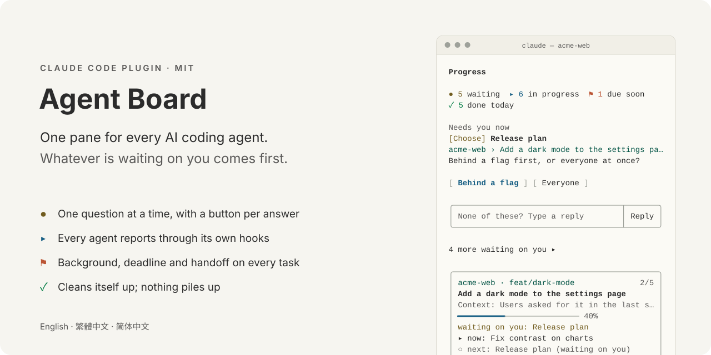
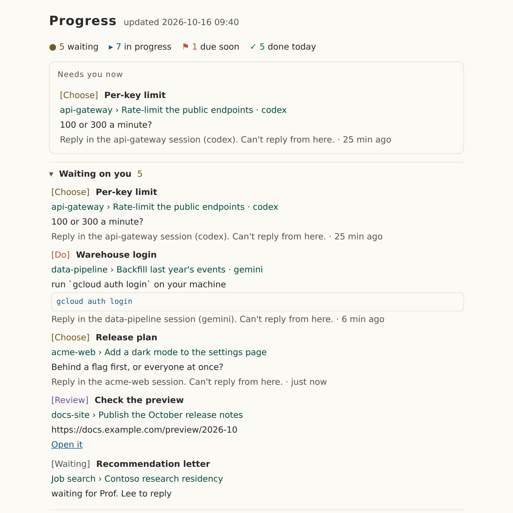
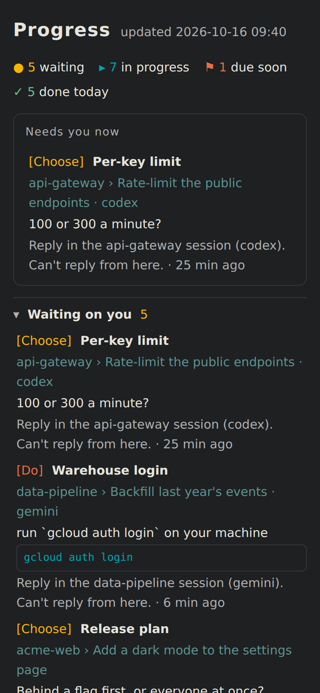

<h1 align="center">
<picture>
  <source media="(prefers-color-scheme: dark)" srcset="docs/images/hero-en-dark.svg">
  
</picture>
</h1>

**A progress dashboard for coding agents.** One side pane shows every project's work and every step, and puts what needs you at the top. It stays in step with Claude Code's Task list without anyone editing a file, and Codex, Gemini, Cursor or a shell script can put their own work on it too.

English · [繁體中文](README.zh-TW.md) · [简体中文](README.zh-CN.md)

<p align="center">
  <picture>
    <source media="(prefers-color-scheme: dark)" srcset="docs/images/demo-en-dark.svg">
    
  </picture>
</p>

## Features

- **Needs you first.** The pane opens on one thing: the question or deadline that needs you most. Everything else (waiting on you, due soon, other work, done) folds to one line with a count and opens when you click it.
- **Buttons that fit the question.** Every step waiting on you is sorted into a kind, and each kind gets its own controls:

  | Kind | Example step | What you get |
  |---|---|---|
  | Confirm | `Deploy build 214 — Deploy it to staging, OK?` | Yes · No |
  | Choose | `Key lifetime — 24 hours or 7 days?` | one button per option, and a reply box |
  | Do | ``Seed the database — run `make seed` on your machine`` | Copy command · Did it |
  | Review | `Check the preview — https://example.com/preview` | Open it · Looks good, and a box for what should change |
  | Input | `Staging credentials — send me the staging API key` | a reply box |
  | Waiting | `Recommendation letter — waiting for Prof. Lee to reply` | Ready (when it arrives) |

  A press goes straight back to that Claude session as your answer. A question from another session says where to answer it; a step you keep by hand gets one button that ticks it in the file.
- **Background on every task.** Each task carries one line on why it exists (`Context: users asked for it in the last survey`), written when Claude names the task, so you never open a card and wonder what it was for.
- **Every project, every agent.** One Markdown file, `~/.claude/progress.md`, holds one block per session. Blocks from other agents are labelled (`codex`, `gemini`) and say where to answer them. Things outside code, like a job search, go in by hand or with a one-line quick add.
- **Cleans up after itself.** Finished work moves to a monthly archive after half a day, anything else after three days. A session silent for 12 hours shows as stopped instead of still asking you things. The file stays about what is open. Open a stopped session or a task you keep by hand and press **Archive** to move it now.
- **Survives compaction.** When Claude Code compacts a conversation, the new context gets the goal, the count, the step in progress and the next ones, so work picks up where it was.
- **A window of its own.** `/progress open` opens `progress.html` in your browser: the same view as a page that refreshes itself, follows your system's light or dark mode, and fits a phone screen.
- **Pull requests and CI.** With [gh](https://cli.github.com) signed in, the card shows this branch's PR, its checks and its review state, and checks again while CI runs.
- **Stays out of the way.** Desktop notifications when a step needs you, when another session or agent asks you something, when work is due today or late (once a day), when a list is done and when CI finishes. Each one pings once, however many sessions are open. With the pane closed or the terminal too narrow, one line under the prompt says where things stand.
- **Journal and weekly report.** Every finished step is logged. `Weekly report` turns the last seven days into plain text (finished, open, waiting on you) and copies it, ready for a standup.
- **Readable in any theme.** Traditional Japanese colours (和色), one set for dark terminals and one for light, every text colour at least 4.5:1 against its background. No faint grey text on white.
- **English, 繁體中文, 简体中文.** Follows Claude Code's language setting, or pick one.

<table>
<tr>
<td width="68%"></td>
<td width="32%"></td>
</tr>
</table>

## How it works

<picture>
  <source media="(prefers-color-scheme: dark)" srcset="docs/images/flow-en-dark.svg">
  
</picture>

Everything lives in one plain Markdown file. Each Claude Code session keeps one block of it in step with its Task list; Codex, Gemini CLI, OpenCode or Cursor keep their own block by following the AGENTS.md section; you write the rest by hand or with a quick add. The pane, `progress.html`, the monthly archive and journal, and the status line all read that file, so every project and every agent shows up in one place. The format is open: [docs/FORMAT.md](docs/FORMAT.md).

## Get started

Needs Claude Code 2.1.287 or newer. Tested on 2.1.301 and 2.1.302.

### 1. Install the plugin

At the prompt of a Claude Code terminal session:

```
/plugin install project-progress --marketplace WenyuChiou/claude-progress-pane
```

Answer `y` to add the marketplace and pick the user scope. Or from a shell:

```
claude plugin marketplace add WenyuChiou/claude-progress-pane
claude plugin install project-progress@claude-progress-pane
```

### 2. Run the setup script

It makes the two settings a plugin cannot make for itself, and is safe to re-run.

Windows (PowerShell):

```powershell
powershell -ExecutionPolicy Bypass -File "$env:USERPROFILE\.claude\plugins\marketplaces\claude-progress-pane\scripts\setup.ps1"
```

macOS / Linux:

```bash
bash ~/.claude/plugins/marketplaces/claude-progress-pane/scripts/setup.sh
```

What it does:

- **Turns on the Task tools.** Recent models get Claude Code's Task tools only with `CLAUDE_CODE_ENABLE_TODO_TOOLS=1`, and the pane mirrors those tools. The script adds the variable to your shell profile (`$PROFILE` in PowerShell; `~/.zshrc`, `~/.bashrc`, `~/.bash_profile` on macOS, or `~/.profile`). Not to `settings.json`, whose env also reaches the Claude desktop app, which keeps a task list of its own.
- **Turns on auto-update** for this marketplace, so new versions arrive by themselves. An auto-update you switched off stays off.
- **Moves an old install over**, if you used the zip version.
- **Connects your other agents, if you ask.** With `--agents` (PowerShell: `-Agents auto`) it also gives Codex, Gemini CLI and OpenCode the instructions to report to the pane (see [Other agents](#other-agents)).

Every file it changes is copied to `<file>.bak` first. Run it with `-NoInstall` (`--no-install`) to skip the install step.

### 3. Start Claude again

Open a **new** terminal window (so the profile is read) and run `claude`. The pane opens on the right by itself. `/progress` reopens it.

### 4. Work as usual

Ask Claude for anything with two or more steps:

```
> Add a dark mode to the settings page and open a PR
```

Claude makes a Task list and the pane follows it: the card shows the task, its background, a progress bar, the step in progress and the next one. When Claude needs a decision, the question moves to **Needs you now** with buttons for it.

### 5. Add things that are not code

Type a line starting with `+` in the box at the bottom of the pane:

```
+ Job search: Fabrikam fellowship due 11-20; update the resume; submit
```

The part before the colon is the project, `due MM-DD` sets the date (it moves under **Due soon** 14 days before), and each `;` starts a step. Or write it into `~/.claude/progress.md` yourself (see [The file](#the-file)).

### 6. Open the window

```
/progress open
```

opens `progress.html` in your default browser. Keep it on a second screen; it refreshes every 30 seconds.

### 7. Pick a language

The pane follows Claude Code's `language` setting, then your system locale. To choose:

```
/progress lang en        # or zh-TW, zh-CN, auto
```

or set **Pane language** for the plugin in `/config`.

## Reading the pane

From top to bottom:

1. **Counts.** `● waiting` · `▸ in progress` · `⚑ due soon` · `✓ done today`. Each one opens what it counts.
2. **Needs you now.** The one question, deadline or stuck task that needs you most, with what it is about and what you can do. `N more waiting on you ▸` opens the rest.
3. **This session's card.** Project and branch, the task, its background, the bar, where it stands, the step in progress and the next. `▸ All N steps` lists every step, numbered, the current one marked `← now`. The pull request, when there is one.
4. **Folded sections.** Waiting on you, Due soon, Other open work (grouped by project), Done recently. Click a row to see its steps and its actions: **Take over and finish** for work a closed session in this project left, **Copy resume command** to reopen that session where it ran, **Mark step done** and **Hand to Claude** for tasks you keep by hand, and **Archive** for either kind to move it out of the file now.
5. **The box.** Ask a side question (answered in the pane without interrupting Claude), or start with `+` to add a task.
6. **Bottom row.** Weekly report · Notifications on/off · Legend.

Marks:

| Mark | Means |
|---|---|
| `✓` | done |
| `▸` | doing |
| `○` | not started |
| `●` | waiting on you |
| `◐` | running: CI, a long job, someone else |
| `!` | stuck |
| `–` | cancelled |

## Commands

| Command | Does |
|---|---|
| `/progress` | Opens the pane |
| `/progress open` | Opens `progress.html` in the browser |
| `/progress add <line>` | Adds a task, same as `+` in the pane |
| `/progress tidy` | Archives finished work now |
| `/progress sync` | Re-reads Claude's Task list and the PR |
| `/progress report` / `today` | Copies a report of the last 7 days / today |
| `/progress notify on` / `off` | Turns notifications on or off |
| `/progress lang en` / `zh-TW` / `zh-CN` / `auto` | Picks the pane's language |

The Chinese words work too: `/progress 視窗`, `加`, `整理`, `同步`, `週報`, `今天`, `通知 開`.

## The file

Everything lives in `~/.claude/progress.md` (`%USERPROFILE%\.claude\progress.md` on Windows; set `CLAUDE_PROGRESS_FILE` to use another path). It is plain Markdown you can read and edit:

```markdown
# Project progress

## acme-web

<!-- auto session=2be48af2 agent=claude state=waiting updated=2026-10-16T01:40:00Z pr=128 ci=pending -->
### Add a dark mode to the settings page
> waiting on your reply · feat/dark-mode · PR #128 · CI running
> Context: users asked for it in the last survey
- [x] Add colour tokens for dark
- [~] Fix contrast on charts
- [?] Release plan — Behind a flag first, or everyone at once?
- [ ] Open the pull request
<!-- /auto session=2be48af2 -->

## Job search

### Contoso research residency
> due 10-31
- [x] Update the resume
- [?] Recommendation letter — waiting for Prof. Lee to reply
- [ ] Submit
```

- Each session rewrites only the lines between its own `<!-- auto -->` markers. Everything else (your hand-kept sections, notes) is left byte for byte.
- Marks: `[x]` done, `[~]` doing, `[ ]` not started, `[?]` waiting on you, `[>]` running, `[!]` stuck, `[-]` cancelled. Text after ` — ` is the step's note: what it needs, or why it is stuck.
- `due MM-DD` (or `截止 MM-DD`) on a task gives it a date: it moves under Due soon 14 days before, and turns red 3 days before.

The full specification, for tools that read or write the file, is [docs/FORMAT.md](docs/FORMAT.md).

## Other agents

Any agent that can write a file can show its work on the pane. All it needs is one section of instructions, **"Report your progress to the progress pane"** at the end of [AGENTS.md](AGENTS.md).

**Codex, Gemini CLI, OpenCode:** run the setup script with `--agents`. It adds the section to each one's global instructions, so every project picks it up:

```bash
bash ~/.claude/plugins/marketplaces/claude-progress-pane/scripts/setup.sh --agents
```

```powershell
powershell -ExecutionPolicy Bypass -File "$env:USERPROFILE\.claude\plugins\marketplaces\claude-progress-pane\scripts\setup.ps1" -Agents auto
```

| Agent | File it writes |
|---|---|
| Codex | `~/.codex/AGENTS.md` (`$CODEX_HOME`; `AGENTS.override.md` when that one has text) |
| Gemini CLI | `~/.gemini/GEMINI.md` |
| OpenCode | `~/.config/opencode/AGENTS.md` |

`--agents` takes the agents installed on the machine; `--agents=codex,gemini` (`-Agents codex,gemini`) names them; `--remove-agents` (`-RemoveAgents`) takes the section out again. The section sits between `<!-- claude-progress-pane:start -->` and `<!-- claude-progress-pane:end -->`, and the rest of the file is left as it was.

**Any other agent** (Cursor, Aider, GitHub Copilot, Windsurf…): paste the section into the project's instruction file (`AGENTS.md`, `.cursorrules`, `CONVENTIONS.md`, …).

The agent then keeps one block of its own, and the pane labels it with the agent's name. Its questions are listed with the rest and say where to answer them; a command it asks you to run can be copied, and a link opened, right from the pane.

Checked by giving agents on three different models only that section and having them write to one file at the same time: the pane read every block, label and kind of question right, and nothing outside their blocks changed.

## How it keeps itself tidy

| What | When |
|---|---|
| A finished block moves to `progress-archive-YYYY-MM.md` | 12 hours after its last update |
| Any other block moves there | 3 days after its last update |
| A hand-kept task with every step done moves there | 24 hours after the pane first saw it done |
| A session that has not written for 12 hours | shows as stopped; its questions leave Needs you now |
| You press **Archive** on a stopped session or a hand-kept task | right away |
| A `##` section the archive emptied | is removed; one you left empty stays |

The sweep runs when a session starts and every hour after. `/progress tidy` runs it now.

## Update and uninstall

With auto-update on (the setup script turns it on), new versions arrive by themselves. To update by hand:

```
claude plugin marketplace update claude-progress-pane
claude plugin update project-progress@claude-progress-pane
```

then `/reload-plugins` in a running session, or start a new one.

To uninstall:

```
claude plugin uninstall project-progress@claude-progress-pane
claude plugin marketplace remove claude-progress-pane
```

`progress.md`, its archives and journals, and the line in your shell profile stay.

## Troubleshooting

- **The pane says this session has no Task tools.** Run the setup script, then start `claude` from a new terminal window. Sessions that never get the variable (the desktop app, git-bash on Windows) can still keep `progress.md` by hand.
- **No pane on screen.** In the terminal's fullscreen layout the pane docks on the right on its own from 144 columns wide, and through `/progress` from 110. Under tmux or `CLAUDE_CODE_NO_FLICKER=0` it sits above the prompt. Cloud sessions draw no pane.
- **PowerShell warns about the execution policy.** Your profile only runs where scripts may run: `Set-ExecutionPolicy -Scope CurrentUser RemoteSigned`, then run the script again. Until then the variable stays in `settings.json`.
- **Private fork.** Claude Code clones with your own git credentials. Run `gh auth login` and `gh auth setup-git` once; without a GitHub SSH key also set `CLAUDE_CODE_PLUGIN_PREFER_HTTPS=1`.
- **Your organization manages Claude Code.** Plugins you install yourself do not get the system-prompt hook there. Run the setup script with `-KeepRule` (`--keep-rule`) to keep the rule in `~/.claude/CLAUDE.md` instead.

## Contributing

Bug reports and pull requests are welcome. [CONTRIBUTING.md](CONTRIBUTING.md) has the checks and the release steps, [AGENTS.md](AGENTS.md) the code layout and conventions, and [docs/FORMAT.md](docs/FORMAT.md) the file format, which is a public interface. The [CHANGELOG](CHANGELOG.md) lists every change with the tests that cover it.

## License

[MIT](LICENSE)
