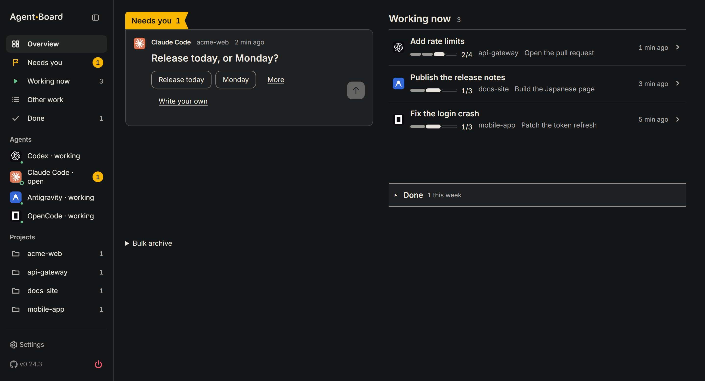
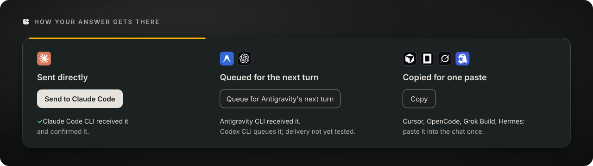
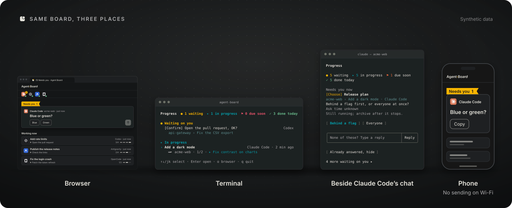

<h1 align="center"></h1>

<p align="center"><b>A board that shows which AI agent is waiting on you.</b></p>

<p align="center"><a href="CHANGELOG.md"></a> <a href="LICENSE"></a> <a href="https://github.com/WenyuChiou/agent-board/actions/workflows/test.yml"></a> <a href="https://www.npmjs.com/package/@wenyuchiou/agent-board"></a></p>

<p align="center">English · <a href="README.zh-TW.md">繁體中文</a> · <a href="README.zh-CN.md">简体中文</a></p>

<p align="center">

</p>

Claude Code, Codex, Antigravity and other AI agents report to one board on your computer. When one stops to ask you something, its question goes to the top within seconds, so you stop hunting through windows. One Markdown file, no account.

## Quick start

With Node.js 22+, in any terminal:

```sh
npx @wenyuchiou/agent-board@next setup
npx @wenyuchiou/agent-board@next
```

- `setup` shows what it will change and asks once before it writes.
- Then open a new session of your agent and type `/agent-board` (`$agent-board` in Codex; Cursor has no such command, so use the second command).
- Per-agent steps, language, options and other ways to install: [setup guide](docs/SETUP.md#after-setup-per-agent).

## What you get

- **Questions first.** A question an agent is waiting on goes to the top, with a button for each option it can read, or you write your own answer.
- **Every agent stays where it is.** Agents keep running in their own terminals; the board reads what their hooks report.
- **Local and plain.** One Markdown file you can read and edit, a page on 127.0.0.1 only, and no model calls by the board.
- **One command to install, one to remove.** `setup` shows what it will change before it writes; `remove` takes out what setup wrote and leaves your own settings alone.



## Supported agents

### In a terminal (command line)

| | Agent | Open the board | Your reply reaches it |
|:-:|---|---|---|
|  | Claude Code | `/agent-board` | At once (confirmed) |
|  | Codex | `$agent-board` | At its next turn |
|  | Antigravity | `/agent-board` | At its next turn |
|  | Cursor | The second Quick start command | You paste it |
|  | OpenCode | `/agent-board` | You paste it |
|  | Grok Build | `/agent-board` | You paste it |
|  | Hermes Agent | Ask it for the `agent-board` skill | You paste it |

### In a desktop app or IDE

| | Agent | Open the board | Your reply reaches it |
|:-:|---|---|---|
|  | Claude Code | The pane beside its chat | Not yet |
|  | Codex | Board page (second command) | Not yet |
|  | Antigravity | Board page (second command) | Not tested yet |
|  | Cursor | Board page (second command) | Not tested yet |
|  | OpenCode | Board page (second command) | Not yet |

- Board page: run the second Quick start command in any terminal, the app's own included.
- dot and other web chats report by hand: [how](docs/REMOTE_REPORTERS.md#chat-relay-a-prompt-to-paste).

## Answer from the board



An answer to an agent's question and a message you send it travel the same way, by the button you press:

- **Send** hands it to a connected session; a confirmation from that session means it was received. With no confirmation it may still have arrived, so look at the agent before you use **Copy answer**, or it may get it twice. Send needs [messaging on](docs/MESSAGING.md#local-storage).
- **Queue for the agent's next turn** holds it until that session's next turn, does not wake an idle one, and can be rejected if the session ends first or its 12-hour mailbox expires.
- **Copy answer** puts it on your clipboard to paste into that agent.
- Answered in the agent's own window? Press **Already answered, hide** to clear the card.

## Open it anywhere



| Where | How |
|---|---|
| In an agent | `/agent-board` (`$agent-board` in Codex) |
| A terminal | `npx @wenyuchiou/agent-board`: the terminal board in an interactive terminal over SSH or on Linux with no display, unless an agent's setting such as `HERMES_HOME` or `OPENCODE_CONFIG_DIR` is set in that shell; plain text in CI; the page everywhere else. `--watch` gives the terminal board in any interactive terminal |
| A phone on the same Wi-Fi | `npx @wenyuchiou/agent-board --lan` and scan the QR code. The phone can look, tick, archive and close the board, but cannot send an answer (it shows the answer to copy). Use it on a network you trust: the link is not encrypted and anyone who has it can open the page |
| An agent reading the board | `npx @wenyuchiou/agent-board --json` ([fields](docs/BOARD-JSON.md)) |

## How it works


Each agent's hooks write what its session is doing into its own block of one local `progress.md` (a fresh install uses `~/.agent-board/progress.md`; [the format](docs/FORMAT.md)). The page listens on 127.0.0.1 only and needs no account. The board does not call a model; what the optional Claude Code plugin can send out is in [the guide](docs/GUIDE.md#does-anything-leave-my-machine-what-does-it-cost).

## Update and remove

Run `npx @wenyuchiou/agent-board@next setup` again to see what an update would change, then `setup --apply`; files you edited are left alone. To remove what setup wrote:

```sh
npx @wenyuchiou/agent-board@next remove
npx @wenyuchiou/agent-board@next remove --apply
```

Your history stays beside `progress.md`; [Update and uninstall](docs/GUIDE.md#update-and-uninstall) lists what is kept, and a few small cache files can be left behind. For the shorter `agent-board` command, run `npm install -g @wenyuchiou/agent-board@next` once.

## Troubleshooting

| You see | Try |
|---|---|
| An agent is not on the board | Start a new session of it; one that was already open is not connected. For Codex, preview `npx @wenyuchiou/agent-board --codex-trust --codex-bin "<path-to-codex>" --json` with Codex's full path, review it, then add `--apply` only if you approve. Codex CLI also offers `/hooks`. |
| Nothing changed after installing | Run `npx @wenyuchiou/agent-board@next setup` again without `--apply` (from a checkout: `node scripts/setup-agent.mjs`). Read the conflicts and Next steps; edited files are left alone and listed there. |
| If the board looks old | A session that was already open may still run the version it loaded: start a new session of that agent. To update, see [the guide](docs/GUIDE.md#update-and-uninstall). |
| An agent shows up twice | It may be connected both by the Claude plugin and by setup: [what to remove](docs/GUIDE.md#troubleshooting). |

To check Claude Code's setup, run `claude plugin list` and `/progress connect status`. More answers: the guide's [FAQ](docs/GUIDE.md#faq) and [Troubleshooting](docs/GUIDE.md#troubleshooting). Found a bug? Open the [bug form](https://github.com/WenyuChiou/agent-board/issues/new?template=bug_report.yml) and follow the [safe-report steps](docs/GUIDE.md#reporting-a-problem-safely): no session ids, home-folder paths or tokens.

## Documentation

| Read | For |
|---|---|
| [Guide](docs/GUIDE.md) | Daily use, keys, the page, settings, update and uninstall, FAQ |
| [Setup](docs/SETUP.md) | What the installer writes for each agent |
| [Codex](docs/CODEX.md) · [Messaging](docs/MESSAGING.md) · [File format](docs/FORMAT.md) · [Remote reporters](docs/REMOTE_REPORTERS.md) | Reference |
| [AGENTS.md](AGENTS.md) · [Contributing](CONTRIBUTING.md) · [Security](SECURITY.md) | Working on the code; how a non-Claude agent reports by hand |

## License

[MIT](LICENSE). Agent logos are from [Simple Icons](https://simpleicons.org) (CC0) and [Lobe Icons](https://github.com/lobehub/lobe-icons) (MIT) and belong to their owners; an agent without a logo is shown by its initial.

<p align="center"><a href="CHANGELOG.md"></a><br><sub>Latest stable version: 0.24.2 · 0.24.3 is a pre-release (<code>npx @wenyuchiou/agent-board@next setup</code>) · <a href="CHANGELOG.md">Changelog</a>.</sub></p>
