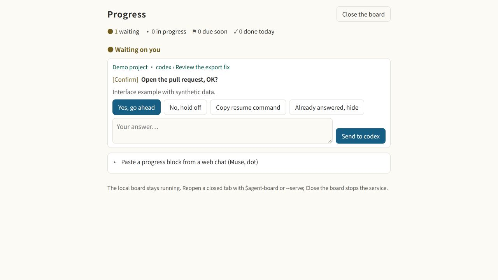
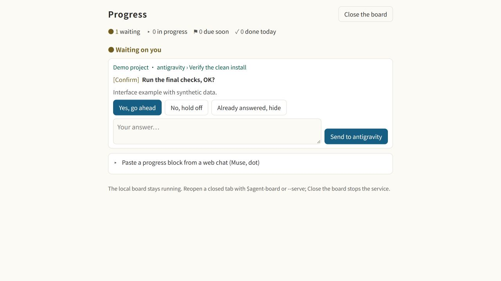

<h1 align="center">

</h1>

<p align="center">
<b>每个 AI coding agent 在做什么，一个面板看完；等你的事，永远排第一个。</b><br>
本地交互看板，从你正在使用的 agent 开始；Claude Code 原生侧栏是可选功能。各 host 能力见<a href="#支持的-agent">下方</a>。
</p>

<p align="center">
<a href="CHANGELOG.md"></a>
<a href="#快速开始"></a>
<a href="LICENSE"></a>

</p>
<p align="center">
<a href="#支持的-agent"></a>
<a href="#支持的-agent"></a>
<a href="#支持的-agent"></a>
<a href="#支持的-agent"></a>
<a href="#支持的-agent"></a>
<a href="#支持的-agent"></a>
</p>

<p align="center"><a href="README.md">English</a> · <a href="README.zh-TW.md">繁體中文</a> · 简体中文</p>

你在一个项目开 Claude Code，另一个开 Codex，第三个开 Antigravity。二十分钟后，其中一个停下来问你事情，你要等到刚好切回去才会发现。**Agent Board** 在它一开口就把问题放到你眼前，每个答案一个按钮。

## 功能

- **需要你的事排最前面。** 任何 agent 的问题都放在最上面，每个答案一个按钮。已连接的 agent 可直接发送答案；其他情况则复制到原对话。已经在对话里回过了？点**已回复，先隐藏**，只在这台电脑上收起来，不会发出任何话；那个对话问了新的问题，它会再出现。
- **所有 agent 一处看。** 各 session 明确报告真实任务步骤，支持的原生 hooks 报告活动状态；按项目分组，不读私人对话。
- **随时接着做。** 对话压缩、终端关掉、第二天早上都没关系：做完什么、卡在哪、下一步是什么，打开就看到。做到一半停掉的对话，点一下就能接手。
- **你自己的待办也放得进来。** 在面板的输入框打 `+ 求职：Fabrikam 研究员 截止 11-20`。快到期会变黄，到期会变红。
- **不在终端也看得到。** `/progress open` 在浏览器打开同一个画面（手机也行）；其他 agent 会打开[可以点的网页](#看板的网页)，在上面勾步骤、归档、回答。面板关着时，状态栏和桌面通知会告诉你有事在等你。
- **周报。** `/progress report` 和 `/progress today` 把做完的事复制成文字。
- **自己清理。** 做完的事移到每月归档文件，日志留下每一步完成记录。超过一周没人动的工作收进一行 **N 项超过 7 天没动**，文件里一字不改。
- **就是一个 Markdown 文件。** 独立安装默认用 `~/.agent-board/progress.md`，现有安装沿用原路径；你可以自己看、自己改。支持 English、繁體中文、简体中文；浅色深色都有。

## 怎么运作


独立 reporter 将原生 session 活动与明确任务摘要写到同一个本地 `progress.md`，每个 session 只更新自己的区块；网页看板不需要另一个模型。上图是可选 Claude 插件的 inbox 与摘要流程。格式见 [docs/FORMAT.md](docs/FORMAT.md)。

## 快速开始

<details open>
<summary><b>让 agent 帮你安装</b></summary>

把下面这段贴给你正在用的 agent，不必先选哪一家的安装路线：

```text
帮我在这台电脑安装 https://github.com/WenyuChiou/agent-board 的 Agent Board。
先读 AGENTS.md、README 与安装指南，识别当前 host 和这台电脑已安装的其他 coding agent，再用共同入口 node scripts/setup-agent.mjs 预览。
保留现有设置与共享进度路径，按我对永久改动的确认要求，完成适用的 hooks、plugin 与看板入口；不要依赖或调用另一家 AI 来初始化。
完成原生 host 必要的限定范围信任并读回设置，让当前 session 报告自己的真实任务进度，打开交互看板。
CLI、桌面 App、IDE 的实际 hook 事件分别验收；安装文件、传输接受、收到 ACK 和进度接通是不同结果。
列出哪些现有 session 需要重新加载，以及尚未支持或未验收的部分。不要扫描私密对话，也不要默默跳过阻挡。
```

</details>

手动安装只需要 Node.js 18 以上与 Git。先预览，再应用已检查的安装范围：

```sh
git clone https://github.com/WenyuChiou/agent-board.git
cd agent-board
node scripts/setup-agent.mjs
node scripts/setup-agent.mjs --apply
```

安装器检测的是设置目录，不代表那些 agent 正在运行。安装后用看板 skill 打开交互页面；关掉标签页后可用 `node ~/.agent-board/agent-board.mjs --serve` 再打开。见[通用安装指南](docs/SETUP.md)。

<details>
<summary>Claude Code 原生侧栏（可选）</summary>

需要 Claude Code 2.1.287 以上；离线 CI 使用 2.1.301。安装插件后打开 Claude Code，输入 `/progress`；其他 host 可独立使用交互看板。

```sh
claude plugin marketplace add WenyuChiou/agent-board
claude plugin install agent-board@agent-board
```

</details>

## 支持的 agent

独立 hooks 与明确进度报告共用本地看板。卡片只通过确切在线 adapter 发送；CLI、App、IDE 分别验收。[消息说明](docs/MESSAGING.md)。

| Host／界面 | 当前范围 |
| --- | --- |
| Codex CLI | 独立安装与六个 hooks；已验证独占 app-server 的 hooks／ACK，交互 TTY 另行验收。 |
| Codex 桌面 App | 交互看板与真实进度报告；原生自动 hooks、直接消息尚未验收。 |
| Antigravity CLI | 独立安装、四个原生 hooks 与独占 stream 发消息，已在 Windows 实测。App／IDE 单独验收。 |
| Cursor、OpenCode、Grok Build、Muse Code | 可生成独立 hooks 或 plugin；原生运行与收信依 host 而异，不能只凭安装判定通过。 |
| OpenClaw、DeepSeek Harness | 独立原生状态 plugin 与 skill；隔离回调／加载检查通过。原生应用及收信仍未验收。 |
| Hermes Agent | 看板与 skill；独立生命周期 adapter 待完成。 |
| Claude Code | 可选原生侧栏、Task 镜像与 plugin 连接流程。 |
| dot 与其他网页 agent | 明确进度转发；尚未验证原生收信。 |

### 按能力

生命周期支持见[安装 adapter 表](docs/SETUP.md#native-status-adapters)；精确 session 绑定、ACK 与界面限制见[传信文档](docs/MESSAGING.md)。

<details>
<summary>旧 Gemini CLI 兼容性</summary>

Google 已于 2026 年 6 月 18 日停止 Gemini CLI 的免费个人版及 Google AI Pro／Ultra 服务，改用 Antigravity CLI；企业授权与付费 API key 渠道另计。保留明确指定的 `--agent gemini` 兼容目标，不把它当成 Antigravity 的别名。[官方公告](https://developers.googleblog.com/an-important-update-transitioning-gemini-cli-to-antigravity-cli/)。

</details>

<details>
<summary>可选 Claude connector 的历史截图</summary>

这张历史图片含旧 Gemini CLI；当前一般用户入口改为 Antigravity CLI，图片不算 Antigravity 验收证据。


</details>

## 每个 agent 里都看得到看板

接上时，每个 agent 也会拿到一个看看板的命令。不管你在哪一个里面，都看得到全部 agent 在做什么：

| 在 | 输入 |
|---|---|
| OpenCode | `/board` |
| Codex | `$agent-board` |
| OpenClaw、Hermes Agent | `/agent-board` |
| Grok Build、Cursor、Antigravity（还没验证） | `/agent-board` |
| 任何终端，开在任何 agent 旁边 | `node ~/.agent-board/agent-board.mjs --watch`（`--html` 在浏览器打开） |
| 浏览器，从任何 agent | `node ~/.agent-board/agent-board.mjs --serve` |
| 聊天软件，通过 agent（Hermes Agent、OpenClaw） | `node ~/.agent-board/agent-board.mjs --chat`（纯文本，没有网页也没有网址；由 agent 去运行） |

**在聊天软件里。** `--chat` 把看板打印成纯文本，没有网页、没有网址、也不开浏览器，并缩到一条消息放得下（还有更多时结尾是“还有 N 项”）。等你回复的问题排最前面，接着是每件工作和它的下一步，最后是今天做完的。它会把你的主目录显示成 `~`，并遮掉它认得的凭证形式（例如 `token=...`、`Bearer ...` 和常见的密钥开头）；其他形状的机密它认不出来，所以别把机密写进看板。Hermes Agent 的 skill 会替你运行它，并把打印出来的内容原样发出。

**像面板一样操作。** 在 agent 旁边开一个终端（分屏），运行 `node ~/.agent-board/agent-board.mjs --watch`：

| 按键 | 作用 |
|---|---|
| ↑ ↓、Enter | 选一行、展开 |
| `x` | 勾掉自己工作的下一步，并记进工作日志 |
| `a` | 归档自己的工作，或已停对话的区块 |
| `1`–`9`、`y`／`n` | 复制另一个 agent 问题的答案，贴到那个 agent |
| `c` | 复制命令，或接回提问那个对话的命令 |
| `h`、`u` | 把另一个 agent 的问题标成已回复：只在这台电脑上隐藏，不发出任何话；把隐藏的全部重新显示 |
| `i` | 展开或收起超过 7 天没动的工作 |
| `o`、`q` | 打开网页版；退出 |

做完的工作会自己离开看板。看板写 `progress.md` 跟面板一样小心；别的对话的区块不会动，除非你归档一个已经停掉的。


<table>
<tr><th width="50%">Codex CLI</th><th width="50%">Antigravity CLI</th></tr>
<tr>
<td></td>
<td></td>
</tr>
</table>

使用合成数据的交互看板示例；原生 CLI hooks 与实机 ACK 的证据见[独立验收记录](docs/validation/2026-10-19-native-hooks.md)。

### 看板的网页

上面的看板命令和技能通常会运行 `--serve`：打印看板、启动后台服务器、写入地址文件、在浏览器打开网页，并把带 token 的链接打印到 agent 的对话中。在任何终端运行 `node ~/.agent-board/agent-board.mjs --serve` 也一样（加 `--no-open` 只打印网址）。再运行一次 `--serve` 会叫回已经开着的那一页。在聊天 app 中，技能会改用 `--chat`，不会打印链接。在网页上可以：

- **勾掉**自己工作的下一步、**归档**一件工作，或点**现在归档**把做完的全部收走。
- **复制**回复、续接命令或步骤中的命令。
- **已回复，先隐藏**：已经在它自己的对话里回过的问题。只在这台电脑上隐藏，网页、面板和终端看板都一样，不会发出任何话。那个对话问新的问题时会再出现；点**重新显示**可以提早叫回来。
- **发送**到确切在线的对话。离线 session 保留复制；旧版启动进程功能须明确加上 `--allow-resume`。[界面支持](docs/MESSAGING.md)。
- **贴入区块**：保留来源时间，重复不变更，拒绝过时或冲突的内容；旧数据时间不明时先比较两份内容。[修复方式](docs/REMOTE_REPORTERS.md)。

网页只在 127.0.0.1 上监听（除非加上 `--lan`，见下文），网址里带一把随机钥匙。这台电脑上的任何程序只要有链接就能使用。关闭标签页后本地服务会继续运行，使用 $agent-board 或 --serve 可重开；点击**关闭看板**才停止。可用 --idle-minutes 30 选择闲置关闭，0 代表停用；LAN 仍保留 10 分钟限制。传信进行中不会关闭。

**在手机上。** 网页的布局适合手机。要从和电脑连同一个 Wi-Fi 的手机打开，运行 `node ~/.agent-board/agent-board.mjs --serve --lan`：除了电脑本机的网址，它还会打印网页在你网络上的网址和它的二维码，用手机相机对着扫就好。电脑有不止一个网络地址时，用 `--lan 192.168.1.23` 指定一个。Windows 可能会问要不要让 Node.js 使用网络：在专用网络上允许，并确认 Windows 把你的 Wi-Fi 算作专用网络（刚连上的网络它会先当成公用网络），不然手机连不到网页。跨网络访问须另行设置远程连接。

网络上的网页有这些限制：

- 只有加了 `--lan` 才开，只开在电脑的私有地址上（开头是 192.168、10，或 172.16 到 172.31 的地址，绝不是公网地址），也只响应发到那个地址的请求。
- 它的网址带着自己的一把钥匙，不是电脑本机网页那把。拿到这个网址或拍到二维码的人，在它关掉之前都能用这个网页，所以只在信得过的网络上用，比如家里的 Wi-Fi，不要在咖啡店的。
- 在网络上，网页走的是没有加密的 HTTP，同一个 Wi-Fi 上的其他设备可能读到传过去的内容，包括 agent 的回答。所以手机可以勾步骤、归档、标成已回复（和重新显示）、复制、贴上区块和关闭看板，但不能回复 agent：回复会在电脑上运行一个程序，所以手机只显示答案让你复制，再从电脑本机的网页发出。
- 10 分钟没有手机来看就会关，电脑本机的网页关掉时也跟着关。开着的时候再运行一次 `--serve --lan`，拿到的是同一个网址。

## 命令

以下是可选 Claude Code 侧栏的命令；其他 agent 使用上方的看板入口。

| 输入 | 用途 |
|---|---|
| `/progress` | 打开面板 |
| `/progress connect` | 现在就接上其他 agent，并看看改了什么；每个对话开始时也会自动做（`/progress connect remove` 去掉 hook 并停止自动接） |
| `+ 项目：标题 截止 11-20；步骤；步骤` | 在面板输入框加一件自己的事（或用 `/progress add …`） |
| `/progress open` | 在浏览器看 |
| `/progress report` / `/progress today` | 复制最近 7 天／今天的进度 |
| `/progress notify on` / `off` | 桌面通知 |
| `/progress lang zh-CN` | `en`、`zh-TW`、`zh-CN` 或 `auto` |
| `/progress tidy` | 现在就归档做完的工作，以及停太久的工作（见[使用说明](docs/GUIDE.zh-CN.md#它怎么保持整齐)） |

## 颜色与符号

面板跟着 Claude Code 的主题走。输入 `/config`，选 **Theme**：选浅色主题，面板就用浅色那组颜色；其他主题用深色那组。`progress.html` 跟着你电脑的浅色或深色模式。两组都是日本传统色（和色），选来让每个字都清楚好读。

| 符号 | 意思 | | 符号 | 意思 |
|:-:|---|---|:-:|---|
| ● | 等你 | | ◐ | 在跑，或在等别人 |
| ▸ | 正在做 | | ! | 卡住 |
| ○ | 还没做 | | ⚑ | 两周内到期 |
| ✓ | 完成 | | – | 取消 |

点面板最下面的“说明”，面板里也会列出这张表。

## 常见问题

<details>
<summary><b>可以只从一个 agent 开始吗？</b></summary>

可以，使用通用安装器从支持的任一 agent 开始，不需要另一家 AI。原生 hooks 依 host 而异；看板和明确报告自身进度的入口共用。
</details>

<details>
<summary><b>我是从 Codex（或其他 agent）装的，它看得到 Claude Code 在做什么吗？</b></summary>

可以，只要各 session 报告到同一个本地进度文件。独立 reporter 不需要 Claude Code 就能更新自己的区块；可选侧栏也读同一文件。打开看板和接上原生收信是两件事。
</details>

<details>
<summary><b>换了一台电脑，东西都没了吗？</b></summary>

不会没，但也不会自己搬过去：`progress.md`、收件箱和 hook 都只在各自的电脑上。在新电脑运行通用安装器，再重启 agent 就好。要带上以前的记录，就把你选用的 `progress.md` 和旁边的 `progress-archive-*.md`、`progress-journal-*.md` 复制过去。

想让两台电脑共用一个面板，就在两台都把 `CLAUDE_PROGRESS_FILE` 设成同步文件夹（OneDrive、Dropbox、iCloud）里的同一个文件。一次只用一台最稳：两台同时写，同步软件可能会留下冲突副本。
</details>

<details>
<summary><b>某个 agent 没出现。</b></summary>

1. 执行 `node scripts/setup-agent.mjs` 预览当前 host，查看冲突与 `adapter-pending`。
2. 按 host 要求重载，完成限定范围的原生 hook 信任／启用，再读回确认。
3. 由该 session 使用自己的原生 id 报告，检查精确区块与更新时间；不要替其他 session 猜任务。
4. 另外观察新的原生生命周期事件。进度出现不代表可以反向收信，见[接线检查](docs/MESSAGING.md#connecting-a-session-that-was-already-open)。

可选 Claude 插件另有 inbox 流程，该安装可用 `/progress connect status` 查询；独立状态 hooks 不需要 Claude 对话开着。

公开反馈问题时，请提供：

- 看板、Node.js（`node --version`）和受影响 agent 的版本；使用可选 Claude 集成时才附该插件版本。
- 操作系统、哪个 agent、做了什么、预期结果和实际结果。
- 已移除私人信息的安装／doctor 输出。

不要上传原始收件箱、进度或会话日志文件。分享输出或截图前，移除提问、回复、私人路径、token（包括看板链接和二维码），以及人名或项目名称。请另写一个小示例。`--chat` 只会尽力隐藏自身输出中的主目录路径和常见凭据格式，无法保证完整，也不会清理诊断文件。

虚构示例（填上版本，不需要真实对话）：

```text
操作系统：演示系统；看板／Node.js／agent 版本：<版本>
操作：在 demo-1 完成一个回合。预期：看板出现一行。实际：没有出现。
安装／doctor：<已检查并移除私人信息的状态>
```

私密或涉及安全性的问题，请通过 GitHub 的 [Report a vulnerability](https://github.com/WenyuChiou/agent-board/security/advisories/new) 反馈。详见 [SECURITY.md](SECURITY.md)（英文）。
</details>

<details>
<summary><b>会把数据传出去吗？要花多少钱？</b></summary>

独立 reporter 只在本地保留挑选过的 session 元数据，不调用摘要模型。发信给在线 agent会使用目标 agent 的模型与额度。下列模型与对话访问适用于可选的 Claude 插件流程：看板文件保存在本机。通过你自己的 Claude Code 登录／模型访问，回合摘要会把提问和回复发送给 Claude Haiku；标题会发送该对话的第一个请求和步骤名称；交接行会发送最多 6,000 个字符的压缩摘要。面板的侧边提问框也会通过同一个登录，把你的问题发送给模型，根据这段对话的记录回答。这些调用使用该账号的额度或计费。面板会运行 `git branch --show-current`，装了 GitHub 的 `gh` 的话，也会用它查 pull request 和 CI 状态。默认只发给确切在线的对话；旧版 Codex／Grok 进程续接须明确加上 `--allow-resume`，使用该 agent 的权限和网络。独立 OpenClaw 插件禁用对话访问；可选 Claude 连接器则设置 `allowConversationAccess: true`。

`--serve` 默认只监听本机（`127.0.0.1`）；这台电脑上的任何程序只要有链接就能使用。`--serve --lan` 会通过带 token 的 HTTP 链接，在私有网络分享网页。token 是访问密钥，不会加密：同一网络上任何拿到 LAN 链接的人都能读看板、修改看板文件（包括导入区块），也能停止服务器。LAN 网页会拒绝启动 agent 的回复，也不显示恢复会话的命令。私有网络地址不代表咖啡馆或酒店的网络值得信任。不要分享链接或二维码。要停止服务，请按网页上的“关闭”按钮；若正在发送回复，请等完成后重试。只关标签页，后台服务会继续运行；空闲关闭须自行启用。看板服务器或 LAN 监听器每次重新启动都会生成新的 token，因此停止后旧链接就无法使用。文件变更、启动的程序、网络访问和 `--chat` 隐藏信息的限制，详见 [SECURITY.md](SECURITY.md)（英文）。
</details>

<details>
<summary><b>Windows 能用吗？</b></summary>

本地看板支持 macOS、Linux、Windows；原生 hooks 与消息按 host 和界面分别验收，见支持表。独立 Windows hooks 使用 Node，不需要 `sh`。
</details>

<details>
<summary><b>以前用的是 <code>claude-progress-pane</code>。</b></summary>

插件在 0.10.0 改了名，不会自己换过去。按[从旧名称换过来](docs/GUIDE.zh-CN.md#从旧名称换过来)的步骤做就好，`progress.md` 不会动。
</details>

<details>
<summary><b>怎么卸载？</b></summary>

独立安装：先关闭看板，预览 `node ~/.agent-board/agent-board.mjs --codex-remove --agent <name>`，确认后加上 `--apply`。进度和历史会保留。可选 Claude 插件的卸载方式：

```sh
claude -p "/progress connect remove"
claude plugin uninstall agent-board@agent-board
claude plugin marketplace remove agent-board
```

第一行会断开其他 agent 的连接；先处理完列出的清理问题，再卸载插件。历史记录、汇报脚本和收件箱会留着。重试方式、已经卸载插件时的补救步骤，以及保留文件的位置，请看使用说明的[完整卸载步骤](docs/GUIDE.zh-CN.md#更新和卸载)。
</details>

更多问题请看使用说明的[问题排查](docs/GUIDE.zh-CN.md#问题排查)。

## 文档

- [使用说明](docs/GUIDE.zh-CN.md)：设置脚本、看懂面板、所有命令、其他 agent、自动整理、问题排查
- [文件格式](docs/FORMAT.md)（英文）：`progress.md` 怎么写，给任何想写进去的程序
- [AGENTS.md](AGENTS.md)（英文）：代码结构，以及任何 agent 都能照着手动汇报的那一段
- [更新记录](CHANGELOG.md) · [参与贡献](CONTRIBUTING.md) · [安全性](SECURITY.md)

## 许可

[MIT](LICENSE)。agent 的图标来自 [Simple Icons](https://simpleicons.org)（CC0）和 [Lobe Icons](https://github.com/lobehub/lobe-icons)（MIT），商标属于各自的所有者；没有图标的 agent 以名字的第一个字母表示。
