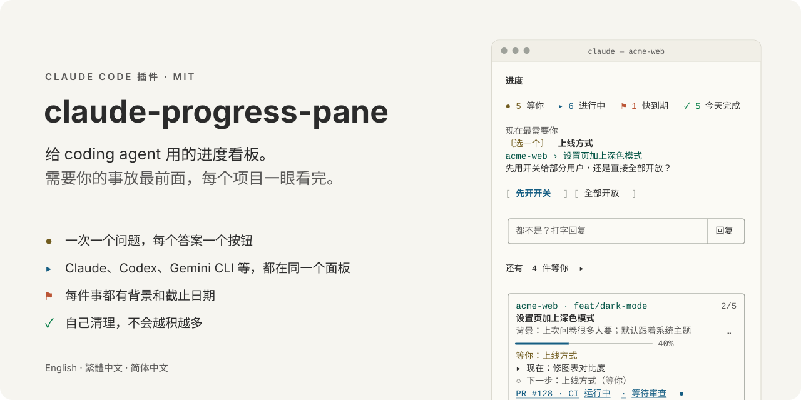
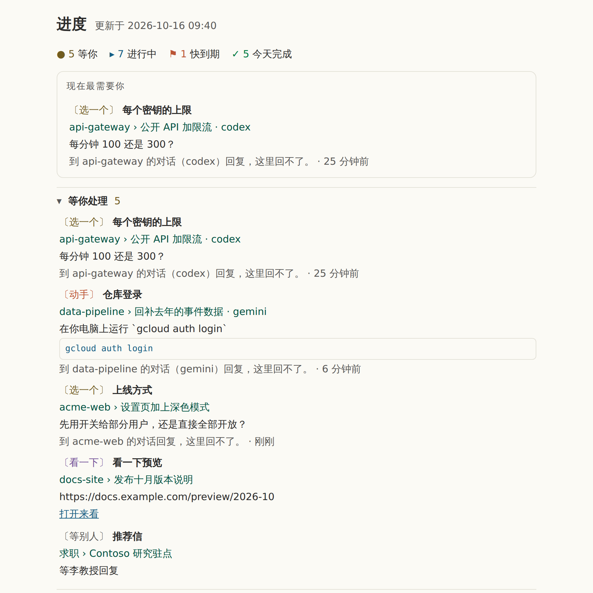
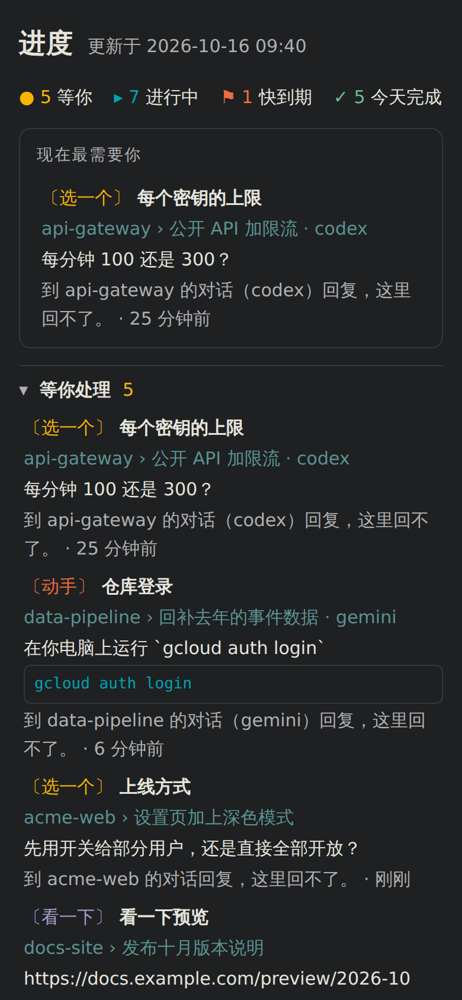
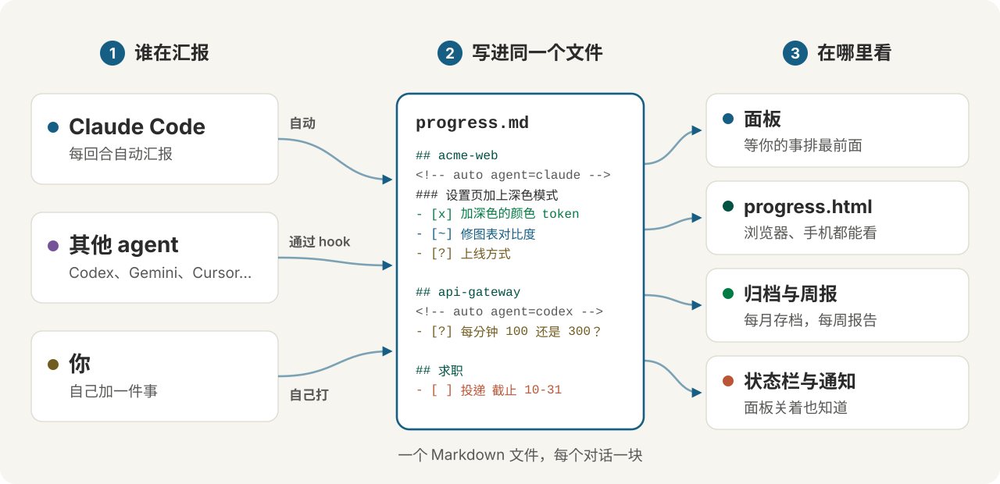

<h1 align="center">
<picture>
  <source media="(prefers-color-scheme: dark)" srcset="docs/images/hero-zh-CN-dark.svg">
  
</picture>
</h1>

**给 coding agent 用的进度看板。** 一个侧边面板列出每个项目的工作和每一步，把需要你处理的事放在最上面。它跟着 Claude Code 的 Task 清单走，不用手动改任何文件；Codex、Gemini、Cursor 或 shell 脚本也能把自己的工作放上来。

[English](README.md) · [繁體中文](README.zh-TW.md) · 简体中文

<p align="center">
  <picture>
    <source media="(prefers-color-scheme: dark)" srcset="docs/images/demo-zh-CN-dark.svg">
    
  </picture>
</p>

## 功能

- **先看需要你的事。** 面板打开时只显示一件事：现在最需要你处理的问题或截止日期。其他的（等你处理、快到期、其他进行中、最近完成）各折叠成一行，带上数字，点一下才展开。
- **按钮配合问题。** 每个等你处理的步骤都会归成一种，每一种有自己的操作：

  | 种类 | 示例步骤 | 你会得到 |
  |---|---|---|
  | 确认 | `部署第 214 版 — 要部署到 staging 吗？` | 好 · 不要 |
  | 选一个 | `密钥有效期 — 24 小时还是 7 天？` | 每个选项一个按钮，外加回复框 |
  | 动手 | ``初始化数据库 — 在你的电脑上运行 `make seed` 一次`` | 复制指令 · 做好了 |
  | 看一下 | `看一下预览 — https://example.com/preview` | 打开来看 · 没问题，外加一个写要改什么的框 |
  | 填资料 | `Staging 凭据 — 提供 staging 的 API key` | 回复框 |
  | 等别人 | `推荐信 — 等李教授回复` | 好了（等到了再按） |

  按下去的结果会直接当作你的回答，送回那个 Claude 对话。别的对话的问题会写明要到哪里回答；你手记的步骤只有一个按钮，按了就在文件里打勾。
- **每件事都有背景。** 每件事带一句说明它为什么要做的话（`背景：上次问卷很多人要`），Claude 给任务起名时一起写，所以你不会打开卡片，却想不起它是做什么的。
- **每个项目、每个 agent。** 一个 Markdown 文件，`~/.claude/progress.md`，每个对话一个区块。其他 agent 的区块会标上名字（`codex`、`gemini`），并说明要到哪里回复。代码以外的事，例如求职，可以手写进去，或用一行快速添加。
- **自己收拾干净。** 做完的工作半天后移到每月的归档文件，其他的三天后移。对话安静超过 12 小时会显示为对话已停，不再当作还在问你事情。文件里留的都是还没做完的事。已停的对话或手记的任务点开按**归档**，可以马上移走。
- **压缩后接得上。** Claude Code 压缩对话时，新的上下文会带着目标、完成几步、正在做的步骤和接下来的步骤，工作从原来的地方接着做。
- **自己的窗口。** `/progress open` 在浏览器打开 `progress.html`：同样的内容，做成会自己刷新的网页，跟着系统的浅色或深色模式，手机屏幕也放得下。
- **Pull request 和 CI。** 本机登录 [gh](https://cli.github.com) 的话，卡片会显示这个分支的 PR、它的检查和审查状态，CI 运行的时候会再重新检查。
- **不碍事。** 有步骤需要你、别的对话或 agent 在问你、事情今天到期或过期（一天一次）、清单做完、CI 跑完时会发桌面通知。开了几个对话都只通知一次。面板关着或终端太窄时，输入框下面有一行说明当前进度。
- **日志和周报。** 每完成一步都会记一笔。点 `周报` 把最近七天整理成纯文本（完成的、进行中的、等你处理的）并复制起来，可以直接带去站会。
- **任何主题都看得清。** 日本传统色（和色），深色终端一组、浅色终端一组，每种文字颜色对背景的对比度至少 4.5:1。不会有白底上的浅灰字。
- **English、繁體中文、简体中文。** 跟着 Claude Code 的语言设置，也可以自己选。

<table>
<tr>
<td width="68%"></td>
<td width="32%"></td>
</tr>
</table>

## 怎么运作

<picture>
  <source media="(prefers-color-scheme: dark)" srcset="docs/images/flow-zh-CN-dark.svg">
  
</picture>

所有内容都在一个纯 Markdown 文件里。每个 Claude Code 对话把自己的 Task 清单同步成其中一块；Codex、Gemini CLI、OpenCode、Cursor 照 AGENTS.md 那段说明维护自己的一块；其他的由你手写或用快速添加。面板、`progress.html`、每月归档与日志、状态栏都读这个文件，所以每个项目、每个 agent 都出现在同一个地方。格式是公开的：[docs/FORMAT.md](docs/FORMAT.md)（英文）。

## 开始使用

需要 Claude Code 2.1.287 或更高版本。在 2.1.301 和 2.1.302 上测试过。

### 1. 安装插件

在 Claude Code 终端对话的输入框里：

```
/plugin install project-progress --marketplace WenyuChiou/claude-progress-pane
```

回答 `y` 添加 marketplace，并选 user scope。或者从 shell 运行：

```
claude plugin marketplace add WenyuChiou/claude-progress-pane
claude plugin install project-progress@claude-progress-pane
```

### 2. 运行设置脚本

它会做两项插件自己做不到的设置，可以重复运行。

Windows（PowerShell）：

```powershell
powershell -ExecutionPolicy Bypass -File "$env:USERPROFILE\.claude\plugins\marketplaces\claude-progress-pane\scripts\setup.ps1"
```

macOS / Linux：

```bash
bash ~/.claude/plugins/marketplaces/claude-progress-pane/scripts/setup.sh
```

它做的事：

- **打开 Task 工具。** 新模型要设了 `CLAUDE_CODE_ENABLE_TODO_TOOLS=1` 才有 Claude Code 的 Task 工具，而面板就是跟着这些工具走。脚本把这个变量加进你的 shell 的 profile（PowerShell 是 `$PROFILE`；`~/.zshrc`、`~/.bashrc`、macOS 上是 `~/.bash_profile`，或 `~/.profile`）。不加进 `settings.json`：那里的 env 也会进到 Claude 桌面 app，而桌面 app 自己有一份待办清单。
- **打开自动更新**，这个 marketplace 的新版本会自己送到。你自己关掉的自动更新会保持关闭。
- **把旧的安装换过来**，如果你用过 zip 版。
- **帮你接上其他 agent（需要你开口）。** 加上 `--agents`（PowerShell 是 `-Agents auto`），它也会把汇报进度的说明交给 Codex、Gemini CLI 和 OpenCode（见[其他 agent](#其他-agent)）。

它改的每个文件都会先复制一份 `<文件名>.bak`。加上 `-NoInstall`（`--no-install`）可以跳过安装这一步。

### 3. 重新启动 Claude

打开一个**新的**终端窗口（让 profile 被读进去），运行 `claude`。面板会自己在右边打开。`/progress` 可以重新打开。

### 4. 照常工作

跟 Claude 说任何两步以上的事：

```
> 设置页加上深色模式，然后提 PR
```

Claude 会列出 Task 清单，面板跟着走：卡片显示任务、它的背景、进度条、正在做的步骤和下一步。Claude 需要你做决定时，问题会移到**现在最需要你**，附上对应的按钮。

### 5. 加入不是代码的事

在面板最下面的框里，输入一行以 `+` 开头的文字：

```
+ 求职：Fabrikam 研究资助 截止 11-20；改简历；投递
```

冒号前面是项目，`截止 MM-DD` 设定日期（到期前 14 天排进**快到期**），每个 `；` 开始一个步骤。也可以自己写进 `~/.claude/progress.md`（见[进度文件](#进度文件)）。

### 6. 打开窗口

```
/progress open
```

会在默认浏览器打开 `progress.html`。可以放在第二块屏幕上，它每 30 秒自己刷新一次。

### 7. 选语言

面板先看 Claude Code 的 `language` 设置，再看系统区域设置。要自己选：

```
/progress lang zh-CN        # 或 en、zh-TW、auto
```

或在 `/config` 里设置这个插件的 **Pane language**。

## 看懂面板

从上到下：

1. **数字。** `● 等你` · `▸ 进行中` · `⚑ 快到期` · `✓ 今天完成`。点每一个会展开它统计的那些项目。
2. **现在最需要你。** 一个最需要你处理的问题、截止日期或卡住的任务，写明它是关于什么、你可以怎么做。`还有 N 件等你 ▸` 会展开其余的。
3. **这个对话的卡片。** 项目和分支、任务、它的背景、进度条、当前的状况、正在做的步骤和下一步。`▸ 全部 N 步` 列出每一步，有编号，当前这步标着 `← 现在`。有 pull request 的话也显示在这里。
4. **折叠的区块。** 等你处理、快到期、其他进行中（按项目分组）、最近完成。点一行可以看它的步骤和可用的操作：**接手做完**（这个项目里已关闭的对话留下来的工作）、**复制续接指令**（在原来运行的地方重新打开那个对话）、**完成这步**和**交给 Claude**（你自己手动记的任务），两种都有**归档**，马上移出文件。
5. **输入框。** 问一句旁边的问题（在面板里回答，不打断 Claude），或以 `+` 开头添加任务。
6. **最下面一排。** 周报 · 通知：开／关 · 说明。

符号：

| 符号 | 意思 |
|---|---|
| `✓` | 完成 |
| `▸` | 正在做 |
| `○` | 还没做 |
| `●` | 等你 |
| `◐` | 在跑：CI、长时间运行的任务、别人 |
| `!` | 卡住 |
| `–` | 取消 |

## 命令

| 命令 | 作用 |
|---|---|
| `/progress` | 打开面板 |
| `/progress open` | 在浏览器打开 `progress.html` |
| `/progress add <line>` | 添加一件事，和在面板里输入 `+` 一样 |
| `/progress tidy` | 立刻归档做完的工作 |
| `/progress sync` | 重新读取 Claude 的 Task 清单和 PR |
| `/progress report` / `today` | 复制最近 7 天／今天的报告 |
| `/progress notify on` / `off` | 打开或关闭通知 |
| `/progress lang en` / `zh-TW` / `zh-CN` / `auto` | 选面板的语言 |

中文词也能用：`/progress 窗口`（或 `网页`）＝ `open`、`加`（或 `新增`）＝ `add`、`整理` ＝ `tidy`、`同步` ＝ `sync`、`周报` ＝ `report`、`今天` ＝ `today`、`通知 开`／`通知 关` ＝ `notify on`／`off`、`语言 zh-CN` ＝ `lang zh-CN`。

## 进度文件

所有内容都放在 `~/.claude/progress.md`（Windows 上是 `%USERPROFILE%\.claude\progress.md`；设置 `CLAUDE_PROGRESS_FILE` 可以改用别的路径）。它是可以直接读、直接改的纯 Markdown：

```markdown
# 项目进度

## acme-web

<!-- auto session=2be48af2 agent=claude state=waiting updated=2026-10-16T01:40:00Z pr=128 ci=pending -->
### 设置页加上深色模式
> 等你回复 · feat/dark-mode · PR #128 · CI 运行中
> 背景：上次问卷很多人要
- [x] 加深色的颜色 token
- [~] 修图表对比度
- [?] 上线方式 — 先用开关给部分用户，还是直接全部开放？
- [ ] 提 PR
<!-- /auto session=2be48af2 -->

## 求职

### Contoso 研究驻点
> 截止 10-31
- [x] 改简历
- [?] 推荐信 — 等李教授回复
- [ ] 投递
```

- 每个对话只改写自己的 `<!-- auto -->` 标记之间的行。其他一切（你手写的区段、笔记）一个字节都不动。
- 符号：`[x]` 完成、`[~]` 正在做、`[ ]` 还没做、`[?]` 等你、`[>]` 在跑、`[!]` 卡住、`[-]` 取消。` — ` 后面的文字是这一步的备注：它需要什么，或为什么卡住。
- `截止 MM-DD`（或 `due MM-DD`）写在任务上就有了日期：到期前 14 天排进快到期，3 天内变红。

给要读写这个文件的工具用的完整规范在 [docs/FORMAT.md](docs/FORMAT.md)（英文）。

## 其他 agent

任何能写文件的 agent 都可以把自己的工作显示在面板上。它只需要一段说明：[AGENTS.md](AGENTS.md)（英文）最后那一节 **"Report your progress to the progress pane"**。

**Codex、Gemini CLI、OpenCode：** 运行设置脚本时加上 `--agents`。它会把这段说明加进每个 agent 的全局指令文件，之后每个项目都会用到：

```bash
bash ~/.claude/plugins/marketplaces/claude-progress-pane/scripts/setup.sh --agents
```

```powershell
powershell -ExecutionPolicy Bypass -File "$env:USERPROFILE\.claude\plugins\marketplaces\claude-progress-pane\scripts\setup.ps1" -Agents auto
```

| Agent | 写入的文件 |
|---|---|
| Codex | `~/.codex/AGENTS.md`（`$CODEX_HOME`；如果 `AGENTS.override.md` 有内容就写进它） |
| Gemini CLI | `~/.gemini/GEMINI.md` |
| OpenCode | `~/.config/opencode/AGENTS.md` |

`--agents` 会处理这台电脑上装了的 agent；`--agents=codex,gemini`（`-Agents codex,gemini`）可以指定；`--remove-agents`（`-RemoveAgents`）会把这段删掉。这段说明放在 `<!-- claude-progress-pane:start -->` 和 `<!-- claude-progress-pane:end -->` 之间，文件其他内容保持不变。

**其他 agent**（Cursor、Aider、GitHub Copilot、Windsurf…）：把这段说明粘贴进项目的指令文件（`AGENTS.md`、`.cursorrules`、`CONVENTIONS.md`…）。

之后这个 agent 会维护一个自己的区块，面板会标上它的名字。它的问题和其他问题列在一起，并写明要到哪里回答；它要你运行的命令可以直接在面板上复制，链接也可以直接打开。

实测方式：让三个不同模型的 agent 只拿到这段说明，同时写同一个文件。面板把每个区块、agent 标签和问题种类都读对了，它们区块以外的内容一个字都没变。

## 它怎么保持整齐

| 项目 | 时机 |
|---|---|
| 做完的区块移到 `progress-archive-YYYY-MM.md` | 最后一次更新后 12 小时 |
| 其他区块也移到那里 | 最后一次更新后 3 天 |
| 手写、每一步都打勾的任务移到那里 | 面板第一次看到它做完后 24 小时 |
| 12 小时没有写入的对话 | 显示为对话已停；它的问题不再出现在现在最需要你 |
| 你在已停的对话或手记的任务按**归档** | 马上 |
| 归档后变空的 `##` 区段 | 会被移除；你自己留空的会保留 |

这个清理在对话开始时运行，之后每小时一次。`/progress tidy` 会立刻运行。

## 更新和卸载

自动更新打开时（设置脚本会帮你打开），新版本会自己送到。要手动更新：

```
claude plugin marketplace update claude-progress-pane
claude plugin update project-progress@claude-progress-pane
```

然后在运行中的对话里输入 `/reload-plugins`，或开新的对话。

要卸载：

```
claude plugin uninstall project-progress@claude-progress-pane
claude plugin marketplace remove claude-progress-pane
```

`progress.md`、它的归档文件和日志，以及 shell 的 profile 里那一行都会留着。

## 问题排查

- **面板说这个对话没有 Task 工具。** 运行设置脚本，然后从新的终端窗口启动 `claude`。一直拿不到这个变量的对话（桌面 app、Windows 上的 git-bash）还是可以手动维护 `progress.md`。
- **屏幕上没有面板。** 在终端的全屏布局里，面板从 144 列宽起会自己停靠在右边，用 `/progress` 的话从 110 列起。在 tmux 或 `CLAUDE_CODE_NO_FLICKER=0` 下，它会在输入框上方。云端对话不绘制面板。
- **PowerShell 警告执行策略。** PowerShell 要允许运行脚本才会执行你的 profile：`Set-ExecutionPolicy -Scope CurrentUser RemoteSigned`，然后再运行一次脚本。在那之前，这个变量会留在 `settings.json`。
- **私有 fork。** Claude Code 用你自己的 git 凭据 clone。运行一次 `gh auth login` 和 `gh auth setup-git`；没有 GitHub SSH key 的话，再设置 `CLAUDE_CODE_PLUGIN_PREFER_HTTPS=1`。
- **你的组织统一管理 Claude Code。** 在那种环境里，你自己装的插件收不到系统提示的 hook。运行设置脚本时加 `-KeepRule`（`--keep-rule`），改把规则留在 `~/.claude/CLAUDE.md`。

## 参与贡献

欢迎报告问题和提交 pull request。[CONTRIBUTING.md](CONTRIBUTING.md)（英文）有检查项和发布步骤，[AGENTS.md](AGENTS.md)（英文）有代码结构和约定，[docs/FORMAT.md](docs/FORMAT.md)（英文）是文件格式，它是公开接口。[CHANGELOG](CHANGELOG.md)（英文）列出每项变更和覆盖它的测试。

## 许可证

[MIT](LICENSE)
