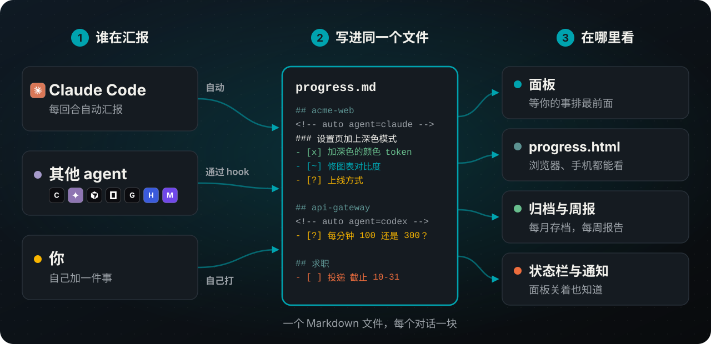

<h1 align="center">

</h1>

<p align="center">
<b>每个 AI coding agent 在做什么，一个面板看完；等你的事，永远排第一个。</b><br>
Claude Code 插件，也跟得上 Codex、Gemini CLI、OpenCode、Grok Build、Hermes Agent 和 OpenClaw，更多见<a href="#支持的-agent">下方</a>。
</p>

<p align="center">
<a href="CHANGELOG.md"></a>

<a href="LICENSE"></a>

</p>
<p align="center">
<a href="#支持的-agent"></a>
<a href="#支持的-agent"></a>
<a href="#支持的-agent"></a>
<a href="#支持的-agent"></a>
<a href="#支持的-agent"></a>
<a href="#支持的-agent"></a>
</p>

<p align="center"><a href="README.md">English</a> · <a href="README.zh-TW.md">繁體中文</a> · 简体中文</p>

你在一个项目开 Claude Code，另一个开 Codex，第三个开 Gemini。二十分钟后，其中一个停下来问你事情，你要等到刚好切回去才会发现。**Agent Board** 在它一开口就把问题放到你眼前，每个答案一个按钮。

## 功能

- **需要你的事排最前面。** 任何 agent 的问题都放在最上面，每个答案一个按钮。在 Claude Code 里点一下就回答了；其他 agent 则给你要贴过去的那句话或命令。已经在对话里回过了？点**已回复，先隐藏**，只在这台电脑上收起来，不会发出任何话；那个对话问了新的问题，它会再出现。
- **所有 agent 一处看。** 按项目分组，每个对话都有标题、一行背景和编号步骤，由每个回合的简短摘要自动写好。
- **随时接着做。** 对话压缩、终端关掉、第二天早上都没关系：做完什么、卡在哪、下一步是什么，打开就看到。做到一半停掉的对话，点一下就能接手。
- **你自己的待办也放得进来。** 在面板的输入框打 `+ 求职：Fabrikam 研究员 截止 11-20`。快到期会变黄，到期会变红。
- **不在终端也看得到。** `/progress open` 在浏览器打开同一个画面（手机也行）；其他 agent 会打开[可以点的网页](#看板的网页)，在上面勾步骤、归档、回答。面板关着时，状态栏和桌面通知会告诉你有事在等你。
- **周报。** `/progress report` 和 `/progress today` 把做完的事复制成文字。
- **自己清理。** 做完的事移到每月归档文件，日志留下每一步完成记录。
- **就是一个 Markdown 文件。** 全部在 `~/.claude/progress.md`，你可以自己看、自己改。支持 English、繁體中文、简体中文；浅色深色都有。

## 怎么运作



每个接上的 agent，hook 会把它最后的回复存进 `~/.claude/progress-inbox/`。开着的 Claude Code 对话五秒内读到，把那个回合整理好，写进 `progress.md` 里那个 agent 自己的一块，然后删掉那个文件。格式写在 [docs/FORMAT.md](docs/FORMAT.md)（英文）。

## 快速开始

**1. 安装**（需要 Claude Code 2.1.287 以上）：

```
claude plugin marketplace add WenyuChiou/agent-board
claude plugin install agent-board@agent-board
```

**2. 打开 Claude Code。** 面板在右边（没看到就输入 `/progress`）。第一次打开时，它会自动接上这台电脑装的所有 coding agent，并告诉你接了哪些；之后才装的 agent，下次打开 Claude Code 时也会自动接上。

**3. 重启其他 agent 一次**，让它们加载新的 hook。第一次时，Codex 要在 `/hooks` 里批准，Hermes Agent 会问你一次，回答 `y`。之后每个 agent 的回合几秒内就会出现。

<details>
<summary><b>或者让 agent 帮你装</b></summary>

把下面这段贴给 Codex、Gemini CLI、Cursor、Grok、Hermes、Muse，或任何能运行命令的 agent：

```text
帮我在这台电脑装 Claude Code 的 Agent Board 插件，并把这台电脑上的 coding agent 接上它。
依次运行这三行，任何一行失败就停下来告诉我：
claude plugin marketplace add WenyuChiou/agent-board
claude plugin install agent-board@agent-board
claude -p "/progress connect"
最后把最后一行打印的内容给我看，并告诉我要重启哪些 agent。
```

</details>

## 支持的 agent

在 Claude Code 里安装，之后 Claude Code 每次启动都会把这台电脑上装了的 agent 接上。顶端徽章用同样的分法：绿色是完全可用，黄绿色是部分可用。

**完全可用**：回合自己上看板，在它里面也叫得出看板。
- **Claude Code** 2.1.302，在面板里；问题点一下就回答
- **Codex** 0.163.0，打 `$agent-board`；第一次要在 Codex 的 `/hooks` 批准
- **Gemini CLI** 0.64.0，打 `/board`；第一次运行命令前会问一次
- **OpenCode** 1.19.3，打 `/board`

**部分可用**
- **Grok Build** 1.0.62：回合会上看板；在它里面打 `/agent-board` 还没验证
- **Hermes Agent** 0.19.0：两者都能用；第一次回答 `y`；单次的 `hermes -q` 提问会显示成已停，不是等你
- **OpenClaw** 2026.10.4：两者都能用；需要 2026.4.24 以上，会警告无法确认插件来源，但照样加载
- 网页版 **dot**、**Muse**：没有 hook，要把[一段提示](docs/REMOTE_REPORTERS.md#chat-relay-a-prompt-to-paste)贴进聊天，再把它写的每个区块贴进[看板的网页](#看板的网页)；在它们里面看不到看板
- **其他 agent**（Aider、Copilot、Windsurf…）：把 [AGENTS.md](AGENTS.md) 的一段贴进它的说明文件，它会自己写一块；在它里面看不到看板

**还不支持**
- **Cursor**：Windows 上它用 bash 运行所有 hook，其他工具的 PowerShell hook 挡住了它的回合；macOS、Linux 还没验证
- **Muse Code**：hook 按它的文档设置，`/agent-board` 技能放在它会读的 `~/.agents/skills`；两者都还没验证
- **Antigravity**：没有回合结束的 hook，回合上不了看板

### 按能力

✅ 可以用 · ⚠️ 可以用，限制见上 · ❔ 还没验证 · ❌ 还不支持

| | Agent | 回合上看板 | 在它里面看看板 | 验证版本 |
|:-:|---|:-:|:-:|---|
|  | **Claude Code** | ✅ | ✅ 面板 | 2.1.302 |
|  | **Codex** | ✅ | ✅ `$agent-board` | 0.163.0 |
|  | **Gemini CLI** | ✅ | ✅ `/board` | 0.64.0 |
|  | **OpenCode** | ✅ | ✅ `/board` | 1.19.3 |
|  | **Grok Build** | ✅ | ❔ `/agent-board` | 1.0.62 |
|  | **Hermes Agent** | ⚠️ | ✅ `/agent-board` | 0.19.0、0.16.0（Windows） |
|  | **OpenClaw** | ⚠️ | ✅ `/agent-board` | 2026.10.4 |
|  | **Cursor** | ❌ | ❔ `/agent-board` | 2026.10.16（Windows） |
|  | **Muse Code** | ❔ | ❔ `/agent-board` | |
| | **Antigravity** | ❌ | ❔ `/agent-board` | |
| | **dot**、**Muse**（网页版） | ⚠️ | ❌ | |
| | **其他 agent** | ⚠️ | ❌ | |

在 agent 里看到的看板是打印出来的文字：看得到全部，但不能点。所以看板命令也会在浏览器打开[看板的网页](#看板的网页)，在那里勾步骤、归档工作、复制回答，或回复已经结束的 Grok Build、Codex 对话。还开着的对话，在那个 agent 里回答。


## 每个 agent 里都看得到看板

接上时，每个 agent 也会拿到一个看看板的命令。不管你在哪一个里面，都看得到全部 agent 在做什么：

| 在 | 输入 |
|---|---|
| Gemini CLI、OpenCode | `/board` |
| Codex | `$agent-board` |
| OpenClaw、Hermes Agent | `/agent-board` |
| Grok Build、Cursor、Antigravity（还没验证） | `/agent-board` |
| 任何终端，开在任何 agent 旁边 | `node ~/.claude/agent-board.mjs --watch`（`--html` 在浏览器打开） |
| 浏览器，从任何 agent | `node ~/.claude/agent-board.mjs --serve` |

**像面板一样操作。** 在 agent 旁边开一个终端（分屏），运行 `node ~/.claude/agent-board.mjs --watch`：

| 按键 | 作用 |
|---|---|
| ↑ ↓、Enter | 选一行、展开 |
| `x` | 勾掉自己工作的下一步，并记进工作日志 |
| `a` | 归档自己的工作，或已停对话的区块 |
| `1`–`9`、`y`／`n` | 复制另一个 agent 问题的答案，贴到那个 agent |
| `c` | 复制命令，或接回提问那个对话的命令（没有命令就复制它的 ID） |
| `h`、`u` | 把另一个 agent 的问题标成已回复：只在这台电脑上隐藏，不发出任何话；把隐藏的全部重新显示 |
| `o`、`q` | 打开网页版；退出 |

做完的工作会自己离开看板。看板写 `progress.md` 跟面板一样小心；别的对话的区块不会动，除非你归档一个已经停掉的。


<table><tr>
<td></td>
<td></td>
</tr></table>

上图是 Codex 0.163.0 和 Gemini CLI 0.64.0（界面为繁体中文）；OpenCode 和终端的画面在[使用说明](docs/GUIDE.zh-CN.md#每个-agent-里都看得到看板)。

看板直接读 `progress.md`，不用开 Claude Code，只要 Node.js 18 以上：用 npm 安装的 Codex 和 Gemini CLI 会带着它，原生安装的 Codex 不会；`node --version` 找不到的话，就装一下 Node。少了它，对话开始时会说一次，`/progress connect status` 也看得到。其他 agent 的回合要有 Claude Code 对话开着才会整理成步骤；在那之前，看板照原样列出它们。

### 看板的网页

上面的看板命令会先打印看板，再在浏览器打开它的网页，最后一行是网址；在任何终端运行 `node ~/.claude/agent-board.mjs --serve` 也一样（加 `--no-open` 只打印网址）。再运行一次 `--serve` 会叫回已经开着的那一页。在网页上可以：

- **勾掉**自己工作的下一步、**归档**一件工作，或点**现在归档**把做完的全部收走。
- **复制**另一个 agent 问题的答案、问这个问题的对话 ID、对话的续接命令，或步骤里的命令。
- **已回复，先隐藏**：已经在它自己的对话里回过的问题。只在这台电脑上隐藏，网页、面板和终端看板都一样，不会发出任何话。那个对话问新的问题时会再出现；点**重新显示**可以提早叫回来。
- **回复**已经结束的 Grok Build 或 Codex 对话。回复会在那个对话自己的文件夹里运行 `grok -r <id>` 或 `codex exec resume <id>`，agent 回答后网页会显示它回了什么，可能要几分钟。同一个对话一次只发一条。还开着的对话要在它自己的窗口回答，因为两边同时写会把对话弄乱。
- **贴上区块**：从 Muse、dot 这类网页聊天来的。先从网页复制聊天提示，贴进聊天一次；之后把聊天打印出的每个区块贴进来。格式不对，或会覆盖 Claude 或其他 agent 区块的，会被拒绝。

网页只在 127.0.0.1 上监听（除非加上 `--lan`，见下文），网址里带一把随机钥匙，所以别的电脑、你开着的其他网页都用不了它。30 分钟没人看就会关，也可以点它的**关闭看板**；不过还有一条回复在发给 agent 的路上时，不会关。

**在手机上。** 网页的布局适合手机。要从和电脑连同一个 Wi-Fi 的手机打开，运行 `node ~/.claude/agent-board.mjs --serve --lan`：除了电脑本机的网址，它还会打印网页在你网络上的网址和它的二维码，用手机相机对着扫就好。电脑有不止一个网络地址时，用 `--lan 192.168.1.23` 指定一个。Windows 可能会问要不要让 Node.js 使用网络：在专用网络上允许，并确认 Windows 把你的 Wi-Fi 算作专用网络（刚连上的网络它会先当成公用网络），不然手机连不到网页。不在那个网络上时，通过 Remote Control 打开一个 Claude Code 对话，问它进度如何：它读的是同一份 `progress.md`。

网络上的网页有这些限制：

- 只有加了 `--lan` 才开，只开在电脑的私有地址上（开头是 192.168、10，或 172.16 到 172.31 的地址，绝不是公网地址），也只响应发到那个地址的请求。
- 它的网址带着自己的一把钥匙，不是电脑本机网页那把。拿到这个网址或拍到二维码的人，在它关掉之前都能用这个网页，所以只在信得过的网络上用，比如家里的 Wi-Fi，不要在咖啡店的。
- 在网络上，网页走的是没有加密的 HTTP，同一个 Wi-Fi 上的其他设备可能读到传过去的内容，包括 agent 的回答。所以手机可以勾步骤、归档、标成已回复（和重新显示）、复制、贴上区块和关闭看板，但不能回复 agent：回复会在电脑上运行一个程序，所以手机只显示答案让你复制，再从电脑本机的网页发出。
- 10 分钟没有手机来看就会关，电脑本机的网页关掉时也跟着关。开着的时候再运行一次 `--serve --lan`，拿到的是同一个网址。

## 命令

| 输入 | 用途 |
|---|---|
| `/progress` | 打开面板 |
| `/progress connect` | 现在就接上其他 agent，并看看改了什么；每个对话开始时也会自动做（`/progress connect remove` 去掉 hook 并停止自动接） |
| `+ 项目：标题 截止 11-20；步骤；步骤` | 在面板输入框加一件自己的事（或用 `/progress add …`） |
| `/progress open` | 在浏览器看 |
| `/progress report` / `/progress today` | 复制最近 7 天／今天的进度 |
| `/progress notify on` / `off` | 桌面通知 |
| `/progress lang zh-CN` | `en`、`zh-TW`、`zh-CN` 或 `auto` |
| `/progress tidy` | 现在就归档做完的工作，以及停太久的工作（见[使用说明](docs/GUIDE.zh-CN.md#它怎么保持整齐)） |

## 颜色与符号

面板跟着 Claude Code 的主题走。输入 `/config`，选 **Theme**：选浅色主题，面板就用浅色那组颜色；其他主题用深色那组。`progress.html` 跟着你电脑的浅色或深色模式。两组都是日本传统色（和色），选来让每个字都清楚好读。

| 符号 | 意思 | | 符号 | 意思 |
|:-:|---|---|:-:|---|
| ● | 等你 | | ◐ | 在跑，或在等别人 |
| ▸ | 正在做 | | ! | 卡住 |
| ○ | 还没做 | | ⚑ | 两周内到期 |
| ✓ | 完成 | | – | 取消 |

点面板最下面的“说明”，面板里也会列出这张表。

## 常见问题

<details>
<summary><b>一定要有其他 agent 吗？只用 Claude Code 可以吗？</b></summary>

可以。每个 Claude Code 对话都会自己出现；接上其他 agent 是可选的。
</details>

<details>
<summary><b>我是从 Codex（或其他 agent）装的，它看得到 Claude Code 在做什么吗？</b></summary>

看得到。插件装在 Claude Code 里，但接上时每个 agent 都会拿到看看板的命令（见[每个 agent 里都看得到看板](#每个-agent-里都看得到看板)），而看板读的就是所有 agent 共用的那个文件。想让其他 agent 的回合整理成步骤，就在某处开着一个 Claude Code 对话。
</details>

<details>
<summary><b>换了一台电脑，东西都没了吗？</b></summary>

不会没，但也不会自己搬过去：`progress.md`、收件箱和 hook 都只在各自的电脑上。在新电脑跑那三行安装命令，再重启 agent 就好。要带上以前的记录，就把 `~/.claude/progress.md` 和旁边的 `progress-archive-*.md`、`progress-journal-*.md` 复制过去。

想让两台电脑共用一个面板，就在两台都把 `CLAUDE_PROGRESS_FILE` 设成同步文件夹（OneDrive、Dropbox、iCloud）里的同一个文件。一次只用一台最稳：两台同时写，同步软件可能会留下冲突副本。
</details>

<details>
<summary><b>某个 agent 没出现。</b></summary>

1. 再运行一次 `/progress connect`，看它打印什么：它会列出接上了哪些 agent，以及哪些配置文件改不了。
2. 重启那个 agent，hook 是在启动时加载的。Codex 要在 `/hooks` 批准，Hermes Agent 会问一次。
3. 开着一个 Claude Code 对话：面板只在有对话开着时读收件箱。这段时间进来的回合会在那里等，最多两天。
4. 先关掉所有 Claude Code 对话（开着的对话几秒内就会读走并删掉文件），再看看 `~/.claude/progress-inbox/`。回合结束后没有新文件，就是 hook 没运行；有文件却没出现，请开 issue 附上那个文件。看板没能收下的回合（`progress.md` 写不进去，或模型没给摘要、回复里也没有提问）会以 `.taking` 文件留在那里，每 15 分钟再试一次；试满 8 次就改成 `.failed` 文件保留，不会删掉。不是有效 JSON、或没写是哪个对话的报告，会直接改成 `.failed` 文件保留，面板会告诉你在哪里；`.failed` 文件不会自动清掉，看完再自己删。
</details>

<details>
<summary><b>会把数据传出去吗？要花多少钱？</b></summary>

`progress.md`、收件箱和 `progress.html` 都留在你的电脑上。回合的摘要由 Claude Haiku 通过你自己的 Claude Code 登录来做：其他 agent 每个回合一次简短调用，没有 Task 清单的 Claude Code 对话也是。装了 GitHub 的 `gh` 的话，面板会用它查你的 pull request 状态。其他什么都不会发出去。详见 [SECURITY.md](SECURITY.md)（英文）。
</details>

<details>
<summary><b>Windows 能用吗？</b></summary>

可以：macOS、Linux、Windows，在终端、桌面版和 VS Code 都行。Windows 上的 hook 运行的是 PowerShell 脚本，不需要 `sh`。
</details>

<details>
<summary><b>以前用的是 <code>claude-progress-pane</code>。</b></summary>

插件在 0.10.0 改了名，不会自己换过去。按[从旧名称换过来](docs/GUIDE.zh-CN.md#从旧名称换过来)的步骤做就好，`progress.md` 不会动。
</details>

<details>
<summary><b>怎么卸载？</b></summary>

```
claude -p "/progress connect remove"
claude plugin uninstall agent-board@agent-board
claude plugin marketplace remove agent-board
```

第一行会把其他 agent 里的 hook 去掉。`progress.md` 会留着。
</details>

更多问题请看使用说明的[问题排查](docs/GUIDE.zh-CN.md#问题排查)。

## 文档

- [使用说明](docs/GUIDE.zh-CN.md)：设置脚本、看懂面板、所有命令、其他 agent、自动整理、问题排查
- [文件格式](docs/FORMAT.md)（英文）：`progress.md` 怎么写，给任何想写进去的程序
- [AGENTS.md](AGENTS.md)（英文）：代码结构，以及任何 agent 都能照着手动汇报的那一段
- [更新记录](CHANGELOG.md) · [参与贡献](CONTRIBUTING.md) · [安全性](SECURITY.md)

## 许可

[MIT](LICENSE)。agent 的图标来自 [Simple Icons](https://simpleicons.org)（CC0）和 [Lobe Icons](https://github.com/lobehub/lobe-icons)（MIT），商标属于各自的所有者；没有图标的 agent 以名字的第一个字母表示。
