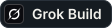
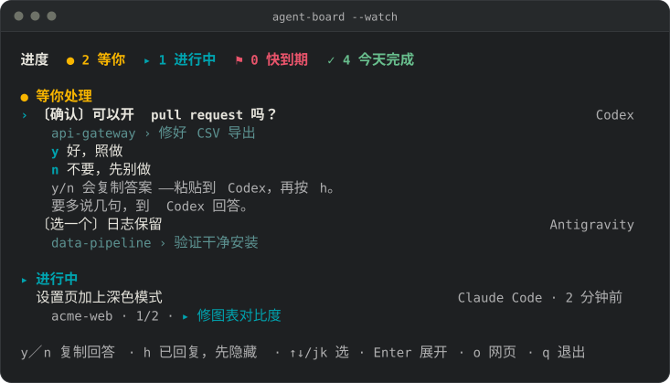
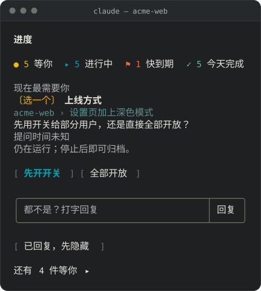

<h1 align="center">Agent Board</h1>

<p align="center"><b>每个 AI coding agent 在做什么，一个看板看完；哪个在等你，就在那里回它。</b></p>

<p align="center">

</p>

<p align="center"><b>集成</b><br>
<a href="#支持的-agent"></a>
<a href="#支持的-agent"></a>
<a href="#支持的-agent"></a>
<a href="#支持的-agent"></a>
<a href="#支持的-agent"></a>
<a href="#支持的-agent"></a>
<a href="#支持的-agent"></a>
<a href="#支持的-agent"></a>
<a href="#支持的-agent"></a>
<a href="#支持的-agent"></a>
</p>

<p align="center"><sub>dot 和其他网页聊天要自己汇报：把它们的区块贴进<a href="#看板的网页">看板的网页</a>。</sub></p>

<p align="center"><a href="LICENSE"></a></p>

<p align="center"><a href="README.md">English</a> · <a href="README.zh-TW.md">繁體中文</a> · 简体中文</p>

你在一个项目开 Claude Code，另一个开 Codex，第三个开 Antigravity，其中一个停下来问你事情，你要等到刚好切回去才会发现。**Agent Board** 在它一开口就把问题放到你眼前，每个答案一个按钮。它在你自己的电脑上运行，所有东西都放在一个 Markdown 文件里。

## 快速开始

需要 Node.js 22 以上，在任何终端运行：

```sh
npx @wenyuchiou/agent-board setup
npx @wenyuchiou/agent-board setup --apply
npx @wenyuchiou/agent-board --serve
```

第一行会找出这台电脑上装了哪些 agent，列出设置会改什么，不写入任何东西；第二行才真正写入；第三行打开看板网页。只设置一个 agent 的话，加上 `--agent` 和它的名字，例如 `--agent codex`。详见[安装指南](docs/SETUP.md#install-with-npm)（英文）。

然后：

- 给每个 agent 开一个新对话：原来就开着的对话不会接入。
- **Claude Code** 改用它的插件接入：`claude plugin marketplace add WenyuChiou/agent-board`，再运行 `claude plugin install agent-board@agent-board`。
- **Codex：** 到 `/hooks` 信任它的 hooks（[做法](docs/CODEX.md)）。
- **OpenCode、OpenClaw：** 重新加载它们的插件。
- **dot 和其他网页聊天：** 把 [AGENTS.md 最后一段](AGENTS.md#report-your-progress-to-the-progress-pane)贴进那个 agent 的指令，再把它写出的区块贴进[看板的网页](#看板的网页)。

<details>
<summary><b>不用 npm：用 git clone 安装</b></summary>

也可以 clone 这个仓库来安装，需要 Node.js 18 以上：

```sh
git clone https://github.com/WenyuChiou/agent-board.git
cd agent-board
node scripts/setup-agent.mjs
node scripts/setup-agent.mjs --apply
```

`setup-agent.mjs` 接受和 `npx @wenyuchiou/agent-board setup` 一样的选项，例如 `--agent codex`。在 Windows 上，请用它打印出来的完整路径。每个 agent 会写哪些文件，见[安装指南](docs/SETUP.md)（英文）。

</details>

<details>
<summary><b>让 agent 帮你安装</b></summary>

把下面这段贴给你正在用的 agent：

```text
帮我在这台电脑安装 https://github.com/WenyuChiou/agent-board 的 Agent Board。
先读 AGENTS.md、README 和安装指南，识别当前 host 和这台电脑已安装的其他 coding agent，再用共用安装程序 node scripts/setup-agent.mjs 预览。
保留现有设置和共享进度路径，按我对永久改动的确认要求，完成适用的 hooks、plugin 和看板命令；不要依赖或调用另一家 AI 来初始化。
完成 host 要求的限定范围信任授权并读回设置，让当前 session 报告自己的真实任务进度，打开交互看板。
CLI、桌面 App、IDE 的实际 hook 事件分开验收；装好了文件、传输被接受、收到 ACK，都不等于进度已经接通。
列出哪些现有 session 需要重新加载，以及尚未支持或未验收的部分。不要扫描私密对话，也不要悄悄跳过阻碍。
```

</details>

## 常用命令

### 在你的 agent 里打开看板

| | Agent | 看板命令 |
|:-:|---|---|
|  | Claude Code | `/progress` |
|  | Codex CLI 和 App | `$agent-board` |
|  | Antigravity | `/agent-board`（还没验证） |
|  | OpenCode | `/board` |
|  | Cursor | `/agent-board`（还没验证） |
|  | Grok Build | `/agent-board`（还没验证） |
|  | Muse Code | `/agent-board`（还没验证） |
|  | Hermes Agent | `/agent-board` |
|  | OpenClaw | `/agent-board` |
|  | DeepSeek Harness | `/agent-board`（还没验证） |

**Claude 桌面 App** 无法显示面板：底部状态栏会显示看板状态，`/progress` 会提供可回答问题、归档工作的[看板网页](#看板的网页)链接；网页无法启动时改开只读网页。看板网页需要 `/progress connect` 安装的看板脚本，或在下次会话开始时更新。

### 在任何地方打开看板

| 在哪里 | 命令 |
|---|---|
| 任何终端 | `node ~/.agent-board/agent-board.mjs --watch`（`--html` 在浏览器打开） |
| 浏览器 | `node ~/.agent-board/agent-board.mjs --serve` |
| 聊天软件（通过 Hermes Agent 或 OpenClaw） | `node ~/.agent-board/agent-board.mjs --chat` |
| 检查某个 agent 的设置 | `node ~/.agent-board/agent-board.mjs --codex-doctor --agent codex` |

**在聊天软件里，** `--chat` 把看板打印成纯文本，缩到一条消息放得下，没有网页也没有链接。它会把你的主目录显示成 `~`，并遮掉它认得的凭证形式，例如 `token=...`；其他形式的机密它识别不出来，所以别把机密写进看板。

<details>
<summary><b>终端看板的按键</b></summary>

**在终端里，** `--watch` 用起来跟面板一样：

| 按键 | 作用 |
|---|---|
| ↑ ↓、Enter | 选一行、展开 |
| `x` | 勾掉自己工作的下一步，并记进工作日志 |
| `d` | 确认自己的一件工作，或一个已停对话的工作，已经完成 |
| `a` | 归档自己的工作，或已停对话的区块 |
| `1`–`9`、`y`／`n` | 复制另一个 agent 问题的答案，贴到那个 agent |
| `c` | 复制命令，或接回提问那个对话的命令 |
| `h`、`u` | 把另一个 agent 的问题标成已回复：只在这台电脑上隐藏，不会发出任何内容；把隐藏的全部重新显示 |
| `i` | 展开或收起超过 7 天没动的工作 |
| `o`、`q` | 打开网页版；退出 |

做完的工作会自己离开看板。看板写 `progress.md` 跟面板一样小心；别的对话的区块不会动，除非你归档一个已经停掉的，或确认它已经完成。

</details>

## 支持的 agent

| | Agent | 在哪里运行 | 看板上有什么 | 从看板回复 |
|:-:|---|---|---|---|
|  | Claude Code | CLI | 它自己的面板：每件工作、每个回合 | 在面板里 |
|  | Codex | CLI、App | 六个 hooks，加上它报告的步骤 | 复制；可发送给[已连接的对话](docs/MESSAGING.md#codex-exclusive-owner-adapter) |
|  | Antigravity | CLI、App、IDE | 四个 hooks，加上它报告的步骤 | 复制；可发送给[已连接的 CLI](docs/MESSAGING.md#antigravity-exclusive-owner-cli-stream) |
|  | OpenCode | CLI | 对话事件，加上它的进度工具报告的步骤 | 复制 |
|  | Cursor | IDE、CLI | Hooks | 复制 |
|  | Grok Build | CLI | 四个 hooks | 复制；对话结束后可用 `--allow-resume` |
|  | Muse Code | CLI | 两个 hooks（停下、结束） | 复制 |
|  | Hermes Agent | 聊天软件 | 看板和它的 skill；它自己的 hooks 还没做好 | 复制 |
|  | OpenClaw | 聊天软件 | 它的插件发来的对话事件 | 复制 |
|  | DeepSeek Harness | CLI | 它的插件发来的对话事件 | 复制 |
| | dot、其他网页聊天 | 网页 | 你贴进来的区块 | 在它的对话里回 |

Hooks 只说对话在做事还是在等；步骤和什么时候算完成，来自 agent 自己的报告。Gemini CLI 仍保留为付费和企业用的目标（`--agent gemini`），见[安装指南](docs/SETUP.md#legacy-gemini-cli-compatibility)（英文）。

<details>
<summary><b>每个 agent 是怎么验证的</b></summary>

| Agent | 验证过 |
|---|---|
| Claude Code | CI 用 Claude Code 2.1.301 |
| Codex | 0.163.0-alpha.10.2 app-server（[记录](docs/validation/2026-10-19-native-hooks.md)）；CLI 有 0.23.5 实机测试；App 未验证 |
| Antigravity | Windows 上的 CLI（[记录](docs/validation/2026-10-19-native-hooks.md)）；App 能打开看板，但还不会报告提问（#285）；IDE 未验证 |
| OpenCode | Plugin SDK 1.19.3（[记录](docs/validation/2026-10-19-portable-hosts.md)） |
| Cursor | 未验证 |
| Grok Build | 1.0.62，搭配模拟模型 |
| Muse Code | 未验证 |
| Hermes Agent | 0.19.0，搭配模拟模型 |
| OpenClaw | 源代码契约和模拟回调（[记录](docs/validation/2026-10-19-portable-hosts.md)）；应用本身未验证 |
| DeepSeek Harness | 插件加载（[记录](docs/validation/2026-10-19-portable-hosts.md)）；应用本身未验证 |
| dot、其他网页聊天 | 未验证 |

“搭配模拟模型”是指真正的 agent 跑起来，但接的是替身模型。0.23.5 在各个应用上的实机测试见[对照记录](docs/validation/2026-10-20-parity-0.23.5.md)（英文）：当时 Codex CLI 和 OpenCode 的提问没有送到看板（0.23.5 之后已修复，#213），Antigravity App 的也没有（#285）。

</details>

## 你会看到什么

- **回复在等你的那一个。** 任何 agent 的问题都排在最上面，每个答案一个按钮。开启了消息功能（[`--messages-dir`](docs/MESSAGING.md#enable-locally)，英文说明）、对方的对话又有实时连接，点**发送**就送到；没有的话，点**复制**再贴回它的对话。
- **确认其他的还在动。** 每个 agent 的工作都显示现在做到哪一步、多久前报告过。超过一周没人动的工作收进一行 **N 项超过 7 天没动**。
- **收掉做完的和停掉的。** 做完的工作会自己移到每月归档文件。做到一半停掉的对话，可以归档、确认完成，或接手继续做。
- **不用切过去也能交代事情。** 在看板上写回复：开启了消息功能、对方又有连接，就直接发过去；没有的话看板帮你复制好，你再贴上。

**终端看板**（`--watch`），打开了 Codex 的问题：按 `y` 或 `n` 复制回答。



**Claude Code 的面板**，放在对话旁边：还是同一个看板，问题的答案变成按钮。



两张图都由看板自己的代码用合成数据画出。原生 hooks 的验收证据另有[记录](docs/validation/2026-10-19-native-hooks.md)。

### 看板的网页

上面的看板命令会在浏览器打开看板网页（在聊天软件里则只打印纯文本，没有链接）。在任何终端运行 `node ~/.agent-board/agent-board.mjs --serve` 也一样，再运行一次就会重新打开网页。在网页上可以：

- **回复**问题：开启了消息功能、对方的对话又在线，就直接**发送**，否则**复制**回复。
- **勾掉**下一步、**归档**一件工作，或点**现在归档**收走所有做完的。
- **已回复，先隐藏**：已在原来对话里回过的问题，只在这台电脑上隐藏，直到那个对话问新的问题；不会发出任何内容。
- **贴入区块**：把 Muse、dot 这类网页聊天的进度贴进来。

网页只在 127.0.0.1 上监听，网址带一串随机密钥：这台电脑上拿到链接的程序都能用。关掉标签页它还在运行，点**关闭看板**才停止。加上 `--lan` 就能用同一个 Wi-Fi 的手机打开：那条链接走没加密的 HTTP，拿到的人都能用这个网页，所以只在信得过的网络上用。细节和限制见[使用指南](docs/GUIDE.zh-CN.md#看板的网页)。

## 怎么运作


每个 agent 的 hooks 把它的对话正在做什么，写进本地同一个 `progress.md` 里它自己的区块（全新安装用 `~/.agent-board/progress.md`）。任务步骤只来自 agent 自己的报告，不读任何私人对话。看板读这个文件不需要调用模型；可选的 Claude 插件可以用 Claude 的模型总结每个回合，细节见[使用指南](docs/GUIDE.zh-CN.md#会把数据传出去吗要花多少钱)。这个文件你也可以自己看、自己改：[文件格式](docs/FORMAT.md)（英文）。支持 English、繁體中文、简体中文。

## 问题排查

先运行 doctor。它检查安装器替某个 agent 写了什么，不会改任何东西：

```sh
node ~/.agent-board/agent-board.mjs --codex-doctor --agent codex
```

`--agent` 后面换成那个 agent 的名字（doctor 对每个 agent 都沿用这个旧名称）。`installed` 表示文件都在，`ready` 表示这个 agent 有报告状态的 adapter。`connected` 一律是 `unverified`：只有新开的对话真的出现在看板上，才算证明接通了。

| 你看到 | 试试 |
|---|---|
| 某个 agent 没出现在看板上 | 开一个它的新对话；原来就开着的不会接入。Codex 还要先在 `/hooks` 信任它的 hooks。 |
| 装完之后什么都没变 | 不加 `--apply` 再运行一次 `npx @wenyuchiou/agent-board setup`（用 git clone 的话是 `node scripts/setup-agent.mjs`），看它列出的冲突和 `adapter-pending`；你改过的文件不会被覆盖，会列在那里。 |
| 还在运行旧版 | 运行中的对话会一直用它加载时的版本：开一个新的。更新方式见[使用指南](docs/GUIDE.zh-CN.md#更新和卸载)。 |
| 同一个 agent 出现两次 | 可能两种方式都接入了：Claude 插件的 `/progress connect` 和安装程序（setup）。`/progress connect status` 会列出插件接了哪些；用 `/progress connect remove` 或 `--codex-remove --agent <name>` 去掉其中一个。 |
| 有个问题一直不消失 | 在它自己的对话里回答，再点**已回复，先隐藏**（`h`）。3 天后它会移到**较早的未答问题**，7 天后移到**更早、尚未回答的问题**。 |

更多答案在使用指南的[常见问题](docs/GUIDE.zh-CN.md#常见问题)和[问题排查](docs/GUIDE.zh-CN.md#问题排查)。发现 bug？用 [bug 表单](https://github.com/WenyuChiou/agent-board/issues/new?template=bug_report.yml)提一个 issue，贴上 doctor 的输出，并照使用指南的[安全报告步骤](docs/GUIDE.zh-CN.md#安全地报告问题)做：不要带 session id、主目录路径或 token。

<details>
<summary><b>颜色和符号</b></summary>

面板跟着 Claude Code 的主题走（`/config`，再选 **Theme**）；网页和 `progress.html` 跟着你电脑的浅色或深色模式，直到你在页面右上角选了亮色或暗色。每个符号形状都不一样，不看颜色也分得出来；网页上还没做的步骤画成小圆点，不画圆圈，免得看起来像能点的按钮：

| 符号 | 意思 | | 符号 | 意思 |
|:-:|---|---|:-:|---|
| ● | 等你 | | ◐ | 在跑，或在等别人 |
| ▸ | 正在做 | | ! | 卡住 |
| ○ • | 还没做（面板是圆圈，网页是小圆点） | | ⚑ | 两周内到期 |
| ✓ | 完成 | | – | 取消 |

</details>

## 文档

| 读 | 用途 |
|---|---|
| 这份 README | 前五分钟 |
| [使用指南](docs/GUIDE.zh-CN.md) | 日常使用、按键、网页、更新和卸载、常见问题、问题排查 |
| [安装指南](docs/SETUP.md)（英文） | 安装器替每个 agent 写了什么 |
| [Codex](docs/CODEX.md) · [消息](docs/MESSAGING.md) · [文件格式](docs/FORMAT.md) · [本地交换](docs/LOCAL-EXCHANGE.md) · [远程报告](docs/REMOTE_REPORTERS.md)（均为英文） | 参考资料 |
| [AGENTS.md](AGENTS.md) · [参与贡献](CONTRIBUTING.md) · [安全](SECURITY.md)（均为英文） | 修改代码；非 Claude 的 agent 怎么手动报告 |

## 许可证

[MIT](LICENSE)。agent 的图标来自 [Simple Icons](https://simpleicons.org)（CC0）和 [Lobe Icons](https://github.com/lobehub/lobe-icons)（MIT），这些图标属于各自的所有者；没有图标的 agent 用名字的第一个字母表示。

<p align="center"><sub>版本 0.24.0 · <a href="CHANGELOG.md">更新日志</a></sub></p>
