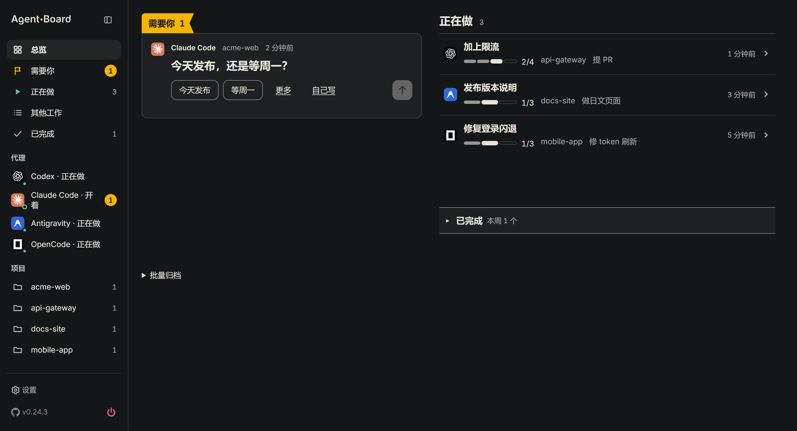
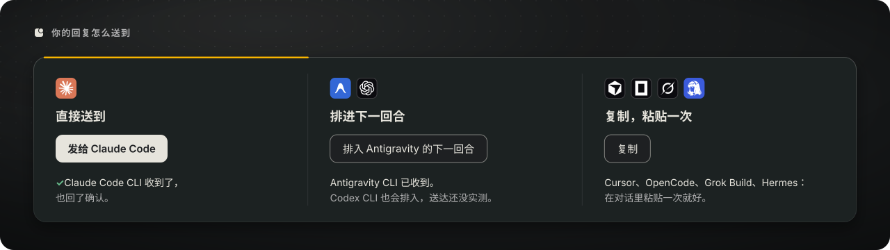
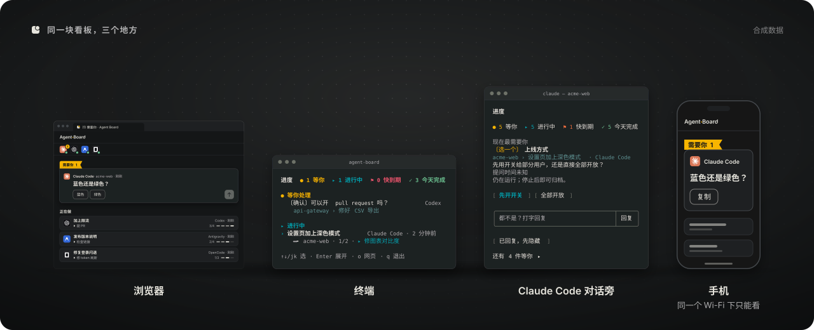
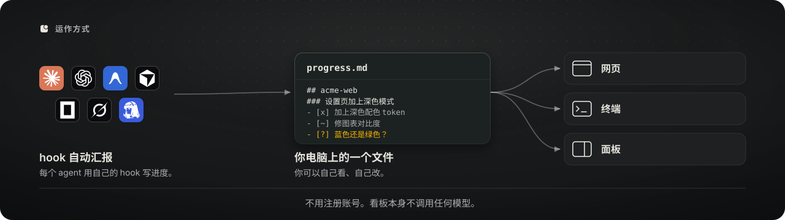

<h1 align="center"></h1>

<p align="center"><b>一块本机看板，告诉你哪个 AI agent 在等你回复</b></p>

<p align="center"><a href="LICENSE"></a> <a href="https://github.com/WenyuChiou/agent-board/actions/workflows/test.yml"></a> <a href="https://www.npmjs.com/package/@wenyuchiou/agent-board"></a></p>

<p align="center"><a href="README.md">English</a> · <a href="README.zh-TW.md">繁體中文</a> · 简体中文</p>

<p align="center">

</p>

Claude Code、Codex、Antigravity 等 AI agent 都向你电脑上的同一块看板汇报。哪个停下来问你，它的提问几秒内就排到最上面，不用再挨个窗口找。一个 Markdown 文件，不用账号。

## 快速开始

需要 Node.js 22 以上，在任何终端运行：

```sh
npx @wenyuchiou/agent-board@next setup
npx @wenyuchiou/agent-board@next
```

`setup` 会找出这台电脑上的 agent，列出它要改什么，只问一次（`Set these up? [Y/n]`）；回答 n 就什么都不写。没有终端可以回答时（例如在 agent 的对话里），它只预览，要写入就加 `--apply`。第二个命令打开看板；如果只有 Claude Code，要先装好它的插件：回答 y 会装，否则照下一段做。0.24.3 是预发布版，所以两个命令都用 `@next`。

接着做完你的 agent 需要的步骤（Claude Code 的插件、Codex 的 hooks 信任：[设置之后](docs/SETUP.md#after-setup-per-agent)，英文），再开一个它的新对话；原来就开着的不会接入。在里面输入 `/agent-board` 打开看板，Codex 是 `$agent-board`；Cursor 没有这种命令，改用第二个命令。

系统语言是繁体或简体中文时，看板就用中文，否则用英文；要自己选，在 setup 命令后加 `--lang en`、`--lang zh-TW` 或 `--lang zh-CN`。看板命令加 `--no-open`，只启动网页、不打开浏览器窗口。更多选项见[安装指南](docs/SETUP.md#install-with-npm)（英文）。不用 npm，或想让 agent 帮你装：[同一份指南](docs/SETUP.md#let-an-agent-install-it)。

## 你会得到什么

- **提问排最前面。** agent 在等你回复的提问会排到最上面；它给的选项读得出来，就每个选项一个按钮，否则自己输入回复。
- **每个 agent 留在原来的地方。** agent 继续在自己的终端里运行，看板读的是它们 hooks 的汇报。
- **在本机、纯文本。** 一个你可以自己看、自己改的 Markdown 文件，只在 127.0.0.1 的网页，看板本身不调用模型。
- **一个命令装、一个命令卸载。** `setup` 写入前先列出要改什么；`remove` 去掉 setup 写的东西，不动你自己的设置。



## 支持的 agent

下面七个 agent 有 0.24.3 的实测记录，都在 Windows 11 上测过（[对照记录](docs/validation/2026-11-10-parity-0.24.3.md)、[模拟用户](docs/validation/2026-11-10-usersim-0.24.3.md)，均为英文）。实机的行是在较早的 0.24.3 版本上跑的：之后对问题识别和设置的修复没有在上面重跑。标“未实机运行”的步骤就是没有实机跑过。

| | Agent | 在 agent 里打开看板 | 提问会上看板 | 你的回复 |
|:-:|---|---|---|---|
|  | Claude Code | `/agent-board` | 会 | **发送**，对话会确认 |
|  | Codex | `$agent-board`（未实机运行） | 会 | **排到下一轮**；0.24.3 没看到实际送达 |
|  | Antigravity | `/agent-board`（未实机运行） | 会 | **排到下一轮**；下一轮有收到 |
|  | Cursor | 没有；用终端命令 | 会 | **复制** |
|  | OpenCode | `/agent-board` | 会 | **复制** |
|  | Grok Build | `/agent-board`（未实机运行） | 会 | **复制** |
|  | Hermes Agent | `/agent-board` （用提示让它执行 skill） | 会 | **复制** |

0.24.3 没测：这些 agent 的桌面 app 和 IDE 扩展、OpenClaw、DeepSeek Harness（setup 仍会装它们）和 macOS。dot 和其他网页版聊天要手动汇报：[怎么做](docs/REMOTE_REPORTERS.md#chat-relay-a-prompt-to-paste)（英文）。

## 在看板上回复



**发送**把回复交给已连接的对话；对话回确认才代表收到。没有确认也可能已经送到，先看一下那个 agent 再用**复制**，免得它收到两次。**排到下一轮**会留到那个对话的下一轮才送，不会唤醒空闲中的对话，对话先结束的话可能被拒收，排队的消息过期也一样（Codex 在对照记录里就被拒收）。**复制**把回复放进剪贴板，由你粘贴到那个 agent。发送需要[开启消息功能](docs/MESSAGING.md#local-storage)（英文）。如果你已经在 agent 自己的窗口里回复了，点**已回复，先隐藏**就能收掉这张卡。

## 在哪里都能开



| 在哪里 | 怎么开 |
|---|---|
| agent 里 | `/agent-board`（Codex 是 `$agent-board`） |
| 终端 | `npx @wenyuchiou/agent-board`：桌面开网页，SSH 或没有显示器时开终端看板 |
| 同一个 Wi-Fi 的手机 | `npx @wenyuchiou/agent-board --lan`，扫它打印出的二维码。手机可以看、勾步骤、归档和关闭看板，但不能发送回复（它只显示回复让你复制）。请在信得过的网络使用：链接没有加密，拿到的人都能打开网页 |
| 让 agent 读看板 | `npx @wenyuchiou/agent-board --json`（[字段说明](docs/BOARD-JSON.md)，英文） |

## 怎么运作



每个 agent 的 hooks 把它的对话正在做什么，写进本机同一个 `progress.md` 里它自己的区块（全新安装用 `~/.agent-board/progress.md`；[文件格式](docs/FORMAT.md)，英文）。网页只监听 127.0.0.1，不用账号。看板不调用模型；可选的 Claude Code 插件会发出什么，见[使用指南](docs/GUIDE.zh-CN.md#会把数据传出去吗要花多少钱)。

## 更新和卸载

再运行一次 `npx @wenyuchiou/agent-board@next setup` 看更新会改什么，再加 `--apply` 应用；你改过的文件不会被覆盖。要卸载 setup 写的东西：

```sh
npx @wenyuchiou/agent-board@next remove
npx @wenyuchiou/agent-board@next remove --apply
```

你的记录会留在 `progress.md` 旁边；[更新和卸载](docs/GUIDE.zh-CN.md#更新和卸载)列出哪些会保留，另外可能留下几个小的缓存文件。想用较短的 `agent-board` 命令，运行一次 `npm install -g @wenyuchiou/agent-board`。

## 问题排查

| 你看到 | 试试 |
|---|---|
| 某个 agent 没出现在看板上 | 开一个它的新对话；原来就开着的不会接入。Codex 请以完整可执行文件路径运行 `npx @wenyuchiou/agent-board --codex-trust --codex-bin "<path-to-codex>" --json` 预览；先检查预览，确认同意后才加上 `--apply`。Codex CLI 也可使用 `/hooks`。 |
| 装完之后什么都没变 | 不加 `--apply` 再运行一次 `npx @wenyuchiou/agent-board@next setup`（用 git clone 的话是 `node scripts/setup-agent.mjs`），查看列出的冲突和接下来的步骤；你改过的文件不会被覆盖，会列在那里。 |
| 看板看起来是旧版 | 原来就开着的对话可能还在跑它加载时的版本：开一个那个 agent 的新对话。更新方式见[使用指南](docs/GUIDE.zh-CN.md#更新和卸载)。 |
| 同一个 agent 出现两次 | 可能同时被 Claude 插件和 setup 接入：[要去掉哪个](docs/GUIDE.zh-CN.md#问题排查)。 |

检查某个 agent 的设置：`node "$HOME/.agent-board/agent-board.mjs" --codex-doctor --agent codex`（也可用 `cursor`、`opencode`、`grok`、`hermes`、`antigravity`，其余见[使用指南](docs/GUIDE.zh-CN.md#问题排查)），它不会改任何东西。Claude Code 请运行 `claude plugin list` 和 `/progress connect status`。更多答案在使用指南的[常见问题](docs/GUIDE.zh-CN.md#常见问题)和[问题排查](docs/GUIDE.zh-CN.md#问题排查)。发现 bug？用 [bug 表单](https://github.com/WenyuChiou/agent-board/issues/new?template=bug_report.yml)提一个 issue，并照[安全报告步骤](docs/GUIDE.zh-CN.md#安全地报告问题)做：不要带 session id、主目录路径或 token。

## 文档

| 读 | 用途 |
|---|---|
| [使用指南](docs/GUIDE.zh-CN.md) | 日常使用、按键、网页、设置、更新和卸载、常见问题 |
| [安装指南](docs/SETUP.md)（英文） | 安装器替每个 agent 写了什么 |
| [Codex](docs/CODEX.md) · [消息](docs/MESSAGING.md) · [文件格式](docs/FORMAT.md) · [远程报告](docs/REMOTE_REPORTERS.md)（均为英文） | 参考资料 |
| [AGENTS.md](AGENTS.md) · [参与贡献](CONTRIBUTING.md) · [安全](SECURITY.md)（均为英文） | 修改代码；非 Claude 的 agent 怎么手动报告 |

## 许可证

[MIT](LICENSE)。agent 的图标来自 [Simple Icons](https://simpleicons.org)（CC0）和 [Lobe Icons](https://github.com/lobehub/lobe-icons)（MIT），这些图标属于各自的所有者；没有图标的 agent 用名字的第一个字母表示。

<p align="center"><a href="CHANGELOG.md"></a><br><sub>最新稳定版本 0.24.2 · 0.24.3 是预发布版（<code>npx @wenyuchiou/agent-board@next setup</code>）· <a href="CHANGELOG.md">更新日志</a> · 0.24.3 未测试 macOS。</sub></p>
