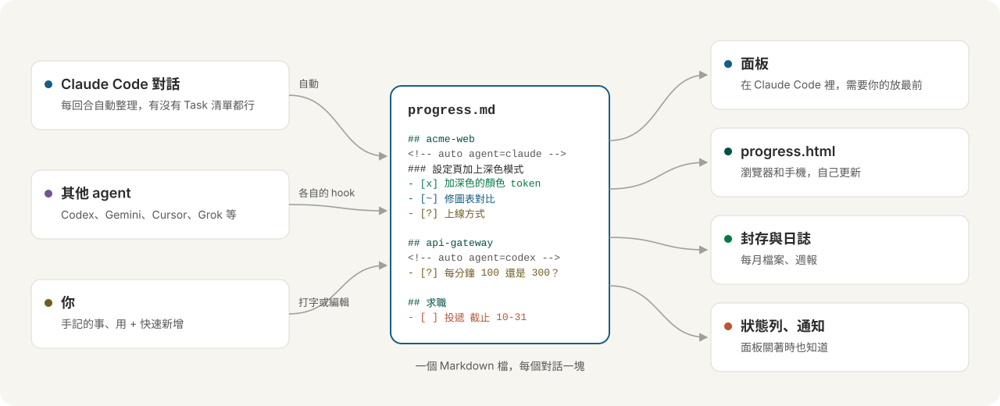

<h1 align="center">
<picture>
  <source media="(prefers-color-scheme: dark)" srcset="docs/images/tour-zh-TW-dark.svg">
  
</picture>
</h1>

[English](README.md) · 繁體中文 · [简体中文](README.zh-CN.md)

**Agent Board** 給同時開好幾個 AI coding agent 的人用。哪個 agent 在等你，一看就知道，不會再讓它們乾等。

## 為什麼需要它

一個專案開 Claude Code，另一個開 Codex，可能還有一個在跑 Gemini。過了二十分鐘，其中一個停下來問你事情，你卻要等到剛好切回去才發現。這個面板會在它一開口的時候，就把問題放到你眼前。

- **再也不會漏掉問題。** 等你的事排在最上面，每個答案一個按鈕，按下去 agent 就繼續做。
- **你現在用的 agent 都接得上。** Claude Code、Codex、Gemini CLI、Cursor、OpenCode、Grok Build、Muse Code。一行指令接上，之後它們會自己回報，不用另外交代。
- **隨時都能接著做。** 對話壓縮、終端機關掉、隔天再開都沒關係，做完什麼、卡在哪、下一步是什麼，打開就看到。誰做到一半停了，你也能直接接手。

## 安裝

```
claude plugin marketplace add WenyuChiou/agent-board
claude plugin install agent-board@agent-board
claude -p "/progress connect"
```

最後一行會把你電腦上其他的 agent 接上。接完把它們重開（Codex 第一次會請你在它的 `/hooks` 裡按核准）。然後打開 Claude Code，面板就在右邊。

**或者讓 agent 幫你裝。** 把下面這段貼給 Codex、Gemini CLI、Cursor、Grok、Muse，或任何能執行指令的 agent：

```text
幫我在這台電腦裝 Claude Code 的 Agent Board 外掛，並把這台電腦上的 coding agent 接上它。
依序執行這三行，任何一行失敗就停下來告訴我：
claude plugin marketplace add WenyuChiou/agent-board
claude plugin install agent-board@agent-board
claude -p "/progress connect"
最後把最後一行印出的內容給我看，並告訴我要重開哪些 agent。
```

用的是 Aider、Copilot 或 Windsurf？把 [AGENTS.md](AGENTS.md) 裡「Report your progress to the progress pane」那段貼進它的說明檔，它也會回報。

## 用法

| | |
|---|---|
| 照常工作就好 | 每個對話會自己出現：做到哪、為什麼做、在等什麼 |
| `+ 求職：Fabrikam 研究員 截止 11-20` | 在面板的輸入框：加一件自己的事 |
| `/progress open` | 在瀏覽器看同一個畫面 |
| `/progress connect` | 把其他 agent 接上面板 |
| `/progress report` | 複製最近七天的進度 |
| `/progress lang zh-TW` | `en`、`zh-TW`、`zh-CN` 或 `auto` |

## 怎麼運作

<picture>
  <source media="(prefers-color-scheme: dark)" srcset="docs/images/flow-zh-TW-dark.svg">
  
</picture>

所有東西都在一個 Markdown 檔裡：`~/.claude/progress.md`，你也可以自己打開來改。格式寫在 [docs/FORMAT.md](docs/FORMAT.md)（英文）。

## 更多

[使用說明](docs/GUIDE.zh-TW.md)（安裝腳本、看懂面板、所有指令、自動整理、疑難排解）· [參與貢獻](CONTRIBUTING.md) · [更新紀錄](CHANGELOG.md) · [MIT](LICENSE)
