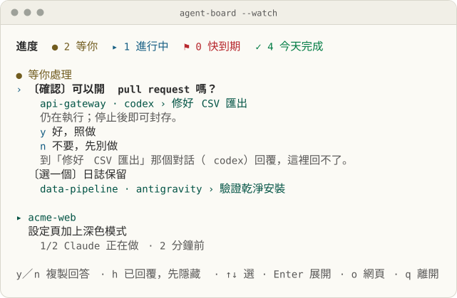
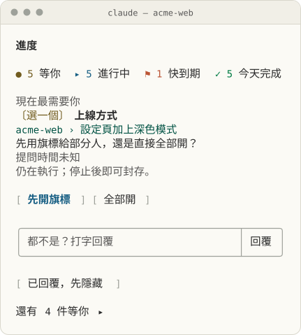

<h1 align="center">Agent Board</h1>

<p align="center"><b>每個 AI coding agent 在做什麼，一個看板看完；哪個在等你，就在那裡回它。</b></p>

<p align="center">
<picture><source media="(prefers-color-scheme: dark)" srcset="docs/images/cover-zh-TW-dark.svg"></picture>
</p>

<p align="center">
<a href="#快速開始"></a>
<a href="LICENSE"></a>
</p>

<p align="center"><a href="README.md">English</a> · 繁體中文 · <a href="README.zh-CN.md">简体中文</a></p>

你在一個專案開 Claude Code，另一個開 Codex，第三個開 Antigravity；其中一個停下來問你事情，你要等到剛好切回去才會發現。**Agent Board** 在它一開口就把問題放到你眼前，每個答案一個按鈕。它在你自己的電腦上跑，所有東西都放在一個 Markdown 檔裡。

## 快速開始

需要 Node.js 22 以上。在任何終端機執行：

```sh
npx @wenyuchiou/agent-board setup
npx @wenyuchiou/agent-board setup --apply
npx @wenyuchiou/agent-board --serve
```

第一行會找出這台電腦上裝了哪些 agent，列出設定會改什麼，不會寫入任何東西。第二行才真的寫入，第三行打開看板網頁。接著為每個 agent 開一個新對話：原本就開著的對話不會接上。只想設定其中一個 agent，就加上 `--agent` 和它的名字，例如 `--agent codex`；Claude Code 則改用它的外掛接上（見[常用指令](#常用指令)）。更多細節見[安裝指南](docs/SETUP.md#install-with-npm)（英文）。

<details>
<summary><b>不用 npm：用 git clone 安裝</b></summary>

也可以 clone 這個 repository 來安裝，需要 Node.js 18 以上：

```sh
git clone https://github.com/WenyuChiou/agent-board.git
cd agent-board
node scripts/setup-agent.mjs
node scripts/setup-agent.mjs --apply
```

`setup-agent.mjs` 接受的選項和 `npx @wenyuchiou/agent-board setup` 一樣，例如 `--agent codex`。在 Windows 上，請用它印出來的完整路徑。每個 agent 會寫哪些檔案，見[安裝指南](docs/SETUP.md)（英文）。

</details>

<details>
<summary><b>讓 agent 幫你安裝</b></summary>

把下面這段貼給你正在用的 agent：

```text
幫我在這台電腦安裝 https://github.com/WenyuChiou/agent-board 的 Agent Board。
先讀 AGENTS.md、README 與安裝指南，辨識目前的 host 和這台電腦已安裝的其他 coding agent，再用共用安裝程式 node scripts/setup-agent.mjs 預覽。
保留既有設定與共用進度路徑，依我對永久改動的確認要求，完成適用的 hooks、plugin 與看板指令；不要依賴或呼叫另一家 AI 來初始化。
完成 host 要求的限定範圍信任授權並讀回設定，讓目前 session 回報自己的真實任務進度，開啟互動看板。
CLI、桌面 App、IDE 的實際 hook 事件分開驗收；安裝了檔案、傳輸被接受、收到 ACK，都不等於進度已經接通。
列出哪些既有 session 需要重新載入，以及尚未支援或未驗收的部分。不要掃描私密對話，也不要遇到阻礙就默默略過。
```

</details>

## 常用指令

| | 在哪裡 | 怎麼接上 | 打開看板 |
|:-:|---|---|---|
|  | Claude Code | `claude plugin marketplace add WenyuChiou/agent-board`<br>`claude plugin install agent-board@agent-board` | `/progress` |
|  | Codex CLI 與 App | 先[執行 setup](#快速開始)，再到 `/hooks` 信任它的 hooks（[做法](docs/CODEX.md)） | `$agent-board` |
|  | OpenCode | 先[執行 setup](#快速開始)，再重新載入它的 plugin | `/board` |
|   | Hermes Agent、OpenClaw | [執行 setup](#快速開始)，OpenClaw 還要重新載入 plugin | `/agent-board` |
|      | Antigravity、Cursor、Grok Build、Muse Code、DeepSeek Harness | [執行 setup](#快速開始) | `/agent-board`（還沒驗證） |
| | dot 和其他網頁聊天 | 把 [AGENTS.md 最後一段](AGENTS.md#report-your-progress-to-the-progress-pane)貼進那個 agent 的指示 | 把它的區塊貼進[看板的網頁](#看板的網頁) |
| | 任何終端機 | — | `node ~/.agent-board/agent-board.mjs --watch`（`--html` 在瀏覽器開） |
| | 瀏覽器 | — | `node ~/.agent-board/agent-board.mjs --serve` |
| | 聊天軟體（透過 Hermes Agent 或 OpenClaw） | — | `node ~/.agent-board/agent-board.mjs --chat` |
| | 檢查某個 agent 的設定 | — | `node ~/.agent-board/agent-board.mjs --codex-doctor --agent codex` |

**在聊天軟體裡，** `--chat` 把看板印成純文字，縮到一則訊息放得下，沒有網頁也沒有連結。它會把你的家目錄顯示成 `~`，並遮掉它認得的憑證形式，例如 `token=...`；其他形式的機密它辨識不出來，所以別把機密寫進看板。

**Claude 桌面 App** 無法顯示面板：底部狀態列會顯示看板狀態，`/progress` 會提供可回覆問題、封存工作的[看板網頁](#看板的網頁)連結；網頁無法啟動時改開唯讀網頁。看板網頁需要 `/progress connect` 安裝的看板腳本，或在下次工作階段開始時更新。

<details>
<summary><b>終端機看板的按鍵</b></summary>

**在終端機裡，** `--watch` 用起來跟面板一樣：

| 按鍵 | 作用 |
|---|---|
| ↑ ↓、Enter | 選一行、展開 |
| `x` | 勾掉自己工作的下一步，並記進工作日誌 |
| `d` | 確認自己的一件工作，或一個已停對話的工作，已經完成 |
| `a` | 封存自己的工作，或已停對話的區塊 |
| `1`–`9`、`y`／`n` | 複製另一個 agent 問題的答案，貼到那個 agent |
| `c` | 複製指令，或接回提問那個對話的指令 |
| `h`、`u` | 把另一個 agent 的問題標成已回覆：只在這台電腦上隱藏，不會送出任何內容；把隱藏的全部重新顯示 |
| `i` | 展開或收起超過 7 天沒動的工作 |
| `o`、`q` | 打開網頁版；離開 |

做完的工作會自己離開看板。看板寫 `progress.md` 跟面板一樣小心；別的對話的區塊不會動，除非你封存一個已經停掉的，或確認它已經完成。

</details>

## 支援的 agent

<p>         </p>

| | Agent | 在哪裡跑 | 看板上有什麼 | 從看板回覆 |
|:-:|---|---|---|---|
|  | Claude Code | CLI | 它自己的面板：每件工作、每個回合 | 在面板裡 |
|  | Codex | CLI、App | 六個 hooks，加上它回報的步驟 | 複製；可傳送給[已連線的對話](docs/MESSAGING.md#codex-exclusive-owner-adapter) |
|  | Antigravity | CLI、App、IDE | 四個 hooks，加上它回報的步驟 | 複製；可傳送給[已連線的 CLI](docs/MESSAGING.md#antigravity-exclusive-owner-cli-stream) |
|  | OpenCode | CLI | 對話事件，加上它的進度工具回報的步驟 | 複製 |
|  | Cursor | IDE、CLI | Hooks | 複製 |
|  | Grok Build | CLI | 四個 hooks | 複製；對話結束後可用 `--allow-resume` |
|  | Muse Code | CLI | 兩個 hooks（停下、結束） | 複製 |
|  | Hermes Agent | 聊天軟體 | 看板和它的 skill；它自己的 hooks 還沒做好 | 複製 |
|  | OpenClaw | 聊天軟體 | 它的 plugin 送來的對話事件 | 複製 |
|  | DeepSeek Harness | CLI | 它的 plugin 送來的對話事件 | 複製 |
| | dot、其他網頁聊天 | 網頁 | 你貼進來的區塊 | 在它的對話裡回 |

Hooks 只說對話在做事還是在等；步驟和什麼時候算完成，來自 agent 自己的回報。Gemini CLI 仍保留為付費與企業用的目標（`--agent gemini`），見[安裝指南](docs/SETUP.md#legacy-gemini-cli-compatibility)（英文）。

<details>
<summary><b>各個 agent 是怎麼驗證的</b></summary>

| Agent | 驗證過 |
|---|---|
| Claude Code | CI 用 Claude Code 2.1.301 |
| Codex | 0.163.0-alpha.10.2 app-server（[紀錄](docs/validation/2026-10-19-native-hooks.md)）；CLI 有 0.23.5 實機測試；App 未驗證 |
| Antigravity | Windows 上的 CLI（[紀錄](docs/validation/2026-10-19-native-hooks.md)）；App 能打開看板，但還不會回報提問（#285）；IDE 未驗證 |
| OpenCode | Plugin SDK 1.19.3（[紀錄](docs/validation/2026-10-19-portable-hosts.md)） |
| Cursor | 未驗證 |
| Grok Build | 1.0.62，搭配模擬模型 |
| Muse Code | 未驗證 |
| Hermes Agent | 0.19.0，搭配模擬模型 |
| OpenClaw | 原始碼契約與模擬回呼（[紀錄](docs/validation/2026-10-19-portable-hosts.md)）；應用程式本身未驗證 |
| DeepSeek Harness | Plugin 載入（[紀錄](docs/validation/2026-10-19-portable-hosts.md)）；應用程式本身未驗證 |
| dot、其他網頁聊天 | 未驗證 |

「搭配模擬模型」是指真正的 agent 跑起來，但接的是替身模型。0.23.5 在各個應用程式上的實機測試見[對照紀錄](docs/validation/2026-10-20-parity-0.23.5.md)（英文）：當時 Codex CLI 和 OpenCode 的提問沒有送到看板（0.23.5 之後已修好，#213），Antigravity App 的也沒有（#285）。

</details>

## 你會看到什麼

- **回覆在等你的那一個。** 任何 agent 的問題都排在最上面，每個答案一個按鈕。開了訊息功能（[`--messages-dir`](docs/MESSAGING.md#enable-locally)，英文說明）、對方的對話又有即時連線，按**傳送**就送到；沒有的話，按**複製**再貼回它的對話。
- **確認其他的還在動。** 每個 agent 的工作都顯示現在做到哪一步、多久前回報過。超過一週沒人動的工作收進一行 **N 項超過 7 天沒動**。
- **收掉做完的和停掉的。** 做完的工作會自己移到每月封存檔。做到一半停掉的對話，可以封存、確認完成，或接手繼續做。
- **不用切過去也能交代事情。** 在看板上打回覆：開了訊息功能、對方又有連線，就直接送過去；沒有的話看板幫你複製好，你再貼上。

**終端機看板**（`--watch`），打開了 Codex 的問題：按 `y` 或 `n` 複製回答。

<picture><source media="(prefers-color-scheme: dark)" srcset="docs/images/board/codex-zh-TW-dark.svg"></picture>

**Claude Code 的面板**，在對話旁邊：同一個看板，問題的答案都做成按鈕。

<picture><source media="(prefers-color-scheme: dark)" srcset="docs/images/pane-zh-TW-dark.svg"></picture>

兩張圖都由看板自己的程式碼用合成資料畫出。原生 hooks 的驗收證據另有[紀錄](docs/validation/2026-10-19-native-hooks.md)。

### 看板的網頁

上面的看板指令會在瀏覽器打開看板網頁（在聊天軟體裡則只印出純文字，沒有連結）。在任何終端機跑 `node ~/.agent-board/agent-board.mjs --serve` 也一樣，再跑一次就會重新打開網頁。在網頁上可以：

- **回覆**問題：開了訊息功能、對方的對話又在線，就直接**傳送**，否則**複製**回覆。
- **勾掉**下一步、**封存**一件工作，或按**現在封存**收走所有做完的。
- **已回覆，先隱藏**：已在原本對話回過的問題，只在這台電腦上隱藏，直到那個對話問新的問題；不會送出任何東西。
- **貼入區塊**：把 Muse、dot 這類網頁聊天的進度貼進來。

網頁只監聽 127.0.0.1，網址帶一組隨機金鑰：這台電腦上拿到連結的程式都能用。關掉分頁它還在跑，按**關閉看板**才停。加上 `--lan` 就能用同一個 Wi-Fi 的手機打開：那條連結走沒加密的 HTTP，拿到的人都能用這個網頁，所以只在信得過的網路上用。細節和限制見[使用指南](docs/GUIDE.zh-TW.md#看板的網頁)。

## 怎麼運作


每個 agent 的 hooks 把它的對話正在做什麼，寫進本機同一個 `progress.md` 裡它自己的區塊（全新安裝用 `~/.agent-board/progress.md`）。任務步驟只來自 agent 自己的回報，不讀任何私人對話。看板讀這個檔不需要呼叫模型；選用的 Claude 外掛可以用 Claude 的模型總結每個回合，細節見[使用指南](docs/GUIDE.zh-TW.md#會把資料傳出去嗎要花多少錢)。這個檔你也可以自己看、自己改：[檔案格式](docs/FORMAT.md)（英文）。支援 English、繁體中文、简体中文。

## 疑難排解

先跑 doctor。它檢查安裝器替某個 agent 寫了什麼，不會改任何東西：

```sh
node ~/.agent-board/agent-board.mjs --codex-doctor --agent codex
```

`--agent` 後面換成那個 agent 的名字（doctor 對每個 agent 都沿用這個舊名稱）。`installed` 表示檔案都在，`ready` 表示這個 agent 有回報狀態的 adapter。`connected` 一律是 `unverified`：只有新開的對話真的出現在看板上，才算證明接通了。

| 你看到 | 試試 |
|---|---|
| 某個 agent 沒出現在看板上 | 開一個它的新對話；原本就開著的不會接上。Codex 還要先在 `/hooks` 信任它的 hooks。 |
| 裝完之後什麼都沒變 | 不加 `--apply` 再跑一次 `npx @wenyuchiou/agent-board setup`（用 git clone 的話是 `node scripts/setup-agent.mjs`），看它列出的衝突和 `adapter-pending`；你改過的檔案不會被覆蓋，會列在那裡。 |
| 還在跑舊版 | 跑著的對話會一直用它載入時的版本：開一個新的。更新方式見[使用指南](docs/GUIDE.zh-TW.md#更新與移除)。 |
| 同一個 agent 出現兩次 | 可能兩種方式都接上了：Claude 外掛的 `/progress connect` 和安裝程式（setup）。`/progress connect status` 會列出外掛接了哪些；用 `/progress connect remove` 或 `--codex-remove --agent <name>` 拿掉其中一個。 |
| 有個問題一直不消失 | 在它自己的對話裡回答，再按**已回覆，先隱藏**（`h`）。3 天後它會移到**較早的未答問題**，7 天後移到**更早、尚未回答的問題**。 |

更多答案在使用指南的[常見問題](docs/GUIDE.zh-TW.md#常見問題)和[疑難排解](docs/GUIDE.zh-TW.md#疑難排解)。發現 bug 的話，用 [bug 表單](https://github.com/WenyuChiou/agent-board/issues/new?template=bug_report.yml)開一個 issue，貼上 doctor 的輸出，並照使用指南的[安全回報步驟](docs/GUIDE.zh-TW.md#安全地回報問題)做：不要放 session id、家目錄路徑或 token。

<details>
<summary><b>顏色與符號</b></summary>

面板跟著 Claude Code 的主題走（`/config`，再選 **Theme**）；網頁和 `progress.html` 跟著你電腦的淺色或深色模式，直到你在頁面右上角選了亮色或暗色。每個符號形狀都不一樣，不看顏色也分得出來；網頁上還沒做的步驟畫成小圓點，不畫圓圈，免得看起來像能按的按鈕：

| 符號 | 意思 | | 符號 | 意思 |
|:-:|---|---|:-:|---|
| ● | 等你 | | ◐ | 在跑，或在等別人 |
| ▸ | 正在做 | | ! | 卡住 |
| ○ • | 還沒做（面板是圓圈，網頁是小圓點） | | ⚑ | 兩週內到期 |
| ✓ | 完成 | | – | 取消 |

</details>

## 文件

| 讀 | 用途 |
|---|---|
| 這份 README | 前五分鐘 |
| [使用指南](docs/GUIDE.zh-TW.md) | 日常使用、按鍵、網頁、更新與移除、常見問題、疑難排解 |
| [安裝指南](docs/SETUP.md)（英文） | 安裝器替每個 agent 寫了什麼 |
| [Codex](docs/CODEX.md) · [傳訊](docs/MESSAGING.md) · [檔案格式](docs/FORMAT.md) · [本機交換](docs/LOCAL-EXCHANGE.md) · [遠端回報](docs/REMOTE_REPORTERS.md)（皆為英文） | 參考資料 |
| [AGENTS.md](AGENTS.md) · [參與貢獻](CONTRIBUTING.md) · [安全性](SECURITY.md)（皆為英文） | 修改程式碼；非 Claude 的 agent 怎麼手動回報 |

## 授權

[MIT](LICENSE)。agent 的圖示來自 [Simple Icons](https://simpleicons.org)（CC0）和 [Lobe Icons](https://github.com/lobehub/lobe-icons)（MIT），這些圖示屬於各自的擁有者；沒有圖示的 agent 以名字的第一個字母表示。

<p align="center"><sub>版本 0.23.5 · <a href="CHANGELOG.md">更新紀錄</a></sub></p>
