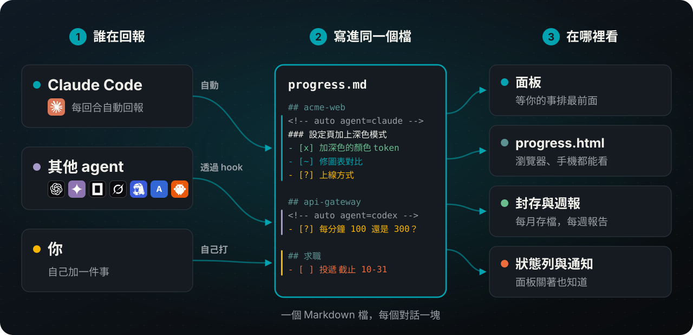
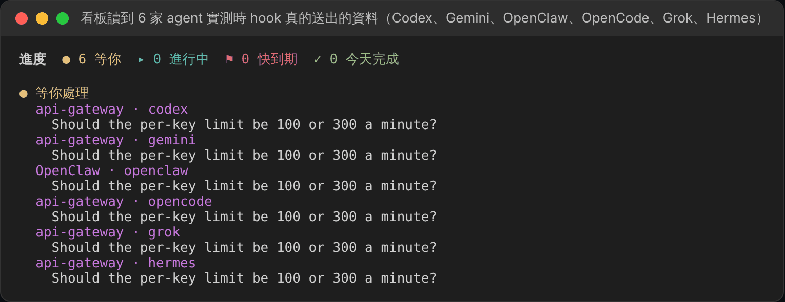
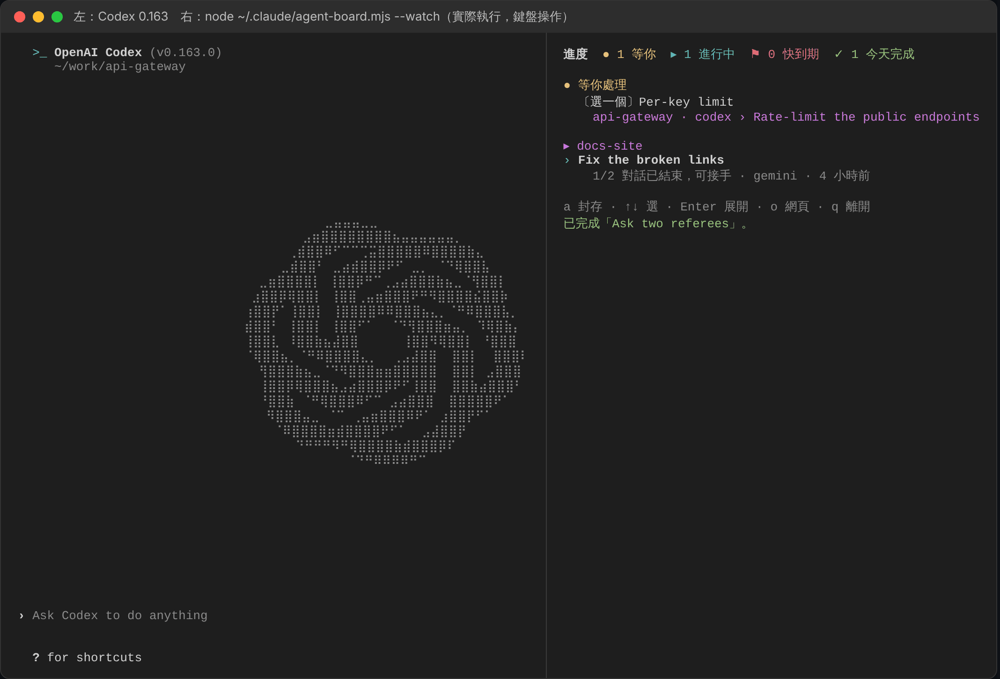
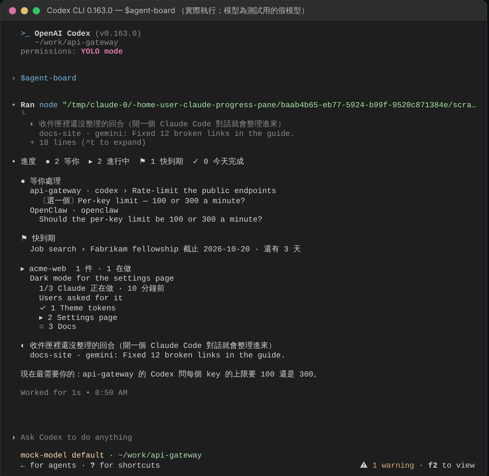
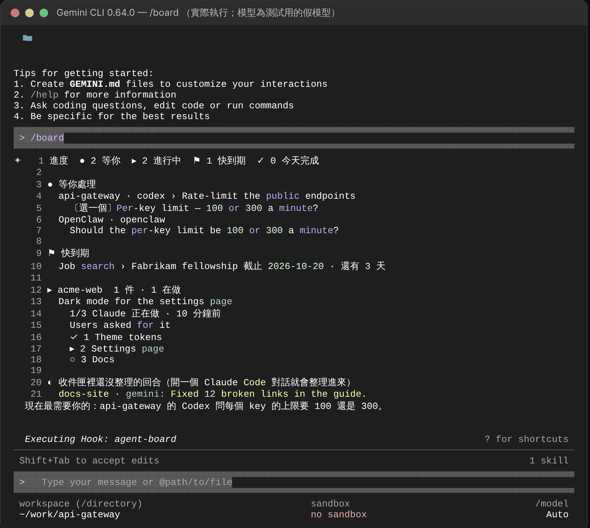

<h1 align="center">

</h1>

<p align="center">
<b>每個 AI coding agent 在做什麼，一個面板看完；等你的事，永遠排第一個。</b><br>
Claude Code 外掛，也跟得上 Codex、Gemini CLI、OpenCode、Grok Build、Hermes Agent 和 OpenClaw，更多見<a href="#支援的-agent">下方</a>。
</p>

<p align="center">
<a href="CHANGELOG.md"></a>

<a href="LICENSE"></a>

</p>
<p align="center">
<a href="#支援的-agent"></a>
<a href="#支援的-agent"></a>
<a href="#支援的-agent"></a>
<a href="#支援的-agent"></a>
<a href="#支援的-agent"></a>
<a href="#支援的-agent"></a>
</p>

<p align="center"><a href="README.md">English</a> · 繁體中文 · <a href="README.zh-CN.md">简体中文</a></p>

你在一個專案開 Claude Code，另一個開 Codex，第三個開 Gemini。二十分鐘後，其中一個停下來問你事情，你要等到剛好切回去才會發現。**Agent Board** 在它一開口就把問題放到你眼前，每個答案一個按鈕。

## 功能

- **需要你的事排最前面。** 任何 agent 的問題都放在最上面，每個答案一個按鈕。在 Claude Code 裡按一下就回答了；其他 agent 則給你要貼過去的那句話或指令。已經在對話裡回過了？按**已回覆，先隱藏**，只在這台電腦上收起來，不會送出任何話；那個對話問了新的問題，它會再出現。
- **所有 agent 一處看。** 依專案分組，每個對話都有標題、一行背景和編號步驟，由每個回合的簡短摘要自動寫好。
- **隨時接著做。** 對話壓縮、終端機關掉、隔天早上都沒關係：做完什麼、卡在哪、下一步是什麼，打開就看到。做到一半停掉的對話，按一下就能接手。
- **你自己的待辦也放得進來。** 在面板的輸入框打 `+ 求職：Fabrikam 研究員 截止 11-20`。快到期會變黃，到期會變紅。
- **不在終端機也看得到。** `/progress open` 在瀏覽器打開同一個畫面（手機也行）；其他 agent 會打開[可以點的網頁](#看板的網頁)，在上面勾步驟、封存、回答。面板關著時，狀態列和桌面通知會告訴你有事在等你。
- **週報。** `/progress report` 和 `/progress today` 把做完的事複製成文字。
- **自己收拾。** 做完的事移到每月封存檔，日誌留下每一步完成紀錄。
- **就是一個 Markdown 檔。** 全部在 `~/.claude/progress.md`，你可以自己看、自己改。支援 English、繁體中文、简体中文；淺色深色都有。

## 怎麼運作



每個接上的 agent，hook 會把它最後的回覆存進 `~/.claude/progress-inbox/`。開著的 Claude Code 對話五秒內讀到，把那個回合整理好，寫進 `progress.md` 裡那個 agent 自己的一塊，然後刪掉那個檔案。格式寫在 [docs/FORMAT.md](docs/FORMAT.md)（英文）。

## 快速開始

**1. 安裝**（需要 Claude Code 2.1.287 以上）：

```
claude plugin marketplace add WenyuChiou/agent-board
claude plugin install agent-board@agent-board
```

**2. 打開 Claude Code。** 面板在右邊（沒看到就輸入 `/progress`）。第一次開的時候，它會自動接上這台電腦裝的所有 coding agent，並告訴你接了哪些；之後才裝的 agent，下次開 Claude Code 時也會自動接上。

**3. 重開其他 agent 一次**，讓它們載入新的 hook。第一次時，Codex 要在 `/hooks` 裡核准，Hermes Agent 會問你一次，回答 `y`。之後每個 agent 的回合幾秒內就會出現。

<details>
<summary><b>或者讓 agent 幫你裝</b></summary>

把下面這段貼給 Codex、Gemini CLI、Cursor、Grok、Hermes、Muse，或任何能執行指令的 agent：

```text
幫我在這台電腦裝 Claude Code 的 Agent Board 外掛，並把這台電腦上的 coding agent 接上它。
依序執行這三行，任何一行失敗就停下來告訴我：
claude plugin marketplace add WenyuChiou/agent-board
claude plugin install agent-board@agent-board
claude -p "/progress connect"
最後把最後一行印出的內容給我看，並告訴我要重開哪些 agent。
```

</details>

## 支援的 agent

在 Claude Code 裡安裝，之後 Claude Code 每次啟動都會把這台電腦上裝了的 agent 接上。頂端徽章用同樣的分法：綠色是完全可用，黃綠色是部分可用。

**完全可用**：回合自己上看板，在它裡面也叫得出看板。
- **Claude Code** 2.1.302，在面板裡；問題點一下就回答
- **Codex** 0.163.0，打 `$agent-board`；第一次要在 Codex 的 `/hooks` 核准
- **Gemini CLI** 0.64.0，打 `/board`；第一次執行指令前會問一次
- **OpenCode** 1.19.3，打 `/board`

**部分可用**
- **Grok Build** 1.0.62：回合會上看板；在它裡面打 `/agent-board` 還沒驗證
- **Hermes Agent** 0.19.0：兩者都能用；第一次回答 `y`；單次的 `hermes -q` 提問會顯示成已停，不是等你
- **OpenClaw** 2026.10.4：兩者都能用；需要 2026.4.24 以上，會警告無法確認外掛來源，但照樣載入
- 網頁版 **dot**、**Muse**：沒有 hook，要把[一段提示](docs/REMOTE_REPORTERS.md#chat-relay-a-prompt-to-paste)貼進聊天，再把它寫的每個區塊貼進[看板的網頁](#看板的網頁)；在它們裡面看不到看板
- **其他 agent**（Aider、Copilot、Windsurf…）：把 [AGENTS.md](AGENTS.md) 的一段貼進它的說明檔，它會自己寫一塊；在它裡面看不到看板

**還不支援**
- **Cursor**：Windows 上它用 bash 跑所有 hook，其他工具的 PowerShell hook 擋住了它的回合；macOS、Linux 還沒驗證
- **Muse Code**：hook 照它的文件設定，`/agent-board` 技能放在它會讀的 `~/.agents/skills`；兩者都還沒驗證
- **Antigravity**：沒有回合結束的 hook，回合上不了看板

### 依能力

✅ 可以用 · ⚠️ 可以用，限制見上 · ❔ 還沒驗證 · ❌ 還不支援

| | Agent | 回合上看板 | 在它裡面看看板 | 驗證版本 |
|:-:|---|:-:|:-:|---|
|  | **Claude Code** | ✅ | ✅ 面板 | 2.1.302 |
|  | **Codex** | ✅ | ✅ `$agent-board` | 0.163.0 |
|  | **Gemini CLI** | ✅ | ✅ `/board` | 0.64.0 |
|  | **OpenCode** | ✅ | ✅ `/board` | 1.19.3 |
|  | **Grok Build** | ✅ | ❔ `/agent-board` | 1.0.62 |
|  | **Hermes Agent** | ⚠️ | ✅ `/agent-board` | 0.19.0、0.16.0（Windows） |
|  | **OpenClaw** | ⚠️ | ✅ `/agent-board` | 2026.10.4 |
|  | **Cursor** | ❌ | ❔ `/agent-board` | 2026.10.16（Windows） |
|  | **Muse Code** | ❔ | ❔ `/agent-board` | |
| | **Antigravity** | ❌ | ❔ `/agent-board` | |
| | **dot**、**Muse**（網頁版） | ⚠️ | ❌ | |
| | **其他 agent** | ⚠️ | ❌ | |

在 agent 裡看到的看板是印出來的文字：看得到全部，但不能點。所以看板指令也會在瀏覽器打開[看板的網頁](#看板的網頁)，在那裡勾步驟、封存工作、複製回答，或回覆已經結束的 Grok Build、Codex 對話。還開著的對話，在那個 agent 裡回答。



## 每個 agent 裡都看得到看板

接上時，每個 agent 也會拿到一個看看板的指令。不管你在哪一個裡面，都看得到全部 agent 在做什麼：

| 在 | 打 |
|---|---|
| Gemini CLI、OpenCode | `/board` |
| Codex | `$agent-board` |
| OpenClaw、Hermes Agent | `/agent-board` |
| Grok Build、Cursor、Antigravity（還沒驗證） | `/agent-board` |
| 任何終端機，開在任何 agent 旁邊 | `node ~/.claude/agent-board.mjs --watch`（`--html` 在瀏覽器開） |
| 瀏覽器，從任何 agent | `node ~/.claude/agent-board.mjs --serve` |

**像面板一樣操作。** 在 agent 旁邊開一個終端機（分割視窗），執行 `node ~/.claude/agent-board.mjs --watch`：

| 按鍵 | 作用 |
|---|---|
| ↑ ↓、Enter | 選一行、展開 |
| `x` | 勾掉自己工作的下一步，並記進工作日誌 |
| `a` | 封存自己的工作，或已停對話的區塊 |
| `1`–`9`、`y`／`n` | 複製另一個 agent 問題的答案，貼到那個 agent |
| `c` | 複製指令，或接回提問那個對話的指令（沒有指令就複製它的 ID） |
| `h`、`u` | 把另一個 agent 的問題標成已回覆：只在這台電腦上隱藏，不送出任何話；把隱藏的全部重新顯示 |
| `o`、`q` | 打開網頁版；離開 |

做完的工作會自己離開看板。看板寫 `progress.md` 跟面板一樣小心；別的對話的區塊不會動，除非你封存一個已經停掉的。



<table><tr>
<td></td>
<td></td>
</tr></table>

上圖是 Codex 0.163.0 和 Gemini CLI 0.64.0；OpenCode 和終端機的畫面在[使用說明](docs/GUIDE.zh-TW.md#每個-agent-裡都看得到看板)。

看板直接讀 `progress.md`，不用開 Claude Code，只要 Node.js 18 以上：Codex 和 Gemini CLI 裝的時候就有，其他 agent 若 `node --version` 找不到，就裝一下 Node。其他 agent 的回合要有 Claude Code 對話開著才會整理成步驟；在那之前，看板照原樣列出它們。

### 看板的網頁

上面的看板指令會先印出看板，再在瀏覽器打開它的網頁，最後一行是網址；在任何終端機執行 `node ~/.claude/agent-board.mjs --serve` 也一樣（加 `--no-open` 只印網址）。再跑一次 `--serve` 會叫回已經開著的那一頁。在網頁上可以：

- **勾掉**自己工作的下一步、**封存**一件工作，或按**現在封存**把做完的全部收走。
- **複製**另一個 agent 問題的答案、問這個問題的對話 ID、對話的續接指令，或步驟裡的指令。
- **已回覆，先隱藏**：已經在它自己的對話裡回過的問題。只在這台電腦上隱藏，網頁、面板和終端機看板都一樣，不會送出任何話。那個對話問新的問題時會再出現；按**重新顯示**可以提早叫回來。
- **回覆**已經結束的 Grok Build 或 Codex 對話。回覆會在那個對話自己的資料夾裡執行 `grok -r <id>` 或 `codex exec resume <id>`，agent 回答後網頁會顯示它回了什麼，可能要幾分鐘。同一個對話一次只送一則。還開著的對話要在它自己的視窗回答，因為兩邊同時寫會把對話弄亂。
- **貼上區塊**：從 Muse、dot 這類網頁聊天來的。先從網頁複製聊天提示，貼進聊天一次；之後把聊天印出的每個區塊貼進來。格式不對，或會蓋掉 Claude 或其他 agent 區塊的，會被拒絕。

網頁只在 127.0.0.1 上聽（除非加上 `--lan`，見下文），網址裡帶一把隨機鑰匙，所以別台電腦、你開著的其他網頁都用不了它。30 分鐘沒人看就會關，也可以按它的**關閉看板**；不過還有一則回覆在送給 agent 的路上時，不會關。

**在手機上。** 網頁的版面適合手機。要從和電腦連同一個 Wi-Fi 的手機打開，跑 `node ~/.claude/agent-board.mjs --serve --lan`：除了電腦本機的網址，它還會印出網頁在你網路上的網址和它的 QR code，用手機相機對著掃就好。電腦有不只一個網路位址時，用 `--lan 192.168.1.23` 指定一個。Windows 可能會問要不要讓 Node.js 使用網路：在私人網路上允許，並確認 Windows 把你的 Wi-Fi 算成私人網路（剛連上的網路它會先當成公用網路），不然手機連不到網頁。不在那個網路上時，透過 Remote Control 打開一個 Claude Code 對話，問它進度如何：它讀的是同一份 `progress.md`。

網路上的網頁有這些限制：

- 只有加了 `--lan` 才開，只開在電腦的私人位址上（開頭是 192.168、10，或 172.16 到 172.31 的位址，絕不是公開位址），也只回應送到那個位址的請求。
- 它的網址帶著自己的一把鑰匙，不是電腦本機網頁那把。拿到這個網址或拍到 QR code 的人，在它關掉之前都能用這個網頁，所以只在信得過的網路上用，例如家裡的 Wi-Fi，不要在咖啡店的。
- 在網路上，網頁走的是沒有加密的 HTTP，同一個 Wi-Fi 上的其他裝置可能讀得到傳過去的內容，包括 agent 的回答。所以手機可以勾步驟、封存、標成已回覆（和重新顯示）、複製、貼上區塊和關閉看板，但不能回覆 agent：回覆會在電腦上跑一個程式，所以手機只顯示答案讓你複製，再從電腦本機的網頁送出。
- 10 分鐘沒有手機來看就會關，電腦本機的網頁關掉時也跟著關。開著的時候再跑一次 `--serve --lan`，拿到的是同一個網址。

## 指令

| 輸入 | 用途 |
|---|---|
| `/progress` | 打開面板 |
| `/progress connect` | 現在就接上其他 agent，並看看改了什麼；每個對話開始時也會自動做（`/progress connect remove` 拿掉 hook 並停止自動接） |
| `+ 專案：標題 截止 11-20；步驟；步驟` | 在面板輸入框加一件自己的事（或用 `/progress add …`） |
| `/progress open` | 在瀏覽器看 |
| `/progress report` / `/progress today` | 複製最近 7 天／今天的進度 |
| `/progress notify on` / `off` | 桌面通知 |
| `/progress lang zh-TW` | `en`、`zh-TW`、`zh-CN` 或 `auto` |
| `/progress tidy` | 現在就封存做完的工作，以及停太久的工作（見[使用說明](docs/GUIDE.zh-TW.md#它怎麼保持整齊)） |

## 顏色與符號

面板跟著 Claude Code 的主題走。輸入 `/config`，選 **Theme**：選淺色主題，面板就用淺色那組顏色；其他主題用深色那組。`progress.html` 跟著你電腦的淺色或深色模式。兩組都是日本傳統色（和色），選來讓每個字都清楚好讀。

| 符號 | 意思 | | 符號 | 意思 |
|:-:|---|---|:-:|---|
| ● | 等你 | | ◐ | 在跑，或在等別人 |
| ▸ | 正在做 | | ! | 卡住 |
| ○ | 還沒做 | | ⚑ | 兩週內到期 |
| ✓ | 完成 | | – | 取消 |

按面板最下面的「說明」，面板裡也會列出這張表。

## 常見問題

<details>
<summary><b>一定要有其他 agent 嗎？只用 Claude Code 可以嗎？</b></summary>

可以。每個 Claude Code 對話都會自己出現；接上其他 agent 是選用的。
</details>

<details>
<summary><b>我是從 Codex（或其他 agent）裝的，它看得到 Claude Code 在做什麼嗎？</b></summary>

看得到。插件裝在 Claude Code 裡，但接上時每個 agent 都會拿到看看板的指令（見[每個 agent 裡都看得到看板](#每個-agent-裡都看得到看板)），而看板讀的就是所有 agent 共用的那個檔案。想讓其他 agent 的回合整理成步驟，就在某處開著一個 Claude Code 對話。
</details>

<details>
<summary><b>換了一台電腦，東西都不見了嗎？</b></summary>

不會不見，但也不會自己搬過去：`progress.md`、收件匣和 hook 都只在各自的電腦上。在新電腦跑那三行安裝指令，再重開 agent 就好。要帶上以前的紀錄，就把 `~/.claude/progress.md` 和旁邊的 `progress-archive-*.md`、`progress-journal-*.md` 複製過去。

想讓兩台電腦共用一個面板，就在兩台都把 `CLAUDE_PROGRESS_FILE` 設成同步資料夾（OneDrive、Dropbox、iCloud）裡的同一個檔案。一次只用一台最穩：兩台同時寫，同步軟體可能會留下衝突副本。
</details>

<details>
<summary><b>某個 agent 沒出現。</b></summary>

1. 再跑一次 `/progress connect`，看它印出什麼：它會列出接上了哪些 agent，以及哪些設定檔改不了。
2. 重開那個 agent，hook 是在啟動時載入的。Codex 要在 `/hooks` 核准，Hermes Agent 會問一次。
3. 開著一個 Claude Code 對話：面板只在有對話開著時讀收件匣。這段期間進來的回合會在那裡等，最多兩天。
4. 先關掉所有 Claude Code 對話（開著的對話幾秒內就會讀走並刪掉檔案），再看看 `~/.claude/progress-inbox/`。回合結束後沒有新檔案，就是 hook 沒跑；有檔案卻沒出現，請開 issue 附上那個檔案。看板沒能收下的回合（`progress.md` 寫不進去，或模型沒給摘要、回覆裡也沒有提問）會以 `.taking` 檔留在那裡，每 15 分鐘再試一次；試滿 8 次就改成 `.failed` 檔保留，不會刪掉。
</details>

<details>
<summary><b>會把資料傳出去嗎？要花多少錢？</b></summary>

`progress.md`、收件匣和 `progress.html` 都留在你的電腦上。回合的摘要由 Claude Haiku 透過你自己的 Claude Code 登入來做：其他 agent 每個回合一次簡短呼叫，沒有 Task 清單的 Claude Code 對話也是。裝了 GitHub 的 `gh` 的話，面板會用它查你的 pull request 狀態。其他什麼都不會送出去。詳見 [SECURITY.md](SECURITY.md)（英文）。
</details>

<details>
<summary><b>Windows 能用嗎？</b></summary>

可以：macOS、Linux、Windows，在終端機、桌面版和 VS Code 都行。Windows 上的 hook 跑的是 PowerShell 腳本，不需要 `sh`。
</details>

<details>
<summary><b>以前用的是 <code>claude-progress-pane</code>。</b></summary>

外掛在 0.10.0 改了名，不會自己換過去。照[從舊名稱換過來](docs/GUIDE.zh-TW.md#從舊名稱換過來)的步驟做就好，`progress.md` 不會動。
</details>

<details>
<summary><b>怎麼移除？</b></summary>

```
claude -p "/progress connect remove"
claude plugin uninstall agent-board@agent-board
claude plugin marketplace remove agent-board
```

第一行會把其他 agent 裡的 hook 拿掉。`progress.md` 會留著。
</details>

更多問題請看使用說明的[疑難排解](docs/GUIDE.zh-TW.md#疑難排解)。

## 文件

- [使用說明](docs/GUIDE.zh-TW.md)：設定腳本、看懂面板、所有指令、其他 agent、自動整理、疑難排解
- [檔案格式](docs/FORMAT.md)（英文）：`progress.md` 怎麼寫，給任何想寫進去的程式
- [AGENTS.md](AGENTS.md)（英文）：程式碼結構，以及任何 agent 都能照著手動回報的那一段
- [更新紀錄](CHANGELOG.md) · [參與貢獻](CONTRIBUTING.md) · [安全性](SECURITY.md)

## 授權

[MIT](LICENSE)。agent 的圖示來自 [Simple Icons](https://simpleicons.org)（CC0）和 [Lobe Icons](https://github.com/lobehub/lobe-icons)（MIT），商標屬於各自的擁有者；沒有圖示的 agent 以名字的第一個字母表示。
