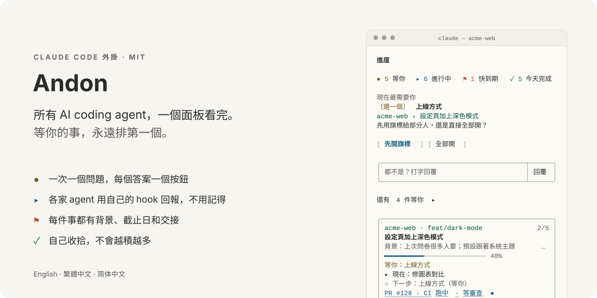

<h1 align="center">
<picture>
  <source media="(prefers-color-scheme: dark)" srcset="docs/images/hero-zh-TW-dark.svg">
  
</picture>
</h1>

[English](README.md) · 繁體中文 · [简体中文](README.zh-CN.md)

Claude Code 外掛。一個面板看所有 coding agent 在做什麼，最需要你的那件事放最上面。

<p align="center">
  <picture>
    <source media="(prefers-color-scheme: dark)" srcset="docs/images/demo-zh-TW-dark.svg">
    
  </picture>
</p>

## 跟別人不一樣的地方

- **需要你的事先講。** 問題、截止日、卡住的工作放最上面，每個答案一個按鈕，按了直接回給那個對話。
- **agent 不用記得回報。** 進度來自各家自己的回合結束 hook：Claude Code、Codex、Gemini CLI、Cursor、OpenCode、Grok Build、Muse Code。每回合自動整理成步驟，agent 最後在問你的事會自動列進「等你」。
- **什麼都不會丟。** 壓縮時留一行交接；停掉的對話可以續接或接手；做完的工作自動移到每月封存檔。

## 安裝

```
claude plugin marketplace add WenyuChiou/claude-progress-pane
claude plugin install project-progress@claude-progress-pane
```

開 Claude Code，面板會自己出現在右邊。要接上其他 agent，執行一次 `/progress connect`。

## 用法

| | |
|---|---|
| 照常工作 | 每個對話都會出現，帶著步驟、背景、在等什麼 |
| `+ 求職：Fabrikam 研究員 截止 11-20` | 在面板的輸入框：加一件自己的事 |
| `/progress open` | 在瀏覽器看同一個畫面 |
| `/progress connect` | 把其他 agent 接上面板 |
| `/progress report` | 複製最近七天的進度 |
| `/progress lang zh-TW` | `en`、`zh-TW`、`zh-CN` 或 `auto` |

## 怎麼運作

<picture>
  <source media="(prefers-color-scheme: dark)" srcset="docs/images/flow-zh-TW-dark.svg">
  
</picture>

全部都在一個 Markdown 檔：`~/.claude/progress.md`。格式公開：[docs/FORMAT.md](docs/FORMAT.md)（英文）。

## 更多

[使用說明](docs/GUIDE.zh-TW.md)（安裝腳本、看懂面板、所有指令、自動整理、疑難排解）· [參與貢獻](CONTRIBUTING.md) · [更新紀錄](CHANGELOG.md) · [MIT](LICENSE)
