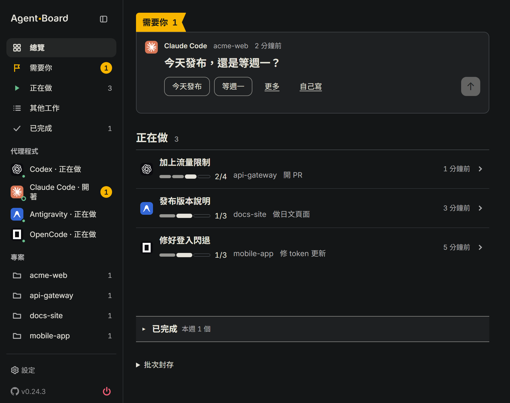
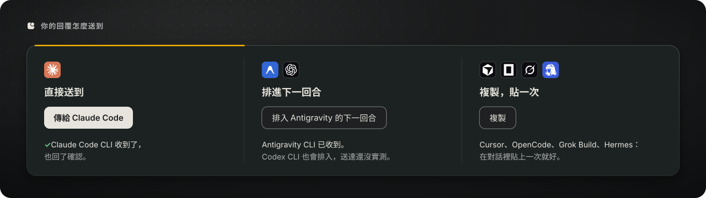
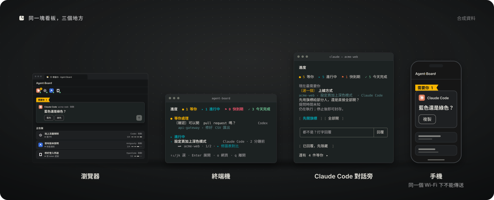
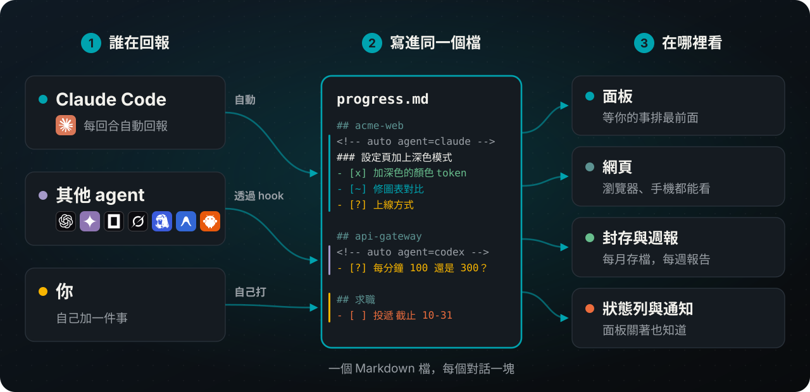

<h1 align="center"></h1>

<p align="center"><b>一塊本機看板，告訴你哪個 AI agent 在等你回答</b></p>

<p align="center"><a href="CHANGELOG.md"></a> <a href="LICENSE"></a> <a href="https://github.com/WenyuChiou/agent-board/actions/workflows/test.yml"></a> <a href="https://www.npmjs.com/package/@wenyuchiou/agent-board"></a></p>

<p align="center"><a href="README.md">English</a> · 繁體中文 · <a href="README.zh-CN.md">简体中文</a></p>

<p align="center">

</p>

Claude Code、Codex、Antigravity 等 AI agent 都向你電腦上的同一塊看板回報。哪個停下來問你，它的問題幾秒內就排到最上面，不用再一個個視窗找。一個 Markdown 檔，不用帳號。

## 快速開始

需要 Node.js 22 以上，在任何終端機執行：

```sh
npx @wenyuchiou/agent-board@next setup
```

然後開一個 agent 的新對話，執行：

```sh
npx @wenyuchiou/agent-board@next
```

- `setup` 會先列出要改什麼，問你一次才寫入。
- 在新對話裡輸入 `/agent-board`（Codex 是 `$agent-board`；Hermes 請它執行 Agent Board skill），或執行第二個指令（Cursor 沒有這種指令）。
- 各 agent 的步驟、語言、選項和其他安裝方式：[安裝指南](docs/SETUP.md#after-setup-per-agent)（英文）。

## 你會得到什麼

- **問題排最前面。** agent 在等你回答的問題會排到最上面；它給的選項讀得出來，就每個選項一顆按鈕，否則自己輸入回答。
- **每個 agent 留在原本的地方。** agent 繼續在自己的終端機裡跑，看板讀的是它們 hooks 的回報。
- **在本機、純文字。** 一個你可以自己看、自己改的 Markdown 檔，只在 127.0.0.1 的網頁，看板本身不呼叫模型。
- **一個指令裝、一個指令移除。** `setup` 寫入前先列出要改什麼；`remove` 拿掉 setup 寫的東西，不動你自己的設定。



## 支援的 agent

### 在終端機（命令列）

| | Agent | 開看板 | 你的回答怎麼送到 |
|:-:|---|---|---|
|  | Claude Code | `/agent-board` | 它空下來就送出 |
|  | Codex | `$agent-board` | 卡片有「排入」時可排給它；[什麼時候交給它](docs/MESSAGING.md#agent-and-surface-support)（英文） |
|  | Antigravity | `/agent-board` | 卡片有「排入」時可排給它；[什麼時候交給它](docs/MESSAGING.md#agent-and-surface-support)（英文） |
|  | Cursor | 快速開始的第二個指令 | 你自己貼上 |
|  | OpenCode | `/agent-board` | 你自己貼上 |
|  | Grok Build | `/agent-board` | 你自己貼上 |
|  | Hermes Agent | 請它執行 Agent Board skill | 你自己貼上 |

### 在桌面 app 或 IDE

| | Agent | 開看板 | 你的回答怎麼送到 |
|:-:|---|---|---|
|  | Claude Code | `/agent-board`（看板網頁） | 尚未支援 |
|  | Codex | 看板網頁 | 尚未支援 |
|  | Antigravity | 看板網頁 | 卡片有「排入」時可排給它。桌面 app：實際跑過；IDE：沒有單獨跑過，它的 hook 把它回報成 app 的介面時，跟 app 一樣處理；[什麼時候交給它](docs/MESSAGING.md#agent-and-surface-support)（英文） |
|  | Cursor | 看板網頁 | 尚未測試 |
|  | OpenCode | 看板網頁 | 尚未支援 |

- 看板網頁：在終端機執行 `npx @wenyuchiou/agent-board@next --html`，app 自己的終端機也行。
- 尚未支援或尚未測試：從看板複製回答，貼到 app 裡。
- dot 和其他網頁版聊天要手動回報：[怎麼做](docs/REMOTE_REPORTERS.md#chat-relay-a-prompt-to-paste)（英文）。

## 在看板上回答



回答 agent 的問題，和主動傳訊息給它，走的是同一條路，看你按哪顆按鈕：

- **傳送**把它交給已連線的對話；對話回確認才代表收到。沒有確認也可能已經送到，先看一下那個 agent 再用**複製回答**，免得它收到兩次。傳送需要[開啟訊息功能](docs/MESSAGING.md#local-storage)（英文）。
- **排入 agent 的下一回合**會留給那個對話的各個回合，不會叫醒閒置中的對話；它的信箱滿 12 小時過期，或是對話先結束（限 hook 會回報對話結束的 agent），都可能被拒收。
- **複製回答**把它放進剪貼簿，由你貼到那個 agent。
- 已經在 agent 自己的視窗裡回答了？按**已回覆，先隱藏**就能收掉這張卡。

## 在哪裡都能開



| 在哪裡 | 怎麼開 |
|---|---|
| agent 裡 | `/agent-board`（Codex 是 `$agent-board`） |
| 終端機 | `npx @wenyuchiou/agent-board`：在互動式終端機裡，透過 SSH 連線或在沒有顯示器的 Linux 上，開終端機看板，但那個 shell 若設了 agent 的設定（例如 `HERMES_HOME`、`OPENCODE_CONFIG_DIR`）就開網頁；CI 裡印出純文字；其他情況都開網頁。在互動式終端機加 `--watch` 一定開終端機看板 |
| 同一個 Wi-Fi 的手機 | `npx @wenyuchiou/agent-board --lan`，掃它印出的 QR code。手機可以看、勾步驟、封存和關閉看板，但不能傳送回答（它只顯示回答讓你複製）。請在信得過的網路使用：連結沒有加密，拿到的人都能打開網頁 |
| 讓 agent 讀看板 | `npx @wenyuchiou/agent-board --json`（[欄位說明](docs/BOARD-JSON.md)，英文） |

## 怎麼運作



每個 agent 的 hooks 把它的對話正在做什麼，寫進本機同一個 `progress.md` 裡它自己的區塊（全新安裝用 `~/.agent-board/progress.md`；[檔案格式](docs/FORMAT.md)，英文）。網頁只聽 127.0.0.1，不用帳號。看板不呼叫模型；選用的 Claude Code 外掛會送出什麼，見[使用指南](docs/GUIDE.zh-TW.md#會把資料傳出去嗎要花多少錢)。

## 更新與移除

再跑一次 `npx @wenyuchiou/agent-board@next setup` 看更新會改什麼，再加 `--apply` 套用；你改過的檔案不會被覆蓋。要移除 setup 寫的東西：

```sh
npx @wenyuchiou/agent-board@next remove
npx @wenyuchiou/agent-board@next remove --apply
```

你的紀錄會留在 `progress.md` 旁邊；[更新與移除](docs/GUIDE.zh-TW.md#更新與移除)列出哪些會保留，另外可能留下幾個小的快取檔。想用較短的 `agent-board` 指令，執行一次 `npm install -g @wenyuchiou/agent-board@next`。

## 疑難排解

| 你看到 | 試試 |
|---|---|
| 某個 agent 沒出現在看板上 | 開一個它的新對話；原本就開著的不會接上。Codex 請以完整執行檔路徑執行 `npx @wenyuchiou/agent-board --codex-trust --codex-bin "<path-to-codex>" --json` 預覽；先檢查預覽，確認同意後才加上 `--apply`。Codex CLI 也可使用 `/hooks`。 |
| 裝完之後什麼都沒變 | 不加 `--apply` 再跑一次 `npx @wenyuchiou/agent-board@next setup`（用 git clone 的話是 `node scripts/setup-agent.mjs`），查看列出的衝突和接下來的步驟；你改過的檔案不會被覆蓋，會列在那裡。 |
| 看板看起來是舊版 | 原本就開著的對話可能還在跑它載入時的版本：開一個那個 agent 的新對話。更新方式見[使用指南](docs/GUIDE.zh-TW.md#更新與移除)。 |
| 同一個 agent 出現兩次 | 可能同時被 Claude 外掛和 setup 接上：[要拿掉哪個](docs/GUIDE.zh-TW.md#疑難排解)。 |

檢查 Claude Code 的設定，請跑 `claude plugin list` 和 `/progress connect status`。更多答案在使用指南的[常見問題](docs/GUIDE.zh-TW.md#常見問題)和[疑難排解](docs/GUIDE.zh-TW.md#疑難排解)。發現 bug 的話，用 [bug 表單](https://github.com/WenyuChiou/agent-board/issues/new?template=bug_report.yml)開一個 issue，並照[安全回報步驟](docs/GUIDE.zh-TW.md#安全地回報問題)做：不要放 session id、家目錄路徑或 token。

## 文件

| 讀 | 用途 |
|---|---|
| [使用指南](docs/GUIDE.zh-TW.md) | 日常使用、按鍵、網頁、設定、更新與移除、常見問題 |
| [安裝指南](docs/SETUP.md)（英文） | 安裝器替每個 agent 寫了什麼 |
| [Codex](docs/CODEX.md) · [傳訊](docs/MESSAGING.md) · [檔案格式](docs/FORMAT.md) · [遠端回報](docs/REMOTE_REPORTERS.md)（皆為英文） | 參考資料 |
| [AGENTS.md](AGENTS.md) · [參與貢獻](CONTRIBUTING.md) · [安全性](SECURITY.md)（皆為英文） | 修改程式碼；非 Claude 的 agent 怎麼手動回報 |

## 授權

[MIT](LICENSE)。agent 的圖示來自 [Simple Icons](https://simpleicons.org)（CC0）和 [Lobe Icons](https://github.com/lobehub/lobe-icons)（MIT），這些圖示屬於各自的擁有者；沒有圖示的 agent 以名字的第一個字母表示。

<p align="center"><a href="CHANGELOG.md"></a><br><sub>最新穩定版本 0.24.2 · 0.24.3 是預先發行版（<code>npx @wenyuchiou/agent-board@next setup</code>）· <a href="CHANGELOG.md">更新紀錄</a></sub></p>
