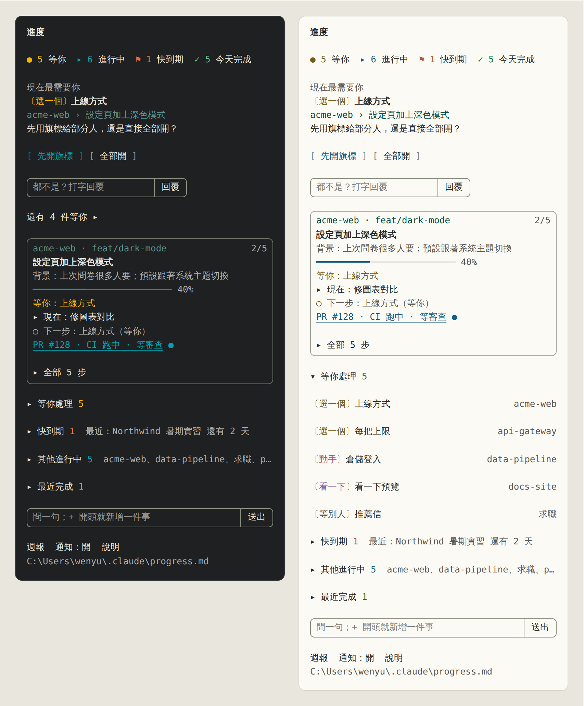
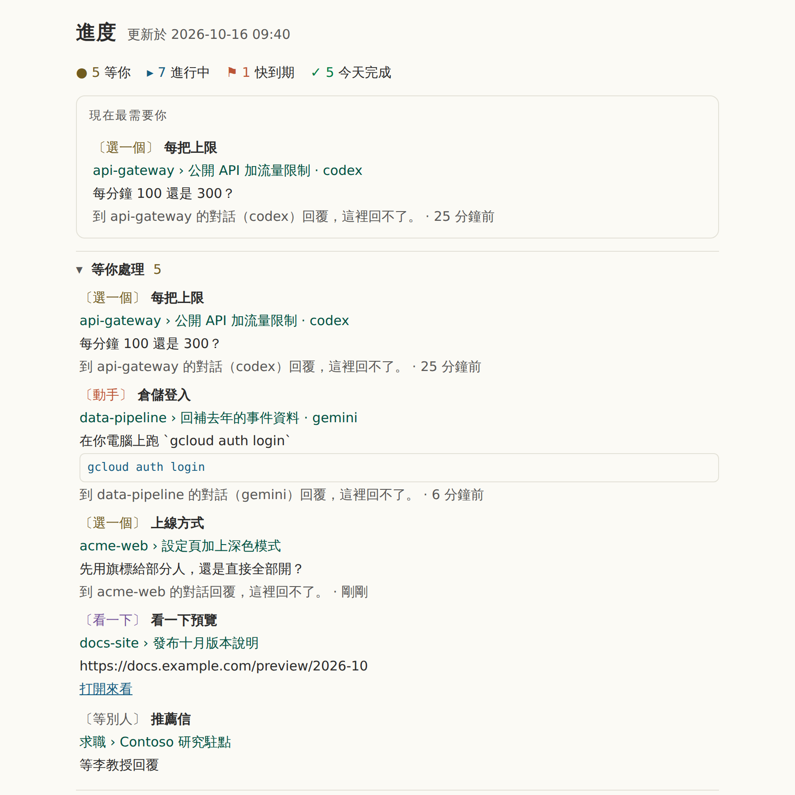
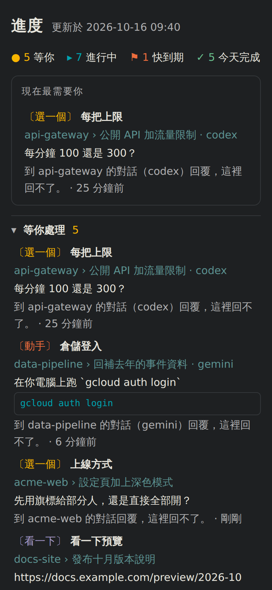

# claude-progress-pane

**給 coding agent 用的進度看板。** 一個側邊面板列出每個專案的工作和每一步，把需要你處理的事放在最上面。它跟著 Claude Code 的 Task 清單走，不用手動改任何檔案；Codex、Gemini、Cursor 或 shell 腳本也能把自己的工作放上來。

[English](README.md) · 繁體中文 · [简体中文](README.zh-CN.md)



## 功能

- **先看需要你的事。** 面板打開時只顯示一件事：現在最需要你處理的問題或截止日。其他的（等你處理、快到期、其他進行中、最近完成）各收成一行，附上數字，點一下才展開。
- **按鈕配合問題。** 每個等你處理的步驟都會歸成一種，每一種有自己的操作：

  | 種類 | 範例步驟 | 你會得到 |
  |---|---|---|
  | 確認 | `部署第 214 版 — 要部署到 staging 嗎？` | 好 · 不要 |
  | 選一個 | `金鑰有效期 — 24 小時還是 7 天？` | 每個選項一個按鈕，外加回覆框 |
  | 動手 | ``初始化資料庫 — 在你的電腦上跑 `make seed` 一次`` | 複製指令 · 做好了 |
  | 看一下 | `看一下預覽 — https://example.com/preview` | 打開來看 · 沒問題，外加一個寫要改什麼的框 |
  | 填資料 | `Staging 帳密 — 提供 staging 的 API key` | 回覆框 |
  | 等別人 | `推薦信 — 等李教授回覆` | 好了（等到了再按） |

  按下去的結果會直接當成你的回答，送回那個 Claude 對話。別的對話的問題會寫明要到哪裡回答；你手記的步驟只有一個按鈕，按了就在檔案裡打勾。
- **每件事都有背景。** 每件事帶一句說明它為什麼要做的話（`背景：上次問卷很多人要`），Claude 幫任務取名時一起寫，所以你不會打開卡片，卻想不起它是做什麼的。
- **每個專案、每個 agent。** 一個 Markdown 檔，`~/.claude/progress.md`，每個對話一個區塊。其他 agent 的區塊會標上名字（`codex`、`gemini`），並說明要到哪裡回覆。程式以外的事，例如求職，可以手寫進去，或用一行快速新增。
- **自己收拾乾淨。** 做完的工作半天後移到每月的封存檔，其他的三天後移。對話安靜超過 12 小時會顯示為對話已停，不再當成還在問你事情。檔案裡留的都是還沒做完的事。
- **壓縮後接得上。** Claude Code 壓縮對話時，新的上下文會帶著目標、完成幾步、正在做的步驟和接下來的步驟，工作從原來的地方接著做。
- **自己的視窗。** `/progress open` 在瀏覽器打開 `progress.html`：同樣的內容，做成會自己重新整理的網頁，跟著系統的淺色或深色模式，手機螢幕也放得下。
- **Pull request 和 CI。** 本機登入 [gh](https://cli.github.com) 的話，卡片會顯示這個分支的 PR、它的檢查和審查狀態，CI 跑的時候會再重新檢查。
- **不礙事。** 有步驟需要你、清單做完、CI 跑完時會發桌面通知。面板關著或終端機太窄時，輸入框下面有一行說明目前進度。
- **日誌和週報。** 每完成一步都會記一筆。按 `週報` 把最近七天整理成純文字（完成的、進行中的、等你處理的）並複製起來，可以直接帶去站會。
- **任何主題都看得清。** 日本傳統色（和色），深色終端機一組、淺色終端機一組，每種文字顏色對背景的對比至少 4.5:1。不會有白底上的淡灰字。
- **English、繁體中文、简体中文。** 跟著 Claude Code 的語言設定，也可以自己選。

<table>
<tr>
<td width="68%"></td>
<td width="32%"></td>
</tr>
</table>

## 開始使用

需要 Claude Code 2.1.287 以上。在 2.1.301 和 2.1.302 上測試過。

### 1. 安裝外掛

在 Claude Code 終端機對話的輸入框：

```
/plugin install project-progress --marketplace WenyuChiou/claude-progress-pane
```

回答 `y` 加入 marketplace，並選 user scope。或者從 shell 執行：

```
claude plugin marketplace add WenyuChiou/claude-progress-pane
claude plugin install project-progress@claude-progress-pane
```

### 2. 執行設定腳本

它會做兩項外掛自己做不到的設定，可以重複執行。

Windows（PowerShell）：

```powershell
powershell -ExecutionPolicy Bypass -File "$env:USERPROFILE\.claude\plugins\marketplaces\claude-progress-pane\scripts\setup.ps1"
```

macOS / Linux：

```bash
bash ~/.claude/plugins/marketplaces/claude-progress-pane/scripts/setup.sh
```

它做的事：

- **打開 Task 工具。** 新模型要設了 `CLAUDE_CODE_ENABLE_TODO_TOOLS=1` 才有 Claude Code 的 Task 工具，而面板就是跟著這些工具走。腳本把這個變數加進你的 shell 的 profile（PowerShell 是 `$PROFILE`；`~/.zshrc`、`~/.bashrc`、macOS 上是 `~/.bash_profile`，或 `~/.profile`）。不加進 `settings.json`：那裡的 env 也會進到 Claude 桌面 app，而桌面 app 自己有一份待辦清單。
- **打開自動更新**，這個 marketplace 的新版本會自己送到。你自己關掉的自動更新會維持關閉。
- **把舊的安裝換過來**，如果你用過 zip 版。

它改的每個檔案都會先複製一份 `<檔名>.bak`。加上 `-NoInstall`（`--no-install`）可以略過安裝這一步。

### 3. 重新啟動 Claude

開一個**新的**終端機視窗（讓 profile 被讀進去），執行 `claude`。面板會自己在右邊打開。`/progress` 可以重新打開。

### 4. 照常工作

跟 Claude 說任何兩步以上的事：

```
> 設定頁加上深色模式，然後開 PR
```

Claude 會列出 Task 清單，面板跟著走：卡片顯示任務、它的背景、進度條、正在做的步驟和下一步。Claude 需要你決定時，問題會移到**現在最需要你**，附上對應的按鈕。

### 5. 加入不是程式的事

在面板最下面的框裡，打一行以 `+` 開頭的字：

```
+ 求職：Fabrikam 研究獎助 截止 11-20；改履歷；投遞
```

冒號前面是專案，`截止 MM-DD` 設定日期（到期前 14 天排進**快到期**），每個 `；` 開始一個步驟。也可以自己寫進 `~/.claude/progress.md`（見[進度檔](#進度檔)）。

### 6. 打開視窗

```
/progress open
```

會在預設瀏覽器打開 `progress.html`。可以放在第二個螢幕上，它每 30 秒自己重新整理一次。

### 7. 選語言

面板先看 Claude Code 的 `language` 設定，再看系統語系。要自己選：

```
/progress lang zh-TW        # 或 en、zh-CN、auto
```

或在 `/config` 裡設定這個外掛的 **Pane language**。

## 看懂面板

從上到下：

1. **數字。** `● 等你` · `▸ 進行中` · `⚑ 快到期` · `✓ 今天完成`。點每一個會展開它算的那些項目。
2. **現在最需要你。** 一個最需要你處理的問題、截止日或卡住的任務，寫明它是關於什麼、你可以怎麼做。`還有 N 件等你 ▸` 會展開其餘的。
3. **這個對話的卡片。** 專案和分支、任務、它的背景、進度條、目前的狀況、正在做的步驟和下一步。`▸ 全部 N 步` 列出每一步，有編號，目前這步標著 `← 現在`。有 pull request 的話也顯示在這裡。
4. **收合的區塊。** 等你處理、快到期、其他進行中（依專案分組）、最近完成。點一列可以看它的步驟和可用的操作：**接手做完**（這個專案裡已關閉的對話留下來的工作）、**複製續接指令**（在原來執行的地方重開那個對話）、**完成這步**和**交給 Claude**（你自己手動記的任務）。
5. **輸入框。** 問一句旁邊的問題（在面板裡回答，不打斷 Claude），或以 `+` 開頭新增任務。
6. **最下面一排。** 週報 · 通知：開／關 · 說明。

符號：

| 符號 | 意思 |
|---|---|
| `✓` | 完成 |
| `▸` | 正在做 |
| `○` | 還沒做 |
| `●` | 等你 |
| `◐` | 在跑：CI、長時間執行的工作、別人 |
| `!` | 卡住 |
| `–` | 取消 |

## 指令

| 指令 | 作用 |
|---|---|
| `/progress` | 打開面板 |
| `/progress open` | 在瀏覽器打開 `progress.html` |
| `/progress add <line>` | 新增一件事，和在面板裡打 `+` 一樣 |
| `/progress tidy` | 立刻封存做完的工作 |
| `/progress sync` | 重新讀 Claude 的 Task 清單和 PR |
| `/progress report` / `today` | 複製最近 7 天／今天的報告 |
| `/progress notify on` / `off` | 打開或關閉通知 |
| `/progress lang en` / `zh-TW` / `zh-CN` / `auto` | 選面板的語言 |

中文詞也能用：`/progress 視窗`（或 `網頁`）＝ `open`、`加`（或 `新增`）＝ `add`、`整理` ＝ `tidy`、`同步` ＝ `sync`、`週報` ＝ `report`、`今天` ＝ `today`、`通知 開`／`通知 關` ＝ `notify on`／`off`、`語言 zh-TW` ＝ `lang zh-TW`。

## 進度檔

所有內容都放在 `~/.claude/progress.md`（Windows 上是 `%USERPROFILE%\.claude\progress.md`；設定 `CLAUDE_PROGRESS_FILE` 可以改用別的路徑）。它是可以直接讀、直接改的純 Markdown：

```markdown
# 專案進度

## acme-web

<!-- auto session=2be48af2 agent=claude state=waiting updated=2026-10-16T01:40:00Z pr=128 ci=pending -->
### 設定頁加上深色模式
> 等你回覆 · feat/dark-mode · PR #128 · CI 跑中
> 背景：上次問卷很多人要
- [x] 加深色的顏色 token
- [~] 修圖表對比
- [?] 上線方式 — 先用旗標給部分人，還是直接全部開？
- [ ] 開 PR
<!-- /auto session=2be48af2 -->

## 求職

### Contoso 研究駐點
> 截止 10-31
- [x] 改履歷
- [?] 推薦信 — 等李教授回覆
- [ ] 投遞
```

- 每個對話只改寫自己的 `<!-- auto -->` 標記之間的行。其他一切（你手寫的區段、筆記）一個位元組都不動。
- 符號：`[x]` 完成、`[~]` 正在做、`[ ]` 還沒做、`[?]` 等你、`[>]` 在跑、`[!]` 卡住、`[-]` 取消。` — ` 後面的文字是這一步的備註：它需要什麼，或為什麼卡住。
- `截止 MM-DD`（或 `due MM-DD`）寫在任務上就有了日期：到期前 14 天排進快到期，3 天內變紅。

給要讀寫這個檔案的工具用的完整規格在 [docs/FORMAT.md](docs/FORMAT.md)（英文）。

## 其他 agent

任何能寫檔案的 agent 都可以把自己的工作顯示在面板上。把 [AGENTS.md](AGENTS.md)（英文）最後那一節 **"Report your progress to the progress pane"** 複製到你專案的 `AGENTS.md`、`GEMINI.md` 或 `.cursorrules`。之後這個 agent 會維護一個自己的區塊，面板會標上這個 agent 的名字。其他 agent 的問題和其他問題列在一起；你要到那個 agent 的對話裡回答。

## 它怎麼保持整齊

| 項目 | 時機 |
|---|---|
| 做完的區塊移到 `progress-archive-YYYY-MM.md` | 最後一次更新後 12 小時 |
| 其他區塊也移到那裡 | 最後一次更新後 3 天 |
| 手寫、每一步都打勾的任務移到那裡 | 面板第一次看到它做完後 24 小時 |
| 12 小時沒有寫入的對話 | 顯示為對話已停；它的問題不再出現在現在最需要你 |
| 封存後變空的 `##` 區段 | 會被移除；你自己留空的會保留 |

這個清理在對話開始時執行，之後每小時一次。`/progress tidy` 會立刻執行。

## 更新與移除

自動更新打開時（設定腳本會幫你打開），新版本會自己送到。要手動更新：

```
claude plugin marketplace update claude-progress-pane
claude plugin update project-progress@claude-progress-pane
```

然後在執行中的對話裡打 `/reload-plugins`，或開新的對話。

要移除：

```
claude plugin uninstall project-progress@claude-progress-pane
claude plugin marketplace remove claude-progress-pane
```

`progress.md`、它的封存檔和日誌，以及 shell 的 profile 裡那一行都會留著。

## 疑難排解

- **面板說這個對話沒有 Task 工具。** 執行設定腳本，然後從新的終端機視窗啟動 `claude`。一直拿不到這個變數的對話（桌面 app、Windows 上的 git-bash）還是可以手動維護 `progress.md`。
- **畫面上沒有面板。** 在終端機的全螢幕版面裡，面板從 144 欄寬起會自己停靠在右邊，用 `/progress` 的話從 110 欄起。在 tmux 或 `CLAUDE_CODE_NO_FLICKER=0` 下，它會在輸入框上方。雲端對話不畫面板。
- **PowerShell 警告執行原則。** PowerShell 要允許執行腳本才會執行你的 profile：`Set-ExecutionPolicy -Scope CurrentUser RemoteSigned`，然後再跑一次腳本。在那之前，這個變數會留在 `settings.json`。
- **私人 fork。** Claude Code 用你自己的 git 認證 clone。執行一次 `gh auth login` 和 `gh auth setup-git`；沒有 GitHub SSH key 的話，再設 `CLAUDE_CODE_PLUGIN_PREFER_HTTPS=1`。
- **你的組織統一管理 Claude Code。** 在那種環境裡，你自己裝的外掛收不到系統提示的 hook。執行設定腳本時加 `-KeepRule`（`--keep-rule`），改把規則留在 `~/.claude/CLAUDE.md`。

## 參與貢獻

歡迎回報問題和提交 pull request。[CONTRIBUTING.md](CONTRIBUTING.md)（英文）有檢查項目和發佈步驟，[AGENTS.md](AGENTS.md)（英文）有程式碼結構和慣例，[docs/FORMAT.md](docs/FORMAT.md)（英文）是檔案格式，它是公開介面。[CHANGELOG](CHANGELOG.md)（英文）列出每項變更和涵蓋它的測試。
