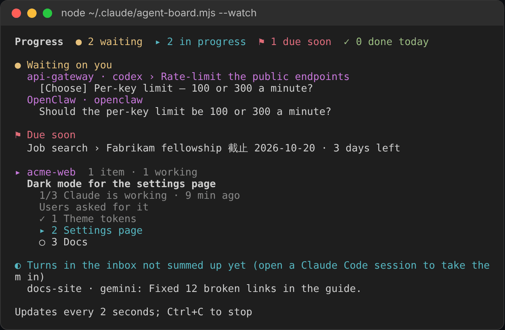
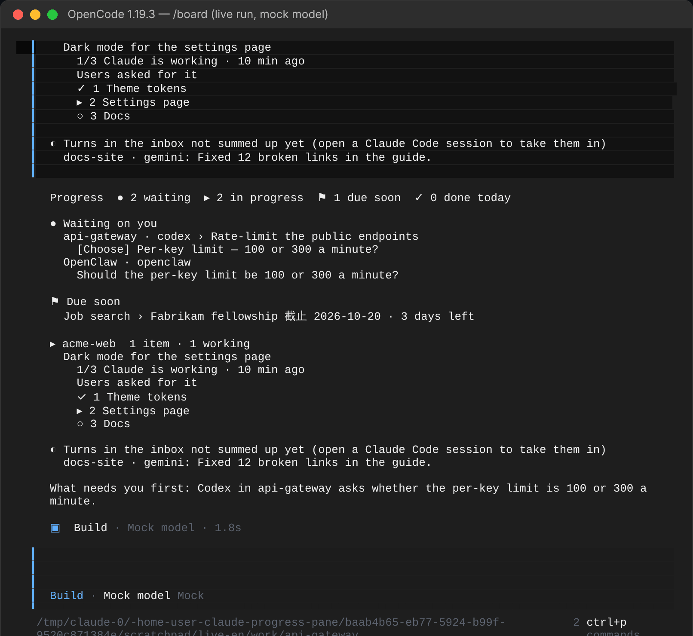

# Guide

English · [繁體中文](GUIDE.zh-TW.md) · [简体中文](GUIDE.zh-CN.md) · [Back to the README](../README.md)

## Get started

Needs Claude Code 2.1.287 or newer. Tested on 2.1.301 and 2.1.302.

### 1. Install the plugin

At the prompt of a Claude Code terminal session:

```
/plugin install agent-board --marketplace WenyuChiou/agent-board
```

Answer `y` to add the marketplace and pick the user scope. Or from a shell:

```
claude plugin marketplace add WenyuChiou/agent-board
claude plugin install agent-board@agent-board
```

### 2. Run the setup script

Optional. It makes the two settings a plugin cannot make for itself, and is safe to re-run. Without it the pane still works: a session without a Task list is summed up turn by turn.

Windows (PowerShell):

```powershell
powershell -ExecutionPolicy Bypass -File "$env:USERPROFILE\.claude\plugins\marketplaces\agent-board\scripts\setup.ps1"
```

macOS / Linux:

```bash
bash ~/.claude/plugins/marketplaces/agent-board/scripts/setup.sh
```

What it does:

- **Turns on the Task tools.** Recent models get Claude Code's Task tools only with `CLAUDE_CODE_ENABLE_TODO_TOOLS=1`, and the pane mirrors those tools. The script adds the variable to your shell profile (`$PROFILE` in PowerShell; `~/.zshrc`, `~/.bashrc`, `~/.bash_profile` on macOS, or `~/.profile`). Not to `settings.json`, whose env also reaches the Claude desktop app, which keeps a task list of its own.
- **Turns on auto-update** for this marketplace, so new versions arrive by themselves. An auto-update you switched off stays off.
- **Moves an old install over**, if you used the zip version.
- **Connects your other agents, if you ask.** With `--agents` (PowerShell: `-Agents auto`) it also gives Codex, Gemini CLI and OpenCode the instructions to report to the pane (see [Other agents](#other-agents)).

Every file it changes is copied to `<file>.bak` first. Run it with `-NoInstall` (`--no-install`) to skip the install step.

### 3. Start Claude again

Open a **new** terminal window (so the profile is read) and run `claude`. The pane opens on the right by itself. `/progress` reopens it.

### 4. Work as usual

Ask Claude for anything with two or more steps:

```
> Add a dark mode to the settings page and open a PR
```

Claude makes a Task list and the pane follows it: the card shows the task, its background, a progress bar, the step in progress and the next one. When Claude needs a decision, the question moves to **Needs you now** with buttons for it. A review gets **Looks good** and **Needs changes**; the second only opens a box for what should change, and nothing is sent until you send it. A question you already answered in its own session, this one or another, can be put away with **Already answered, hide**: it sends nothing, changes no session's block, and is hidden on this computer only (the pane, the terminal board, the board's page and `progress.html` read the list from `progress-answered.json` beside `progress.md`). It comes back when that session words the question anew. **N answered, hidden** lists them, each with **Show again**.

### 5. Add things that are not code

Type a line starting with `+` in the box at the bottom of the pane:

```
+ Job search: Fabrikam fellowship due 11-20; update the resume; submit
```

The part before the colon is the project, `due MM-DD` sets the date (it moves under **Due soon** 14 days before), and each `;` starts a step. Or write it into `~/.claude/progress.md` yourself (see [The file](#the-file)).

### 6. Open the window

```
/progress open
```

opens `progress.html` in your default browser. Keep it on a second screen; it refreshes every 30 seconds.

### 7. Pick a language

The pane follows Claude Code's `language` setting, then your system locale. To choose:

```
/progress lang en        # or zh-TW, zh-CN, auto
```

or set **Pane language** for the plugin in `/config`.

### 8. Pick the colours

The pane takes its colours from Claude Code's theme: run `/config` and choose **Theme**. A light theme (`light`, `light-daltonized`, `light-ansi`) gives it the light set, any other the dark set, and it repaints as soon as you change it. `progress.html` follows your computer's light or dark mode instead. The marks and what they mean are under **Legend** at the bottom of the pane.

## Reading the pane

From top to bottom:

1. **Counts.** `● waiting` · `▸ in progress` · `⚑ due soon` · `✓ done today`. Each one opens what it counts.
2. **Needs you now.** The one question, deadline or stuck task that needs you most, with what it is about and what you can do. `N more waiting on you ▸` opens the rest.
3. **This session's card.** Project and branch, the task, its background, the bar, where it stands, the step in progress and the next. `▸ All N steps` lists every step, numbered, the current one marked `← now`. The pull request, when there is one.
4. **Folded sections.** Waiting on you, Due soon, Other open work (grouped by project), Done recently. Click a row to see its steps and its actions: **Take over and finish** for work a closed session in this project left, **Copy resume command** to reopen that session where it ran, **Mark step done** and **Hand to Claude** for tasks you keep by hand, and **Archive** for either kind to move it out of the file now. A question another session asked names that session's task and the start of its ID, and says how to get back to it: **Copy session ID** copies the whole ID, to find that session in its agent's session list, and for Claude Code, Codex, Grok Build, Gemini CLI, Hermes Agent and OpenCode it also gives the command that reopens that session once it is closed. A session that left no ID, such as a block written by hand or a web chat, says there is no way back to it from here.
5. **The box.** Ask a side question (answered in the pane without interrupting Claude), or start with `+` to add a task.
6. **Bottom row.** Weekly report · Notifications on/off · Legend.

Marks:

| Mark | Means |
|---|---|
| `✓` | done |
| `▸` | doing |
| `○` | not started |
| `●` | waiting on you |
| `◐` | running: CI, a long job, someone else |
| `!` | stuck |
| `–` | cancelled |

## Commands

| Command | Does |
|---|---|
| `/progress` | Opens the pane |
| `/progress open` | Opens `progress.html` in the browser |
| `/progress connect` / `connect remove` / `connect status` | Hooks the other agents installed here into the pane / takes the hooks out / shows, agent by agent, whether its hook and board command are ready |
| `/progress add <line>` | Adds a task, same as `+` in the pane |
| `/progress tidy` | Archives finished work now, and stopped work past its age ([How it keeps itself tidy](#how-it-keeps-itself-tidy)) |
| `/progress sync` | Re-reads Claude's Task list and the PR |
| `/progress report` / `today` | Copies a report of the last 7 days / today |
| `/progress notify on` / `off` | Turns notifications on or off |
| `/progress lang en` / `zh-TW` / `zh-CN` / `auto` | Picks the pane's language |

The Chinese words work too: `/progress 視窗`, `加`, `整理`, `同步`, `週報`, `今天`, `通知 開`.

## The file

Everything lives in `~/.claude/progress.md` (`%USERPROFILE%\.claude\progress.md` on Windows; set `CLAUDE_PROGRESS_FILE` to use another path). It is plain Markdown you can read and edit:

```markdown
# Project progress

## acme-web

<!-- auto session=2be48af2 agent=claude state=waiting updated=2026-10-16T01:40:00Z pr=128 ci=pending -->
### Add a dark mode to the settings page
> waiting on your reply · feat/dark-mode · PR #128 · CI running
> Context: users asked for it in the last survey
- [x] Add colour tokens for dark
- [~] Fix contrast on charts
- [?] Release plan — Behind a flag first, or everyone at once?
- [ ] Open the pull request
<!-- /auto session=2be48af2 -->

## Job search

### Contoso research residency
> due 10-31
- [x] Update the resume
- [?] Recommendation letter — waiting for Prof. Lee to reply
- [ ] Submit
```

- Each session rewrites only the lines between its own `<!-- auto -->` markers. Everything else (your hand-kept sections, notes) is left byte for byte.
- Marks: `[x]` done, `[~]` doing, `[ ]` not started, `[?]` waiting on you, `[>]` running, `[!]` stuck, `[-]` cancelled. Text after ` — ` is the step's note: what it needs, or why it is stuck.
- `due MM-DD` (or `截止 MM-DD`) on a task gives it a date: it moves under Due soon 14 days before, and turns red 3 days before.

The full specification, for tools that read or write the file, is [docs/FORMAT.md](FORMAT.md).

## Other agents

Claude Code connects them on its own: each session hooks in every agent installed here that is not hooked in yet (one installed later included), and says once which it connected. It also says once about any problem: a config it could not read or write, a file it kept, an OpenClaw too old, or no Node.js (or one too old) for the board commands. `/progress connect status` lists each agent again: its reporting hook, what the agent still asks of you (Codex's approval, Hermes Agent's question, OpenClaw's gateway restart), and whether its board command is ready. `/progress connect remove` takes the hooks out and stops this; the plugin's **Connect other agents automatically** option in `/config` turns it off too. To connect by hand, and see which config files could not be edited, run this in Claude Code, or `claude -p "/progress connect"` from any shell:

```
/progress connect
```

It finds the agents installed on this machine and gives each one a hook that runs at the end of every turn. The hook only saves what the agent hands over (its last reply, and the prompt when the agent passes it) into `~/.claude/progress-inbox/`. An open Claude Code session reads it within a few seconds and sums the turn up into that agent's own block. No agent has to follow instructions or remember anything. Restart an agent after connecting it.

| Agent | What it changes | Turn-end event |
|---|---|---|
| Codex | `~/.codex/hooks.json` (`$CODEX_HOME`) | `Stop`. Approve it once in Codex's `/hooks` |
| Gemini CLI | `~/.gemini/settings.json` | `AfterAgent` |
| Cursor | `~/.cursor/hooks.json` | `afterAgentResponse`, `stop` |
| OpenCode | `~/.config/opencode/plugin/agent-board.js` | `session.idle` |
| Grok Build | `~/.grok/hooks/agent-board.json` (`$GROK_HOME`) | `Stop`. Found once Grok has written its `config.toml` or `sessions` in `~/.grok`; other tools' hooks in the folder do not count |
| Hermes Agent | `~/.hermes/config.yaml` (`$HERMES_HOME`) | `post_llm_call`. Hermes asks once before it runs a new hook; answer `y` |
| Muse Code | `~/.config/muse/settings.json` | `Stop` |
| OpenClaw | `~/.openclaw/agent-board.mjs`, and `openclaw.json` beside it to load it (`$OPENCLAW_STATE_DIR`) | `agent_end`. Restart its gateway after connecting |

The hook runs `~/.claude/progress-report.sh` (Windows: `progress-report.ps1`), which `/progress connect` writes. The script has no dependencies, always exits 0 and prints nothing, except `{}` for Cursor. Your own hooks in those files stay. A config file that is not plain JSON is left alone, and the command says which one; a JSON one is written back with two-space indents the first time. If setup `--agents` had put the AGENTS.md section into that agent's instructions, the section is removed, so the work does not show twice. `/progress connect remove` takes the reporting hooks and owned board commands back out, with the retention rules below.

Generated commands, skills and standalone scripts are updated or removed only when their complete contents match a known template or the last output recorded by this plugin. Existing empty files and files you edited are preserved, with their paths shown in a warning, including during automatic setup. Move a conflicting file to another name before reconnecting if you want Agent Board to use that path. An older file without an ownership record is adopted only when its complete contents match a supported template or the exact file an earlier release wrote; a name or header alone is not enough.

Removal checks both the command result and whether the file is gone. An incomplete cleanup lists the unverified or preserved paths; fix the reported problem and retry `/progress connect remove`. If a command or skill remains, its shared `agent-board.mjs` is kept too. Reporter scripts and the inbox are retained for queued or in-flight hooks; progress files, archives, journals and extra files you added inside a skill folder are preserved. The ownership record contains only generated output, is kept in the plugin's store, and is removed after verified deletion. This does not provide cross-process locking for concurrent setup or user edits.

Progress shows only while some Claude Code session is open. Turns that arrive while none is open wait in the inbox, and the reporter clears files older than two days.

**Any other agent** (Aider, GitHub Copilot, Windsurf…): paste the section **"Report your progress to the progress pane"** from [AGENTS.md](../AGENTS.md) into its instruction file. It then writes its own block. `setup.sh --agents` (`setup.ps1 -Agents auto`) does this for Codex, Gemini CLI and OpenCode when they are not connected.

**An agent on another machine** (a cloud VM, a chat assistant) can report too: it writes its block as a fragment, and a merge step on this machine puts it into `progress.md`; see [Remote reporters](REMOTE_REPORTERS.md).

**dot, and explicit reports from Codex:** the opt-in [local exchange](LOCAL-EXCHANGE.md) writes the same kind of fragment, merged by the same step, and keeps a local message queue with receipts.

## The board in every agent

`/progress connect` (and each session's start) also writes `agent-board.mjs` beside `progress.md`: a script that prints the board from `progress.md`, with no Claude Code needed. Every agent's board command runs it with Node.js 18 or newer: Codex and Gemini CLI installed with npm come with Node, a native Codex install does not; for it and for OpenCode, Cursor, Grok Build, Hermes Agent, OpenClaw or Antigravity, install it if `node --version` finds none. Without it, the session start says so once, and the reporting hooks still work.

| Agent | File | Type |
|---|---|---|
| Gemini CLI | `~/.gemini/commands/board.toml` | `/board`. Gemini asks once to allow the command to run |
| OpenCode | `~/.config/opencode/commands/board.md` | `/board` |
| Codex, Cursor, Grok Build, OpenClaw, Muse Code (and Gemini CLI, OpenCode) | `~/.agents/skills/agent-board/SKILL.md` | `$agent-board` in Codex, `/agent-board` in the others |
| Hermes Agent | `~/.hermes/skills/agent-board/SKILL.md` | `/agent-board` |
| Antigravity | `~/.gemini/config/skills/agent-board/SKILL.md` | `/agent-board` |

Gemini CLI and OpenCode paste the board into the prompt themselves; with a skill, the agent runs the script and shows what it prints. Codex, Gemini CLI and OpenCode were run for real (against a mock model, below); the skill for Cursor, Grok Build, OpenClaw, Hermes Agent and Antigravity is written where their documentation says, and was not run. Antigravity only shows the board: it has no turn-end hook to report with yet.

In a terminal, `node ~/.claude/agent-board.mjs` prints the board once, `--watch` keeps it on screen and redraws it every 2 seconds (put it in a split beside Codex), and `--html` writes `progress.html` and opens it in the browser. `--lang en` (or `zh-TW`, `zh-CN`) picks the language; by default it prints in the language you picked for the pane: the plugin's **Pane language** in `/config`, else the one you last picked with `/progress lang` (with `auto`, the language of that session); with neither picked, in the language of the Claude Code session that wrote it first.

On a terminal, `--watch` also takes keys, as the pane takes presses: ↑↓ and Enter to pick and open a line, `x` to tick the next step of a hand-kept task, `a` to archive a hand-kept task or a stopped session’s block (finished work is archived by itself), `1`–`9` or `y`/`n` to copy the answer to another agent's question, `c` to copy a command, or the command that reopens the session that asked (its ID where there is none), `h` to mark another agent's question already answered (hidden on this computer, nothing sent), `u` to show the hidden ones again, `o` for the browser view, `q` to quit. Those, and the list of questions marked answered, are its only writes; otherwise the board only reads. Turns other agents' hooks leave in the inbox are summed up into steps by an open Claude Code session; until one takes them in, the board lists them as they came, a question first. A turn that only showed the board is not counted as work.

`--serve` prints the board, then opens its page in the browser, where the same things take a click: tick a step, archive a task or everything finished, copy an answer or a command, mark a question already answered, answer a Grok Build or Codex session that has ended (in that session's own folder, one reply at a time), and paste a block a web chat wrote. Every board command above runs it, so the address is the last line the agent shows you. The page is served on 127.0.0.1 only, with a random key in its address, and closes after 30 minutes nobody looks at it; more in [the board's page](../README.md#the-boards-page). What an agent answers shows on the page when it comes, which can take a few minutes, and the page does not close while a reply is on its way. An agent that runs its commands in a sandbox may not be allowed to start the page: the board still prints, and its last line says the page could not open. Then run `node ~/.claude/agent-board.mjs --serve` in a terminal yourself.

To look at the page from a phone on the same Wi-Fi, add `--lan`: `node ~/.claude/agent-board.mjs --serve --lan` also prints the page's address on your network and a QR code the phone's camera opens. That page has a key of its own and closes after 10 minutes in which no phone looks at it. A phone can tick, archive, mark a question answered (and show it again), copy and paste a block there, but a reply to an agent is sent from the computer. Use it only on a network you trust; why, in [the board's page](../README.md#the-boards-page).

If the terminal board cannot read or save a file, it reports the full path and filesystem error on stderr; `--keys` exits with status 1. Only a missing file (`ENOENT`) is treated as empty. Fix file access or free disk space, then inspect `progress.md` and that month's archive/journal before retrying. Watch mode keeps trying to read on its next redraw so it can recover after access is restored.

The terminal saves a completion's journal entry before ticking the step, and saves an archive entry before removing the task. A later board-write failure can therefore leave the history entry and the original task together; it reports incomplete persistence rather than success. Retrying an archive skips an identical saved entry. This is not a transaction across files or a cross-process lock, and does not prevent another writer from replacing a successful update. Atomic replacement retains existing POSIX read/write/execute permission bits and creates new history files privately; ownership, extended ACLs and crash durability are not guaranteed by this change.




## How it keeps itself tidy

| What | When |
|---|---|
| A finished block moves to `progress-archive-YYYY-MM.md` | 12 hours after its last update |
| Any other block moves there | 3 days after its last update |
| A hand-kept task with every step done moves there | 24 hours after the pane first saw it done |
| A session that has not written for 12 hours | shows as stopped; its questions leave Needs you now |
| You press **Archive** on a stopped session or a hand-kept task | right away |
| A `##` section the archive emptied | is removed; one you left empty stays |

The sweep runs when a session starts and every hour after. `/progress tidy` and the pane's archive button run it now, and skip the waits for finished work: a block done a minute ago, or a hand-kept task with every step ticked, goes at once (another session's done block too; if that session writes again, its block comes back). A stopped session still gets its three days.

## Update and uninstall

With auto-update on (the setup script turns it on), new versions arrive by themselves. To update by hand:

```
claude plugin marketplace update agent-board
claude plugin update agent-board@agent-board
```

then `/reload-plugins` in a running session, or start a new one.

To uninstall:

```
claude plugin uninstall agent-board@agent-board
claude plugin marketplace remove agent-board
```

`progress.md`, its archives and journals, and the line in your shell profile stay.

### Coming from the old name

Before 0.10 the plugin was `project-progress`, from the `claude-progress-pane` marketplace. The setup script swaps it for you. By hand:

```
claude plugin uninstall project-progress@claude-progress-pane
claude plugin marketplace remove claude-progress-pane
claude plugin marketplace add WenyuChiou/agent-board
claude plugin install agent-board@agent-board
claude -p "/progress connect"
```

The last line moves the hooks in your other agents to the new name. `progress.md` stays as it is. The pane's language and notification settings go back to their defaults; set them again with `/progress lang` and `/progress notify`.

## Troubleshooting

- **The pane says this session has no Task tools.** Run the setup script, then start `claude` from a new terminal window. Sessions that never get the variable (the desktop app, git-bash on Windows) can still keep `progress.md` by hand.
- **No pane on screen.** In the terminal's fullscreen layout the pane docks on the right on its own from 144 columns wide, and through `/progress` from 110. Under tmux or `CLAUDE_CODE_NO_FLICKER=0` it sits above the prompt. Cloud sessions draw no pane.
- **PowerShell warns about the execution policy.** Your profile only runs where scripts may run: `Set-ExecutionPolicy -Scope CurrentUser RemoteSigned`, then run the script again. Until then the variable stays in `settings.json`.
- **Private fork.** Claude Code clones with your own git credentials. Run `gh auth login` and `gh auth setup-git` once; without a GitHub SSH key also set `CLAUDE_CODE_PLUGIN_PREFER_HTTPS=1`.
- **Your organization manages Claude Code.** Plugins you install yourself do not get the system-prompt hook there. Run the setup script with `-KeepRule` (`--keep-rule`) to keep the rule in `~/.claude/CLAUDE.md` instead.
- **An agent doesn't show up.** Run `/progress connect` again: it names every agent it connected and every config it could not edit. Restart the agent, and keep a Claude Code session open while it works. An open session reads each file in `~/.claude/progress-inbox/` and deletes it, so to see what the hook saves, close every session first: if no file appears there after a turn, the agent's hook did not run. A turn the board could not take (`progress.md` could not be written, or the model gave no summary of a reply that asks nothing) stays there as a `.taking` file and is tried again every 15 minutes; after 8 tries it is kept as a `.failed` file, not deleted.
- **Cursor on Windows stops at "blocked".** `cursor-agent` runs every hook through bash, even one written for PowerShell, so another tool's PowerShell hook in `~/.cursor/hooks.json` fails with `syntax error near unexpected token '&'`, and a failing `preToolUse` hook blocks the whole turn (Agent Board's hook never gets to run). Fix or remove that tool's hook.
- **A one-off Hermes Agent question shows as stopped, not waiting.** `hermes -q` ends its session right after the turn, so a block that asks you something reads "session ended, can be taken over". Its question is still the last step; a long-running Hermes (its gateway) keeps it waiting.
- **A new computer.** `progress.md`, the inbox and the hooks live on each computer. Install there and run `/progress connect`; copy `progress.md` and the `progress-archive-*.md` and `progress-journal-*.md` files beside it to bring your history. To share one board, point `CLAUDE_PROGRESS_FILE` on both computers at one file in a synced folder, and use one computer at a time.
