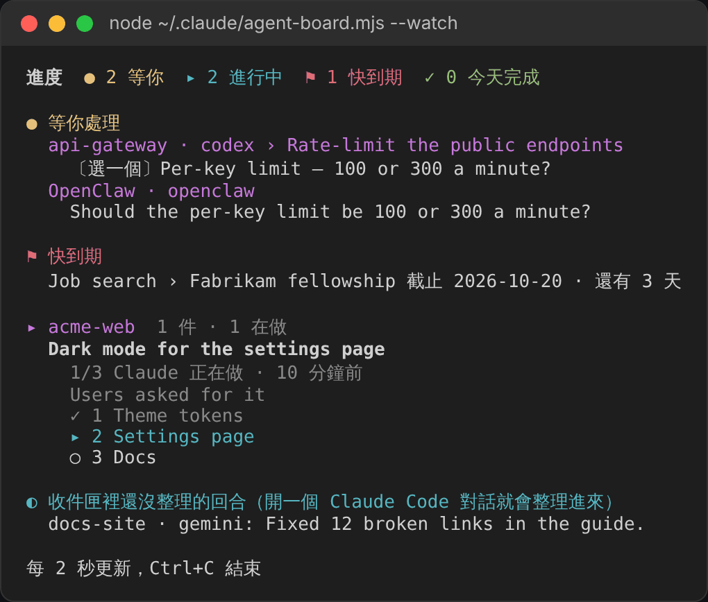
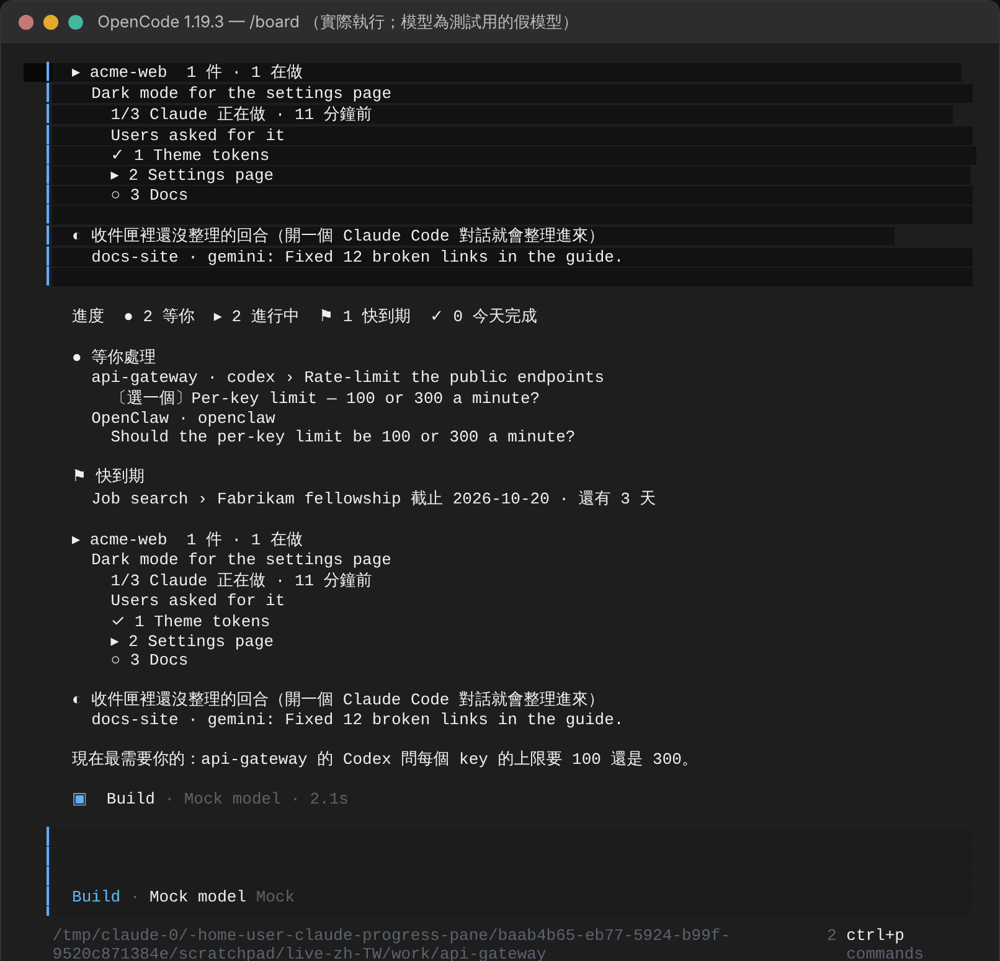

# 使用说明

[English](GUIDE.md) · [繁體中文](GUIDE.zh-TW.md) · 简体中文 · [回到 README](../README.zh-CN.md)

## 开始使用

需要 Claude Code 2.1.287 或更高版本。在 2.1.301 和 2.1.302 上测试过。

### 1. 安装插件

在 Claude Code 终端对话的输入框里：

```
/plugin install agent-board --marketplace WenyuChiou/agent-board
```

回答 `y` 添加 marketplace，并选 user scope。或者从 shell 运行：

```
claude plugin marketplace add WenyuChiou/agent-board
claude plugin install agent-board@agent-board
```

### 2. 运行设置脚本

可以不做。它会做两项插件自己做不到的设置，可以重复运行。没运行也能用：没有 Task 清单的对话会一回合一回合自动整理。

Windows（PowerShell）：

```powershell
powershell -ExecutionPolicy Bypass -File "$env:USERPROFILE\.claude\plugins\marketplaces\agent-board\scripts\setup.ps1"
```

macOS / Linux：

```bash
bash ~/.claude/plugins/marketplaces/agent-board/scripts/setup.sh
```

它做的事：

- **打开 Task 工具。** 新模型要设了 `CLAUDE_CODE_ENABLE_TODO_TOOLS=1` 才有 Claude Code 的 Task 工具，而面板就是跟着这些工具走。脚本把这个变量加进你的 shell 的 profile（PowerShell 是 `$PROFILE`；`~/.zshrc`、`~/.bashrc`、macOS 上是 `~/.bash_profile`，或 `~/.profile`）。不加进 `settings.json`：那里的 env 也会进到 Claude 桌面 app，而桌面 app 自己有一份待办清单。
- **打开自动更新**，这个 marketplace 的新版本会自己送到。你自己关掉的自动更新会保持关闭。
- **把旧的安装换过来**，如果你用过 zip 版。
- **帮你接上其他 agent（需要你开口）。** 加上 `--agents`（PowerShell 是 `-Agents auto`），它也会把汇报进度的说明交给 Codex、Gemini CLI 和 OpenCode（见[其他 agent](#其他-agent)）。

它改的每个文件都会先复制一份 `<文件名>.bak`。加上 `-NoInstall`（`--no-install`）可以跳过安装这一步。

### 3. 重新启动 Claude

打开一个**新的**终端窗口（让 profile 被读进去），运行 `claude`。面板会自己在右边打开。`/progress` 可以重新打开。

### 4. 照常工作

跟 Claude 说任何两步以上的事：

```
> 设置页加上深色模式，然后提 PR
```

Claude 会列出 Task 清单，面板跟着走：卡片显示任务、它的背景、进度条、正在做的步骤和下一步。Claude 需要你做决定时，问题会移到**现在最需要你**，附上对应的按钮。要你看过的东西会有**没问题**和**要修改**；**要修改**只会打开一个框让你写要改什么，你发出前什么都不会发。已经在它自己的对话里回过的问题（这个对话或别的对话），可以点**已回复，先隐藏**收起来：不会发出任何话，也不改任何对话的区块，只在这台电脑上隐藏（面板、终端看板、看板的网页和 `progress.html` 都从 `progress.md` 旁边的 `progress-answered.json` 读这份清单）。那个对话把问题改写成新的，它就会再出现。**已回复、隐藏的 N 项**会列出它们，每项都有**重新显示**。

### 5. 加入不是代码的事

在面板最下面的框里，输入一行以 `+` 开头的文字：

```
+ 求职：Fabrikam 研究资助 截止 11-20；改简历；投递
```

冒号前面是项目，`截止 MM-DD` 设定日期（到期前 14 天排进**快到期**），每个 `；` 开始一个步骤。也可以自己写进 `~/.claude/progress.md`（见[进度文件](#进度文件)）。

### 6. 打开窗口

```
/progress open
```

会在默认浏览器打开 `progress.html`。可以放在第二块屏幕上，它每 30 秒自己刷新一次。

### 7. 选语言

面板先看 Claude Code 的 `language` 设置，再看系统区域设置。要自己选：

```
/progress lang zh-CN        # 或 en、zh-TW、auto
```

或在 `/config` 里设置这个插件的 **Pane language**。

### 8. 选颜色

面板的颜色跟着 Claude Code 的主题：输入 `/config`，选 **Theme**。浅色主题（`light`、`light-daltonized`、`light-ansi`）用浅色那组，其他主题用深色那组，一换就立刻重画。`progress.html` 则跟着你电脑的浅色或深色模式。各个符号的意思，点面板最下面的“说明”就看得到。

## 看懂面板

从上到下：

1. **数字。** `● 等你` · `▸ 进行中` · `⚑ 快到期` · `✓ 今天完成`。点每一个会展开它统计的那些项目。
2. **现在最需要你。** 一个最需要你处理的问题、截止日期或卡住的任务，写明它是关于什么、你可以怎么做。`还有 N 件等你 ▸` 会展开其余的。
3. **这个对话的卡片。** 项目和分支、任务、它的背景、进度条、当前的状况、正在做的步骤和下一步。`▸ 全部 N 步` 列出每一步，有编号，当前这步标着 `← 现在`。有 pull request 的话也显示在这里。
4. **折叠的区块。** 等你处理、快到期、其他进行中（按项目分组）、最近完成。点一行可以看它的步骤和可用的操作：**接手做完**（这个项目里已关闭的对话留下来的工作）、**复制续接指令**（在原来运行的地方重新打开那个对话）、**完成这步**和**交给 Claude**（你自己手动记的任务），两种都有**归档**，马上移出文件。别的对话问的问题会写出那个对话的任务和 ID 开头，也说怎么回到那个对话：**复制对话 ID** 复制完整的 ID，拿去那个 agent 的对话列表找到它；Claude Code、Codex、Grok Build、Gemini CLI、Hermes Agent 和 OpenCode 还会写出那个对话关掉之后接回它的命令。没留下 ID 的对话（例如手写的区块或网页聊天）会直说这里带不了你回去。
5. **输入框。** 问一句旁边的问题（在面板里回答，不打断 Claude），或以 `+` 开头添加任务。
6. **最下面一排。** 周报 · 通知：开／关 · 说明。

符号：

| 符号 | 意思 |
|---|---|
| `✓` | 完成 |
| `▸` | 正在做 |
| `○` | 还没做 |
| `●` | 等你 |
| `◐` | 在跑：CI、长时间运行的任务、别人 |
| `!` | 卡住 |
| `–` | 取消 |

## 命令

| 命令 | 作用 |
|---|---|
| `/progress` | 打开面板 |
| `/progress open` | 在浏览器打开 `progress.html` |
| `/progress connect` / `connect remove` / `connect status` | 把这台电脑上的其他 agent 接上面板／去掉／逐一列出每个 agent 的 hook 和看板命令能不能用 |
| `/progress add <line>` | 添加一件事，和在面板里输入 `+` 一样 |
| `/progress tidy` | 立刻归档做完的工作，以及停太久的工作（见[它怎么保持整齐](#它怎么保持整齐)） |
| `/progress sync` | 重新读取 Claude 的 Task 清单和 PR |
| `/progress report` / `today` | 复制最近 7 天／今天的报告 |
| `/progress notify on` / `off` | 打开或关闭通知 |
| `/progress lang en` / `zh-TW` / `zh-CN` / `auto` | 选面板的语言 |

中文词也能用：`/progress 窗口`（或 `网页`）＝ `open`、`加`（或 `新增`）＝ `add`、`整理` ＝ `tidy`、`同步` ＝ `sync`、`周报` ＝ `report`、`今天` ＝ `today`、`通知 开`／`通知 关` ＝ `notify on`／`off`、`语言 zh-CN` ＝ `lang zh-CN`。

## 进度文件

所有内容都放在 `~/.claude/progress.md`（Windows 上是 `%USERPROFILE%\.claude\progress.md`；设置 `CLAUDE_PROGRESS_FILE` 可以改用别的路径）。它是可以直接读、直接改的纯 Markdown：

```markdown
# 项目进度

## acme-web

<!-- auto session=2be48af2 agent=claude state=waiting updated=2026-10-16T01:40:00Z pr=128 ci=pending -->
### 设置页加上深色模式
> 等你回复 · feat/dark-mode · PR #128 · CI 运行中
> 背景：上次问卷很多人要
- [x] 加深色的颜色 token
- [~] 修图表对比度
- [?] 上线方式 — 先用开关给部分用户，还是直接全部开放？
- [ ] 提 PR
<!-- /auto session=2be48af2 -->

## 求职

### Contoso 研究驻点
> 截止 10-31
- [x] 改简历
- [?] 推荐信 — 等李教授回复
- [ ] 投递
```

- 每个对话只改写自己的 `<!-- auto -->` 标记之间的行。其他一切（你手写的区段、笔记）一个字节都不动。
- 符号：`[x]` 完成、`[~]` 正在做、`[ ]` 还没做、`[?]` 等你、`[>]` 在跑、`[!]` 卡住、`[-]` 取消。` — ` 后面的文字是这一步的备注：它需要什么，或为什么卡住。
- `截止 MM-DD`（或 `due MM-DD`）写在任务上就有了日期：到期前 14 天排进快到期，3 天内变红。

给要读写这个文件的工具用的完整规范在 [docs/FORMAT.md](FORMAT.md)（英文）。

## 其他 agent

Claude Code 会自己接上它们：每个对话开始时，会把这台电脑装了、但还没接上的 agent 接上（之后才装的也一样），并告诉你一次接了哪些。有问题也只说一次：读不懂或写不进去的配置文件、保留下来的文件、太旧的 OpenClaw，或看板命令缺 Node.js（或版本太旧）。`/progress connect status` 会再逐一列出每个 agent：汇报 hook、它还要你做的事（Codex 要批准、Hermes Agent 会问、OpenClaw 要重启 gateway），以及看板命令能不能用。`/progress connect remove` 会去掉 hook 并停止自动接；在 `/config` 里关掉插件的 **Connect other agents automatically** 也能关掉。想手动接、并看看哪些配置文件改不了，就在 Claude Code 里运行，或在任何终端运行 `claude -p "/progress connect"`：

```
/progress connect
```

它会找出这台电脑上装了哪些 agent，给每个装一个在回合结束时运行的 hook。hook 只做一件事：把 agent 交出来的内容（最后的回复，有给的话也包括你的提问）存进 `~/.claude/progress-inbox/`。开着的 Claude Code 对话几秒内就会读到，整理成那个 agent 自己的一块进度。agent 不用照什么说明做，也不用记得汇报。接上之后，重启那个 agent 才会生效。

| Agent | 改的文件 | 回合结束事件 |
|---|---|---|
| Codex | `~/.codex/hooks.json`（`$CODEX_HOME`） | `Stop`，第一次要在 Codex 的 `/hooks` 里批准 |
| Gemini CLI | `~/.gemini/settings.json` | `AfterAgent` |
| Cursor | `~/.cursor/hooks.json` | `afterAgentResponse`、`stop` |
| OpenCode | `~/.config/opencode/plugin/agent-board.js` | `session.idle` |
| Grok Build | `~/.grok/hooks/agent-board.json`（`$GROK_HOME`） | `Stop`。要 Grok 自己在 `~/.grok` 写了 `config.toml` 或 `sessions` 才算装了；其他工具放在那个文件夹的 hook 不算 |
| Hermes Agent | `~/.hermes/config.yaml`（`$HERMES_HOME`） | `post_llm_call`，Hermes 第一次运行新 hook 前会问一次，回答 `y` |
| Muse Code | `~/.config/muse/settings.json` | `Stop` |
| OpenClaw | `~/.openclaw/agent-board.mjs`，以及旁边加载它的 `openclaw.json`（`$OPENCLAW_STATE_DIR`） | `agent_end`，接上后重启它的 gateway |

hook 运行的是 `/progress connect` 写好的 `~/.claude/progress-report.sh`（Windows 是 `progress-report.ps1`）。脚本：
- 不需要装任何东西；
- 永远返回 0；
- 什么都不输出，只有 Cursor 会输出 `{}`。

其他规则：
- 文件里你自己的 hook 会保留。
- 不是纯 JSON 的配置文件不会动，命令会告诉你是哪一个；JSON 的第一次会用两格缩进重写。
- 之前用 setup `--agents` 写进那个 agent 说明里的 AGENTS.md 段落会被去掉，免得同一件事出现两次。
- `/progress connect remove` 去掉汇报用的 hook 和我们写的看板命令，保留的规则见下面。

命令、skill 和独立脚本只有在整份内容和已知模板、这个插件上次记下的输出，或之前某个版本写的文件完全一样时，才会更新或删除。原本就是空的文件和你改过的文件会保留，警告里会列出路径，自动接上时也一样。想让 Agent Board 用那个路径，先把那个文件改名，再重新接上。没有记录的旧文件，只有名称或开头对得上不算数。

移除时会同时看命令的结果和文件是不是真的不见了。没清干净就会列出没能确认或保留下来的路径；照提示处理后，再运行一次 `/progress connect remove`。只要还有命令或 skill 留着，它们共用的 `agent-board.mjs` 也会留着。汇报脚本和收件箱会保留，给排队中或正在运行的 hook 用；进度文件、归档、日志，以及你自己加进 skill 文件夹的文件都不会动。记录只保存插件生成的内容，放在插件自己的存储里，确认删除后就清掉。两个程序同时在连接，或连接时你正好在改文件，这种情况没有防护。

要有 Claude Code 对话开着才会更新。都没开的时候，回合会先存在收件箱，超过两天的文件由汇报脚本自己清掉。

**其他 agent**（Aider、GitHub Copilot、Windsurf…）：把 [AGENTS.md](../AGENTS.md) 最后那段 **「Report your progress to the progress pane」** 贴进它的说明文件，它就会自己写一块。`setup.sh --agents`（`setup.ps1 -Agents auto`）会给还没接上的 Codex、Gemini CLI、OpenCode 做这件事。

**在别的机器上的 agent**（云端 VM、聊天助手）也能汇报：它把自己那块写成片段，由这台电脑上的合并步骤放进 `progress.md`，见 [Remote reporters](REMOTE_REPORTERS.md)。

**dot，以及 Codex 的明确汇报**：自行选用的[本地交换](LOCAL-EXCHANGE.md)写的也是同一种片段，用同一个合并步骤放进去，并在本地保留一个带回执的消息队列。

## 每个 agent 里都看得到看板

`/progress connect`（以及每个对话开始时）也会在 `progress.md` 旁边写一个 `agent-board.mjs`：直接从 `progress.md` 打印看板的脚本，不用开 Claude Code。每个 agent 的看板命令都是用 Node.js 18 以上运行它：用 npm 安装的 Codex 和 Gemini CLI 本来就带 Node，原生安装的 Codex 没有；它和 OpenCode、Cursor、Grok Build、Hermes Agent、OpenClaw、Antigravity 若 `node --version` 找不到，请装一下。少了它，对话开始时会说一次，汇报用的 hook 照样能用。

| Agent | 文件 | 输入 |
|---|---|---|
| Gemini CLI | `~/.gemini/commands/board.toml` | `/board`。Gemini 第一次会问要不要让命令运行 |
| OpenCode | `~/.config/opencode/commands/board.md` | `/board` |
| Codex、Cursor、Grok Build、OpenClaw、Muse Code（还有 Gemini CLI、OpenCode） | `~/.agents/skills/agent-board/SKILL.md` | Codex 输入 `$agent-board`，其他输入 `/agent-board` |
| Hermes Agent | `~/.hermes/skills/agent-board/SKILL.md` | `/agent-board` |
| Antigravity | `~/.gemini/config/skills/agent-board/SKILL.md` | `/agent-board` |

Gemini CLI 和 OpenCode 会自己把看板贴进提示；用技能（skill）的，则是 agent 运行脚本再把打印的内容给你看。Codex、Gemini CLI、OpenCode 实际运行过（接测试用的假模型，见下图）；Cursor、Grok Build、OpenClaw、Hermes Agent、Antigravity 的技能按它们文档写的位置放，没有实际运行过。Antigravity 只能看看板：它还没有回合结束的 hook 可以汇报。

在终端：`node ~/.claude/agent-board.mjs` 打印一次看板，`--watch` 一直开着、每 2 秒重画（分屏放在 Codex 旁边），`--html` 写出 `progress.html` 并在浏览器打开。`--lang zh-CN`（或 `en`、`zh-TW`）选语言；默认用你给面板选的语言：先看 `/config` 里这个插件的 **Pane language**，再看你最后用 `/progress lang` 选的语言（选 `auto` 时是那个对话的语言）；都没选过就用第一个写出它的 Claude Code 对话的语言。

在终端里，`--watch` 也能用按键操作，就像面板能点：↑↓ 和 Enter 选一行并展开、`x` 勾掉手写工作的下一步、`a` 归档手写的工作或已停对话的区块（做完的会自己归档）、`1`–`9` 或 `y`／`n` 复制另一个 agent 问题的答案、`c` 复制命令，或接回提问那个对话的命令（没有命令就复制它的 ID）、`h` 把另一个 agent 的问题标成已回复（只在这台电脑上隐藏，不发出任何话）、`u` 把隐藏的全部重新显示、`o` 打开网页版、`q` 退出。除了这几个和已回复的清单，看板只读不写。其他 agent 的 hook 留在收件箱的回合，要有开着的 Claude Code 对话才会整理成步骤；在那之前，看板照原样列出它们，问题排最前面。只是看看板的回合，不算工作。

`--serve` 先打印看板，再在浏览器打开它的网页，同样的事在那里点一下就好：勾步骤、归档一件工作或全部做完的、复制答案或命令、把问题标成已回复、回复已经结束的 Grok Build 或 Codex 对话（在那个对话自己的文件夹里，一次一条），以及贴上网页聊天写的区块。上面每个看板命令都会运行它，所以 agent 给你看的最后一行就是网址。网页只在 127.0.0.1 上提供，网址里带一把随机钥匙，30 分钟没人看就会关；详见[看板的网页](../README.zh-CN.md#看板的网页)。agent 回的话等它回来才会出现在网页上，可能要几分钟；还有一条在路上时，网页不会关。这时若有更新过的看板脚本运行 `--serve`，它不会再开第二个网页：会在地址上方加一行说明，显示开着的那一个，等回复到了再运行一次才会换成新的。agent 若在沙箱里运行命令，可能不允许开网页：看板照样打印，最后一行会说网页打不开。这时自己在终端运行 `node ~/.claude/agent-board.mjs --serve`。

按下去的动作只作用在看板给你看的那一行，不会落到恰好同名的另一行。在网页上，每一次勾步骤、归档和回复，都带着网页画那一行时的区块和步骤文字；在终端里，`x`、`a` 和 `c` 会对照最近一次重画时的那一行。如果这中间别的对话占了同一个标题，或 agent 改了步骤的文字，看板会说“这一行刚换成别的了；看清楚现在选到的，再按一次。”，而且什么都不写。你在网页上正在打的回复属于它的对话和问题：输入框改画给另一个对话或新的问题时，那段文字会被丢掉，不会发给新的那个。

要从同一个 Wi-Fi 上的手机看网页，加上 `--lan`：`node ~/.claude/agent-board.mjs --serve --lan` 还会打印网页在你网络上的网址，和一个手机相机扫了就能打开的二维码。那个网页有自己的钥匙，10 分钟没有手机来看就会关。手机在那里能勾步骤、归档、标成已回复（和重新显示）、复制、贴上区块，但回复 agent 要从电脑上发。只在信得过的网络上用，原因见[看板的网页](../README.zh-CN.md#看板的网页)。

`--chat` 是给在聊天软件里跟你说话的 agent（Hermes Agent、OpenClaw）用的。它把看板打印成纯文本，别的什么都不做：不启动网页、不开浏览器、不给网址，所以没有链接可泄露。等你回复的问题排最前面，各自标出提问的 agent 和项目；接着每件工作一行，附上下一步；今天有做完的，最后再列一小段。你标成已回复或隐藏的问题不会出现，和看板一样，只用一行算给你看（`已回复、隐藏的 1 项`）。文本会在 3,500 字符之前截止，最后一行像是 `还有 4 项`，所以放得进 Telegram 的一条消息。打印之前，你的主目录会变成 `~`（在主目录里开的项目，名称也一样），网址里带的钥匙（例如 `?t=...`）会被拿掉，看板认得的凭证形式（`key=...`、`token: ...`、`--password ...`、`Bearer ...`、`Basic ...`、网址里的 `user:pass@`，以及常见的密钥开头）会换成 `•••`。其他形状的机密它认不出来，所以别把机密写进看板。`/progress connect` 写下的 Hermes Agent skill 会运行 `--chat`，并把打印出来的内容原样发出；给其他 agent（包括 OpenClaw）的共用 skill 则先说，在聊天软件里就运行 `--chat`，把打印出的内容原样发来、不要用代码块或链接，否则才运行 `--serve`。如果出了任何问题，例如某个文件读不到，`--chat` 只会打印一行简短的文字（主目录已缩短），不会打印错误堆栈，并以状态 1 退出。

如果终端看板读不到或存不了某个文件，它会在 stderr 打印完整路径和文件系统的错误；用 `--keys` 时会以状态 1 退出。只有文件不存在（`ENOENT`）才当成空的。先修好文件权限或腾出磁盘空间，看一下 `progress.md` 和那个月的归档与日志，再重试。`--watch` 每次重画都会再读一次，权限恢复后就会自己好。

终端会先把完成的那一步写进日志，才勾掉那一步；先把工作写进归档，才把它从文件里拿掉。所以之后写看板如果失败，可能会同时留下历史记录和原来的工作，这时它会说没有全部存好，而不是说成功。重试归档时，已经存过一模一样的那一条会跳过。这不是跨文件的事务，也不是跨程序的锁，挡不住别的程序覆盖一次成功的更新。换文件时会保留原来 POSIX 的读、写、执行权限，新的历史文件只有你自己能读；文件的所有者、扩展 ACL 和崩溃后数据一定还在，这次都不保证。




## 它怎么保持整齐

| 项目 | 时机 |
|---|---|
| 做完的区块移到 `progress-archive-YYYY-MM.md` | 最后一次更新后 12 小时 |
| 其他区块也移到那里 | 最后一次更新后 3 天 |
| 手写、每一步都打勾的任务移到那里 | 面板第一次看到它做完后 24 小时 |
| 12 小时没有写入的对话 | 显示为对话已停；它的问题不再出现在现在最需要你 |
| 你在已停的对话或手记的任务按**归档** | 马上 |
| 归档后变空的 `##` 区段 | 会被移除；你自己留空的会保留 |

这个清理在对话开始时运行，之后每小时一次。`/progress tidy` 和面板的归档按钮会立刻运行，而且做完的工作不用等：刚做完的区块、每步都勾完的手写工作会马上移走（别的对话做完的区块也是；那个对话之后再写，它的区块会回来）。停掉的对话还是等三天。

## 更新和卸载

自动更新打开时（设置脚本会帮你打开），新版本会自己送到。要手动更新：

```
claude plugin marketplace update agent-board
claude plugin update agent-board@agent-board
```

然后在运行中的对话里输入 `/reload-plugins`，或开新的对话。

要卸载：

```
claude plugin uninstall agent-board@agent-board
claude plugin marketplace remove agent-board
```

`progress.md`、它的归档文件和日志，以及 shell 的 profile 里那一行都会留着。

### 从旧名称换过来

0.10 以前插件叫 `project-progress`，来自 `claude-progress-pane` marketplace。设置脚本会自动帮你换；要手动换：

```
claude plugin uninstall project-progress@claude-progress-pane
claude plugin marketplace remove claude-progress-pane
claude plugin marketplace add WenyuChiou/agent-board
claude plugin install agent-board@agent-board
claude -p "/progress connect"
```

最后一行会把装在其他 agent 里的 hook 换成新名字。`progress.md` 原封不动。面板的语言和通知设置会回到默认，用 `/progress lang` 和 `/progress 通知` 再设一次。

## 问题排查

- **面板说这个对话没有 Task 工具。** 运行设置脚本，然后从新的终端窗口启动 `claude`。一直拿不到这个变量的对话（桌面 app、Windows 上的 git-bash）还是可以手动维护 `progress.md`。
- **屏幕上没有面板。** 在终端的全屏布局里，面板从 144 列宽起会自己停靠在右边，用 `/progress` 的话从 110 列起。在 tmux 或 `CLAUDE_CODE_NO_FLICKER=0` 下，它会在输入框上方。云端对话不绘制面板。
- **PowerShell 警告执行策略。** PowerShell 要允许运行脚本才会执行你的 profile：`Set-ExecutionPolicy -Scope CurrentUser RemoteSigned`，然后再运行一次脚本。在那之前，这个变量会留在 `settings.json`。
- **私有 fork。** Claude Code 用你自己的 git 凭据 clone。运行一次 `gh auth login` 和 `gh auth setup-git`；没有 GitHub SSH key 的话，再设置 `CLAUDE_CODE_PLUGIN_PREFER_HTTPS=1`。
- **你的组织统一管理 Claude Code。** 在那种环境里，你自己装的插件收不到系统提示的 hook。运行设置脚本时加 `-KeepRule`（`--keep-rule`），改把规则留在 `~/.claude/CLAUDE.md`。
- **某个 agent 没出现。** 再运行一次 `/progress connect`：它会列出接上了哪些 agent，以及哪些配置文件改不了。重启那个 agent，并在它工作时开着一个 Claude Code 对话。开着的对话读完 `~/.claude/progress-inbox/` 里的文件就会删掉，所以要看 hook 存了什么，先关掉所有对话：回合结束后那里没有新文件，就是那个 agent 的 hook 没有运行。看板没能收下的回合（`progress.md` 写不进去，或模型没给摘要、回复里也没有提问）会以 `.taking` 文件留在那里，每 15 分钟再试一次；试满 8 次就改成 `.failed` 文件保留，不会删掉。不是有效 JSON、或没写是哪个对话的报告，会直接改成 `.failed` 文件保留，面板会告诉你在哪里；`.failed` 文件不会自动清掉，看完再自己删。
- **Windows 上的 Cursor 停在“blocked”。** `cursor-agent` 一律用 bash 运行 hook，连写给 PowerShell 的也是，所以 `~/.cursor/hooks.json` 里其他工具的 PowerShell hook 会出现 `syntax error near unexpected token '&'`；`preToolUse` hook 失败会挡住整个回合（Agent Board 的 hook 根本轮不到）。修好或删掉那个工具的 hook。
- **Hermes Agent 单次运行的问题显示成已停，不是等你。** `hermes -q` 回合一结束就关掉对话，所以问你事情的那块会显示“对话已结束，可接手”。问题仍是最后一步；长时间开着的 Hermes（它的 gateway）就会保持等你。
- **换了一台电脑。** `progress.md`、收件箱和 hook 都只在各自的电脑上。在新电脑安装并运行 `/progress connect`；要带上记录，就把 `progress.md` 和旁边的 `progress-archive-*.md`、`progress-journal-*.md` 复制过去。要两台共用一个面板，就在两台都把 `CLAUDE_PROGRESS_FILE` 指向同步文件夹里的同一个文件，并且一次只用一台。
- **要求显示看板时会启动什么？** `/progress connect` 写入的命令和技能通常会运行 `--serve`，启动后台服务器、写入地址文件、打开浏览器，并把带 token 的链接打印到 agent 的对话中。若服务器已在运行，就沿用同一个网页。在聊天 app 中，技能会改用 `--chat`，不会打印链接。
- **谁能使用看板网页？** `--serve` 默认只监听本机（`127.0.0.1`）；这台电脑上的任何程序只要有链接就能使用。`--serve --lan` 会在私有网络开放 HTTP 网页，链接里带有 token。token 是访问密钥，不会加密：同一网络上任何拿到 LAN 链接的人都能读看板、修改看板文件（包括导入区块），也能停止服务器。私有网络地址不代表咖啡馆或酒店的网络值得信任。请使用可信任的网络，不要分享链接或二维码。本机网页可以恢复已结束的 Codex 或 Grok Build 对话；LAN 网页会拒绝启动 agent 的回复，也不显示恢复会话的命令。要停止服务，请按网页上的“关闭”按钮；若正在发送回复，请等完成后重试。只关标签页，后台服务器仍会运行到空闲超时。看板服务器或 LAN 监听器每次重新启动都会生成新的 token，因此停止后旧链接就无法使用。详见[安全性说明](../SECURITY.md)（英文）。

### 安全地反馈问题

收件箱文件（包括 `.taking` 和 `.failed`）可能包含提问、回复、会话标识和私人路径。若待处理回合指定了会话记录文件（Codex 就会）却没有提问，看板可能会读取该记录文件的末尾；缺少回复时，面板也可能读取它。请只在自己的电脑上检查这些文件。不要将原始收件箱、进度、归档、日志或会话记录文件上传到公开 issue。

公开反馈问题时，请提供：

- Claude Code（`claude --version`）、插件（`claude plugin list`）、Node.js（`node --version`）和受影响 agent 的版本。
- 操作系统、哪个 agent、做了什么、预期结果和实际结果。
- 已移除私人信息的 `/progress connect status` 输出。它显示上次连接的结果，不会测试 hook 是否运行。

分享输出或截图前，移除提问、回复、私人路径、token（包括看板链接和二维码），以及人名或项目名称。请另写一个小示例。`--chat` 只会尽力隐藏自身输出中的主目录路径和常见凭据格式，无法保证完整，也不会清理诊断文件或其他视图。

虚构示例（填上版本，不需要真实对话）：

```text
操作系统：演示系统；Claude Code／插件／Node.js／Codex 版本：<版本>
操作：在 demo-1 完成一个回合。预期：看板出现一行。实际：没有出现。
/progress connect status：<已检查并移除私人信息的状态>
```

私密或涉及安全性的问题，请通过 GitHub 的 [Report a vulnerability](https://github.com/WenyuChiou/agent-board/security/advisories/new) 反馈。即使是私密反馈，也不要附上凭据或未编辑的对话。[SECURITY.md](../SECURITY.md)（英文）说明文件变更、启动的程序、模型调用和网络访问。
